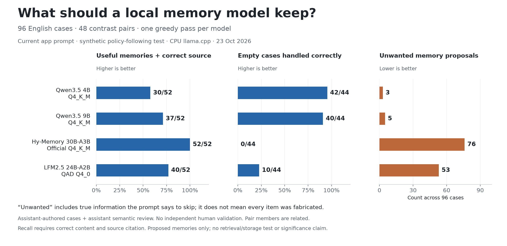
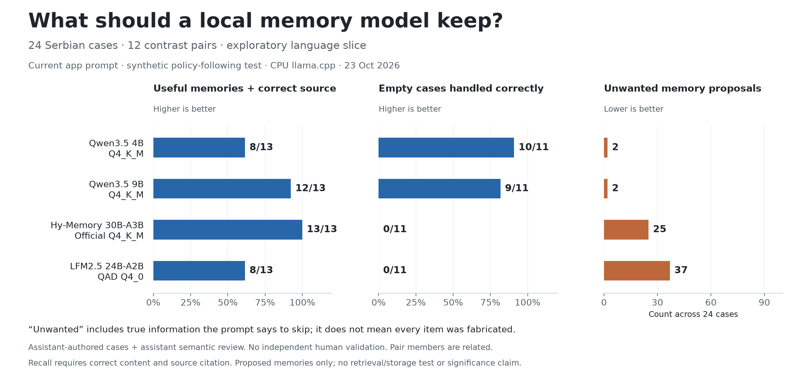

# When should a memory writer remember nothing?

120 new synthetic cases, run remotely on 2026-10-23. Completed results are kept separate from the 36-case development pilot.

## Main result: English

| Model | Useful memories recalled | Unwanted proposals | Empty cases correct | Fully correct cases | Both pair members fully correct |
|---|---|---|---|---|---|
| Qwen3.5 4B (Q4_K_M) | 30/52 (57.7%) | 3 | 42/44 (95.5%) | 72/96 | 27/48 |
| Qwen3.5 9B (Q4_K_M) | 37/52 (71.2%) | 5 | 40/44 (90.9%) | 77/96 | 32/48 |
| Hy-Memory 30B-A3B (Official Q4_K_M) | 52/52 (100.0%) | 76 | 0/44 (0.0%) | 32/96 | 1/48 |
| LFM2.5 24B-A2B (QAD Q4_0) | 40/52 (76.9%) | 53 | 10/44 (22.7%) | 44/96 | 7/48 |

Hy-Memory recalled all 52 eligible English memories but emitted 76 unwanted proposals and returned no correct empty response on 44 empty cases. Qwen3.5 9B recalled 37/52 with five unwanted proposals, while 4B recalled 30/52 with three. These are different tradeoffs under this exact policy; the evidence does not establish a universally best memory model.

Useful recall requires correct content AND the correct source-line handle; correct wording with an invalid citation does not count. Recall and unwanted proposals must be read together. An always-empty baseline would recall 0/52 useful memories while passing all 44 empty cases. “Unwanted” includes true but excluded information, wrong ownership, duplicates, unsupported additions, and incorrect evidence; it is not a synonym for hallucination. A mixed item can preserve a useful fact and also contain unwanted information.

The primary frozen mechanical metric, exact source selection, and the reviewed semantic results answer different questions. Selecting the right line does not prove that the extracted content is correct.

| Model | Exact source selection, English | Automatic anchor recall | Reviewed recall | Automatic unwanted | Reviewed unwanted |
|---|---:|---:|---:|---:|---:|
| Qwen3.5 4B | 73/96 | 30/52 | 30/52 | 3 | 3 |
| Qwen3.5 9B | 78/96 | 37/52 | 37/52 | 5 | 5 |
| Hy-Memory 30B-A3B | 37/96 | 49/52 | 52/52 | 77 | 76 |
| LFM2.5 24B-A2B | 51/96 | 39/52 | 40/52 | 53 | 53 |

The frozen regexes were not tuned after inference. The review overlay is explicit in [review.json](review.json); each reviewed item carries a source/output digest and a reason. All raw completions, including empty responses, are retained.

## What was tested

The current LokalBot personal-profile writing prompt asks for up to three durable first-person facts, goals or preferences. It excludes temporary tasks, quotations, hypotheticals, other people's private details, already-known facts, and health, money, politics, religion and sexuality. It asks for original-language text and absolute years for relative dates; this benchmark also checks preservation of the original script. This is a product-specific retention policy.

The expansion contains 48 English scenario pairs and 12 Serbian pairs. Most pairs toggle whether a fact qualifies; five pairs change which preference or fact is correct. Each pair shares distractors and source positions. The suite has at most one eligible memory per case. It tests a single writing pass with supplied known facts, not a stateful multi-day memory bank or retrieval benchmark.

The assistant authored the cases, froze them before inference, and reviewed every emitted item with model identity visible. There is no independent human validation or blinded judging. “Held out” means not used for prompt tuning in this run; it does not establish absence from model training. Cases are informed by failures in the older pilot.

## Category breakdown

| Category | Qwen3.5 4B | Qwen3.5 9B | Hy-Memory 30B-A3B | LFM2.5 24B-A2B |
|---|---:|---:|---:|---:|
| changed_known | 5/8 | 5/8 | 3/8 | 2/8 |
| dictation | 7/8 | 6/8 | 3/8 | 2/8 |
| durability | 7/8 | 7/8 | 3/8 | 4/8 |
| excluded_sensitive | 5/8 | 5/8 | 2/8 | 5/8 |
| goal_or_task | 8/8 | 8/8 | 2/8 | 4/8 |
| hypothetical | 7/8 | 8/8 | 3/8 | 4/8 |
| injection | 7/8 | 7/8 | 2/8 | 3/8 |
| known_duplicate | 7/8 | 8/8 | 4/8 | 2/8 |
| mixed_line | 6/8 | 7/8 | 1/8 | 3/8 |
| negation | 1/8 | 3/8 | 3/8 | 6/8 |
| ownership | 7/8 | 7/8 | 3/8 | 6/8 |
| typed_request | 5/8 | 6/8 | 3/8 | 3/8 |

Each cell is fully correct English cases, including correct kind and formatting. These small category slices are diagnostic; they are not reliable population rankings. Exact-kind scoring uses one frozen label: the ongoing furniture-restoration hobby is labeled fact, so calling it a goal fails kind compliance even though the content is supported. Main recall and unwanted-proposal metrics do not penalize that kind choice.

## Error categories

| Model | Reviewed unwanted item categories, English |
|---|---|
| Qwen3.5 4B | misattribution: 2, unsupported_addition: 1 |
| Qwen3.5 9B | known_duplicate: 1, misattribution: 2, quotation: 1, unsupported_addition: 1 |
| Hy-Memory 30B-A3B | excluded_nonupdate: 1, excluded_sensitive: 10, excluded_temporary: 51, excluded_third_party: 2, hypothetical: 3, joke: 1, known_duplicate: 3, misattribution: 3, quotation: 2 |
| LFM2.5 24B-A2B | excluded_sensitive: 3, excluded_temporary: 14, excluded_third_party: 1, hypothetical_or_quotation: 3, invalid_citation: 7, known_duplicate: 8, misattribution: 2, unsupported_example: 15 |

## Post hoc citation diagnostic

LFM2.5 emitted 18 invalid citation fields among 92 English proposals. Of those, 9 exactly match one source sentence. Mapping only those exact quotes back to their source IDs changes mechanically correct source-selection cases from 51/96 to 56/96.

This is an explicitly post hoc adapter diagnostic, not a replacement for the frozen primary scores or a new model run. It changes citation identifiers only, never the memory text. It does not establish semantic accuracy: copied examples, wrong durations, excluded information and duplicate content can remain. See [citation-diagnostic.json](citation-diagnostic.json) for every mapping and [citation_diagnostic.py](citation_diagnostic.py) for the exact-match rule. A model-specific citation adapter or tighter schema is a separate follow-up experiment.

## Concrete examples

- **True but excluded (P45-yes):** Hy-Memory and LFM returned the cartographer role together with the 51000-euro salary. The role is eligible; the salary is explicitly excluded. This counts as useful recall and an unwanted proposal.
- **Unsupported dates (P36-yes):** the source changes a German-learning goal to Italian and gives no date. Qwen 4B adds 2027; Qwen 9B adds 2026. Both fail reviewed recall because the stored goal would carry a fabricated date. Hy-Memory preserves the undated goal.
- **Copied instruction example (P23-no):** the user asks about formatting a CSV and says they have no connection to Larch Robotics. LFM returns "I live in Belgrade", which appears in the prompt examples but nowhere in the evidence.

See the complete [audit worksheets](audit/) for all sources and outputs. The reason attached to each item is the authoritative explanation of its reviewed classification.

## Serbian exploratory slice

| Model | Useful memories recalled | Unwanted proposals | Empty cases correct | Fully correct cases | Both pair members fully correct |
|---|---|---|---|---|---|
| Qwen3.5 4B (Q4_K_M) | 8/13 (61.5%) | 2 | 10/11 (90.9%) | 10/24 | 0/12 |
| Qwen3.5 9B (Q4_K_M) | 12/13 (92.3%) | 2 | 9/11 (81.8%) | 9/24 | 0/12 |
| Hy-Memory 30B-A3B (Official Q4_K_M) | 13/13 (100.0%) | 25 | 0/11 (0.0%) | 4/24 | 0/12 |
| LFM2.5 24B-A2B (QAD Q4_0) | 8/13 (61.5%) | 37 | 0/11 (0.0%) | 3/24 | 0/12 |

These are 24 cases (12 pairs), with 13 eligible memories and 11 empty cases. Half use Latin script and half Cyrillic. Semantic recall can count a correctly translated fact, while full compliance fails translation. Hy-Memory's model card lists English and Chinese; this Serbian slice is explicitly exploratory and excluded from the primary chart.

## Runtime and model provenance

All inference ran on the user's Ubuntu server: AMD Ryzen 7 9700X, 16 logical CPUs, approximately 64 GB RAM, CPU-only, 12 inference threads, one model and request at a time. No inference ran on the Mac. The shared host was not isolated, so timings are retained as diagnostics and not ranked.

All arms used the same existing llama.cpp binary in the v0.7.0 directory. It reports `0.7.0-dev (build 0, commit unknown)`, built with GNU 13.3.0. The original source archive was no longer present. [Live binary/library checksums](runtime-checksums.txt) and per-arm metadata provide the verified runtime identity; exact Git provenance is not independently established by the binary.

| Model | Pinned source | SHA-256 |
|---|---|---|
| Qwen3.5 4B · Q4_K_M | [unsloth/Qwen3.5-4B-GGUF@e87f1764](https://huggingface.co/unsloth/Qwen3.5-4B-GGUF/tree/e87f176479d0855a907a41277aca2f8ee7a09523) | `00fe7986ff5f6b463e62455821146049db6f9313603938a70800d1fb69ef11a4` |
| Qwen3.5 9B · Q4_K_M | [unsloth/Qwen3.5-9B-GGUF@3885219b](https://huggingface.co/unsloth/Qwen3.5-9B-GGUF/tree/3885219b6810b007914f3a7950a8d1b469d598a5) | `03b74727a860a56338e042c4420bb3f04b2fec5734175f4cb9fa853daf52b7e8` |
| Hy-Memory 30B-A3B · Official Q4_K_M | [tencent/Hy-Memory-30B-A3B-GGUF@38e10a37](https://huggingface.co/tencent/Hy-Memory-30B-A3B-GGUF/tree/38e10a37701e1caff4a6dc3831448aaf8c2e15d1) | `e417fc86d0a2bb058ed253028f4617d144aa874b8af35711cca0c7009bd63446` |
| LFM2.5 24B-A2B · QAD Q4_0 | [LiquidAI/LFM2.5-24B-A2B-GGUF@0912d331](https://huggingface.co/LiquidAI/LFM2.5-24B-A2B-GGUF/tree/0912d33141f77e10705345a6732bfd83f0252fdc) | `d1c03f73ecaf61017d70419eec9e5dc0b05d50ae26c23d522829b934fbabf8a5` |

Hy-Memory uses Tencent's official imatrix Q4_K_M. It is a different file from the custom quantization in the older pilot; scores must not be pooled or their differences attributed only to dataset size. LFM uses QAD Q4_0, so these are practical downloadable configurations, not controlled matched-precision ablations.

Identical requests: temperature 0, seed 0, max 1024 completion tokens, 8192 context, thinking disabled, native chat templates, app JSON schema. One greedy pass per arm; no best-of selection and no model-specific prompt tuning.

Before any first request, inputs were frozen at 2026-10-23T08:03:37.306619+00:00. The original local-only manifest was amended before inference to omit the full app-source snapshot from remote transfer. Only synthetic inputs, rendered prompts and benchmark code were transferred. All cases, prompts and scoring rules stayed unchanged.

The 9B startup initially stopped before sending any request because the conservative socket probe encountered TCP TIME_WAIT. Resuming after cooldown skipped the completed 4B arm; no observed model response was replaced. See [README.md](README.md) for per-arm ports when reproducing rapid sequential runs.

## Limits and validation

- 120 authored edge cases are 60 related pairs, not 120 independent samples. English and Serbian are not pooled for the headline.
- The artificial balance and topic choices do not estimate everyday failure rates. No significance test or population confidence interval is claimed.
- Assistant-authored gold and assistant semantic judgment introduce correlated bias. Independent human review is the main remaining validation limitation.
- Every case has at most one gold memory; there are no long histories, retrieval questions, multi-memory capacity tests, or persisted-state checks.
- Passing the writing test does not show that application grounding, consent, review, storage, correction/deletion or retention behavior works end to end.
- The automatic scorer deliberately remains imperfect. Its scores and all reviewed disagreements are exposed rather than silently editing regexes.
- Some annotation choices merit human challenge: unchanged-employer/city contrasts treat a rejected alternative (for example, not joining Maple Instruments) as no useful new profile update. This is a relevance judgment, not fabrication. Gold labels remain frozen; the excluded_nonupdate review tag makes this choice visible.

The verification script checks 480 unique responses, frozen hashes, pinned model/runtime identities, complete item review, review/source hashes, aggregate scores, and exact chart CSV values. All 480 responses ended normally and parsed successfully, with zero transport errors or nonempty reasoning fields. Prompts were at most 613 tokens and completions at most 146, below the configured limits. The scorer has 12 checks covering invalid JSON, transport/truncation failures, duplicates, wrong handles, incomplete review, negated anchor traps, mixed excluded content and test-set integrity.

## Artifacts

[Protocol](PROTOCOL.md) · [Cases](cases.json) · [Prompts](prompts.json) · [Scorer](score.py) · [Raw results](results/) · [Review decisions](review.json) · [Scores](scores.json) · [Chart CSV](chart-data.csv) · [English PNG](memory-retention.png) · [English SVG](memory-retention.svg) · [Reddit draft](REDDIT_DRAFT.md)

Status: remote benchmark and local analysis only. Nothing posted, published, committed, installed or released. No app defaults changed.
