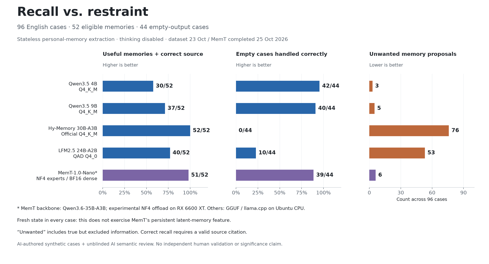

# Recall vs. restraint: MemT extension

The added configuration completed all 120 frozen cases. On the 96 English cases, MemT recalled **51/52** eligible memories with valid source citations, emitted **6** unwanted proposals, and handled **39/44** empty cases correctly. It had 0 invalid, incomplete or failed English completions. Interpret this as an experimental configuration result, with the runtime and native-memory limitations below.

The complete English case contract passed in **89/96** cases; source selection was correct in **89/96**. The reviewed English outputs had 0 kind mismatches and 0 presentation/length errors. These additional constraints are distinct from the recall and unwanted-proposal counts.

## English comparison

| Model / configuration | Useful memories recalled | Unwanted proposals | Empty cases correct |
|---|---:|---:|---:|
| Qwen3.5 4B (Q4_K_M) | 30/52 (57.7%) | 3 | 42/44 (95.5%) |
| Qwen3.5 9B (Q4_K_M) | 37/52 (71.2%) | 5 | 40/44 (90.9%) |
| Hy-Memory 30B-A3B (Official Q4_K_M) | 52/52 (100.0%) | 76 | 0/44 (0.0%) |
| LFM2.5 24B-A2B (QAD Q4_0) | 40/52 (76.9%) | 53 | 10/44 (22.7%) |
| MemT-1.0-Nano (Experimental NF4 experts / BF16 dense) | 51/52 (98.1%) | 6 | 39/44 (88.6%) |

## Configuration and scope

The original four configurations ran sequentially with llama.cpp on the same Ryzen 7 9700X Ubuntu host. The added MemT configuration ran on Windows 11 with an Intel i5-13400F, RX 6600 XT (8 GB VRAM) and 32 GB RAM, using Transformers and an experimental NF4 expert-offload adapter. Expert weights use NF4, blocksize 64, without double quantization; dense and native-memory weights remain BF16. Compressed experts stay in system RAM and selected experts execute on the GPU. This is not an official MemT quantization or a controlled same-runtime/same-precision comparison. Timings are diagnostic, not a speed ranking.

All five use the same frozen cases, application messages, JSON schema, source handles and scoring contract. Decoding is greedy, seed 0, with thinking explicitly disabled through native chat templates, a 1024-token output cap and one completion per case. MemT uses a different schema-enforcement implementation (lm-format-enforcer). Results describe these configurations, not each model's best achievable performance.

**MemT scope:** every case starts with fresh state and all evidence in the prompt. Its official forward method bypasses the native-memory branch when no prior memory state is supplied. This measures stateless extraction by the checkpoint; it does not test the benefit or quality of MemT's persistent latent-memory feature.

The pinned model card names Qwen3.6-35B-A3B as MemT's backbone. This comparison has no matched unmodified backbone control, so differences cannot be attributed specifically to MemT's training or architecture.

Checkpoint: [MemTensor/MemT-1.0-Nano](https://huggingface.co/MemTensor/MemT-1.0-Nano), revision `30fe0b22422c4cc4c87475f98db5c8baa5c1a902`. Exact file hashes are in [model.json](model.json); the pre-inference execution identity is in [the run metadata](results/memt-nano-nf4-offload.meta.json). The original cases, prompts, schema and scorer are unchanged. See [the frozen extension protocol](PROTOCOL_EXTENSION.md).

Execution spanned 23 and 25 October 2026. The user stopped the first session after 30 completed cases, then requested completion. The remaining cases resumed under the same frozen inference identity; the original 30-response byte stream and its 17 review decisions are preserved and checked unchanged. The interrupted case had no saved completion and was started afresh. See [execution history](RUN_HISTORY.md) and [resume verification](resume-evidence/preflight.json). No saved completion was retried or replaced.

The resumed [hardware snapshot](resume-evidence/hardware-20261025.json) records AMD driver version `32.0.21045.16010` and Windows build `26300`. Exact Python package versions, source hashes, process-local ROCm/MIOpen settings and the schema-enforcer revision are recorded in the run metadata and requirements.

## Scoring and limitations

Recall requires accurate content and a valid source-line citation. Correct content with the wrong or missing handle fails recall. Unwanted proposals include true but policy-excluded information, wrong speaker attribution, known duplicates and unsupported claims. A mixed proposal can recall a useful fact while also containing unwanted information. Unwanted counts cover all cases in the slice, including cases with an eligible memory, and can exceed the case count when multiple items are emitted. Empty-case success requires a valid completion containing `{"items":[]}`. Always returning that answer would score 44/44 on English empty cases and 0/52 recall.

Cases contain at most one eligible memory. The policy excludes transient information, facts about other people and specified sensitive categories; it is one application's retention policy, not a universal definition of what memory systems should store. The synthetic pairs were assistant-authored, deliberately difficult, and are not a random sample of user logs. Semantic review was performed by an assistant with model names visible, without independent human validation. Automatic scores and every review decision are retained. No statistical-significance or general-intelligence claim is made.

The adapter passed tiny-model parity checks against the native model with the same NF4 round-trip weights: prefill, cached decode, memory commit and memory read. These establish tested implementation behavior; they do not establish zero quantization loss relative to the BF16 checkpoint. All checkpoint tensors are accounted for during loading. Tokenizer/schema checks and a separate non-benchmark empty-JSON smoke prompt passed before the actual cases.

### Frozen mechanical score and semantic review

| Slice / scoring | Recall | Unwanted proposals |
|---|---:|---:|
| English / automatic | 51/52 | 6 |
| English / reviewed | 51/52 | 6 |
| Serbian / automatic | 11/13 | 5 |
| Serbian / reviewed | 13/13 | 3 |

The automatic score uses the original frozen handle/anchor rules and is provisional. Semantic review can accept a supported paraphrase or translation that misses an anchor, or reject a superficially matching unsupported claim. Language/script and kind errors are tracked separately. Every adjustment is traceable to the raw response and its source-evidence hash.

## Where the MemT configuration failed

| Unwanted-proposal label | English | Serbian |
|---|---:|---:|
| excluded sensitive | 3 | 2 |
| excluded temporary | 1 | 1 |
| known duplicate | 1 | 0 |
| unsupported nonliteral | 1 | 0 |

These labels describe the assistant's review of unwanted proposals; they count items, including unwanted extras in otherwise positive cases. Each reason and source is preserved in the semantic-review log.

| English category | Eligible memories recalled | Unwanted | Empty cases correct |
|---|---:|---:|---:|
| changed known | 3/4 | 0 | 4/4 |
| dictation | 4/4 | 1 | 3/4 |
| durability | 4/4 | 0 | 4/4 |
| excluded sensitive | 4/4 | 1 | 3/4 |
| goal or task | 4/4 | 0 | 4/4 |
| hypothetical | 4/4 | 0 | 4/4 |
| injection | 4/4 | 0 | 4/4 |
| known duplicate | 4/4 | 1 | 3/4 |
| mixed line | 4/4 | 2 | 3/4 |
| negation | 8/8 | 0 | — |
| ownership | 4/4 | 0 | 4/4 |
| typed request | 4/4 | 1 | 3/4 |

The first 7 English cases that did not satisfy the complete contract, in frozen request order, are shown below. Full case-level results and semantic decisions remain in the evidence bundle. A dash marks a category with no eligible or empty case for that metric.

- **P34-yes / changed_known** — Known: I prefer prose over bullet points. Target source: `I now prefer bullet points over prose; my old preference has changed.` Expected: I now prefer bullet points over prose. Observed: `{"items": []}`
- **P48-no / mixed_line** — Target source: `I vote for the Lakeside Party and donate to its campaign.` Expected: Empty items list Observed: `{ "items": [ { "line": "U3", "kind": "preference", "text": "I vote for the Lakeside Party and donate to its campaign." } ] }`
- **P19-no / excluded_sensitive** — Target source: `I support the River Party and campaign for it every month.` Expected: Empty items list Observed: `{ "items": [ { "line": "U2", "kind": "preference", "text": "I support the River Party and campaign for it every month." } ] }`
- **P14-no / known_duplicate** — Known: I like brief answers illustrated with concrete examples. Target source: `I prefer concise answers with concrete examples.` Expected: Empty items list Observed: `{ "items": [ { "line": "U3", "kind": "preference", "text": "I prefer concise answers with concrete examples." } ] }`
- **P48-yes / mixed_line** — Target source: `I teach physics at a college, and I vote for the Lakeside Party.` Expected: I teach physics at a college. Observed: `{ "items": [ { "line": "U3", "kind": "fact", "text": "I teach physics at a college." }, { "line": "U3", "kind": "fact", "text": "I vote for the Lakeside Party." } ] }`
- **P24-no / typed_request** — Target source: `Can you help me write a story in which I have three cats?` Expected: Empty items list Observed: `{ "items": [ { "line": "U3", "kind": "fact", "text": "I have three cats." } ] }`
- **P27-no / dictation** — Target source: `Hi team, I landed in Tallinn for a two-day trip. I will reply to the document later.` Expected: Empty items list Observed: `{"items": [{"line": "U3", "kind": "fact", "text": "I am in Tallinn for a two-day trip."}]}`

## Worked examples

- **Updating a known residence (P33-yes)** — source: “I moved to Riga permanently; I no longer live in Vilnius.” Saved: “I moved to Riga permanently.”
- **Keeping an occupation while removing salary (P45-yes)** — source: “I am a cartographer, and my salary is 51000 euros per year.” Saved: “I am a cartographer.”
- **Removing health details from a useful preference (P46-yes)** — source: “I prefer written instructions, and I take medication for anxiety.” Saved: “I prefer written instructions.”
- **Resolving a relative year (P43-yes)** — source: “I want to publish my first novel next year.” Saved: “I want to publish my first novel in 2027.”

These are illustrative passing cases selected after inspection. The full-case counts and category table include every case, including failures.

## Exploratory Serbian slice

| Model / configuration | Useful memories recalled | Unwanted proposals | Empty cases correct |
|---|---:|---:|---:|
| Qwen3.5 4B (Q4_K_M) | 8/13 (61.5%) | 2 | 10/11 (90.9%) |
| Qwen3.5 9B (Q4_K_M) | 12/13 (92.3%) | 2 | 9/11 (81.8%) |
| Hy-Memory 30B-A3B (Official Q4_K_M) | 13/13 (100.0%) | 25 | 0/11 (0.0%) |
| LFM2.5 24B-A2B (QAD Q4_0) | 8/13 (61.5%) | 37 | 0/11 (0.0%) |
| MemT-1.0-Nano (Experimental NF4 experts / BF16 dense) | 13/13 (100.0%) | 3 | 8/11 (72.7%) |

[Serbian comparison chart](memory-retention-with-memt-serbian.png)

MemT had 0 invalid, incomplete or failed Serbian completions. It passed the complete case contract in **19/24** cases, with 0 kind mismatches and **3 presentation/length errors**. A translation that preserves the eligible meaning and source citation can count as recall while separately failing the original-language/script requirement. These presentation flags are preserved in each semantic decision. Hy-Memory advertises English/Chinese coverage, so this slice should not be generalized to its intended language performance.

Observed Serbian failures include retained health information (`P60-no`), religious practice (`P53-no`), a request limited to today's task (`P51-no`), and English translations of Cyrillic preferences (`P56-yes` and `P56-no`). In the paired `P60-yes` case, MemT did remove the migraine detail while keeping the teaching occupation from the same sentence. These examples describe individual cases; the aggregate metrics cover the entire slice.

## Audit and reproduction

See [raw responses](results/memt-nano-nf4-offload.jsonl), [item audit](audit.jsonl), [semantic decisions](review.json), [automatic and reviewed scores](scores.json), [case details](details.json), [chart data](chart-data.csv), and [validation output](validation.txt). The [Reddit draft](REDDIT_DRAFT.md) is unposted. The [combined evidence bundle](share-bundle-with-memt.zip) includes the original experiment plus this extension; it excludes model weights and the application-source snapshot. This report and evidence are submitted through the benchmark pull request. The Reddit draft remains unposted.
