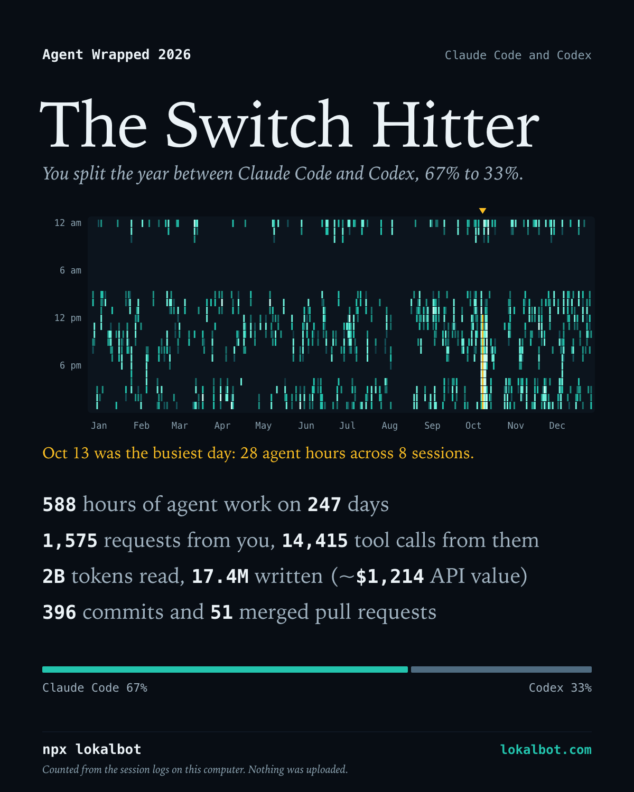

# Agent Wrapped

Your year with coding agents, counted from the session logs on your own computer.

```bash
npx lokalbot
```



<sub>A made-up year, from `npx lokalbot --demo`.</sub>

It prints a card in your terminal and opens a local, offline page in your browser where you can switch between **Portrait (4:5)** and **Wide (16:9)** layouts, toggle **Dark / Light** mode and options, copy or save a 2× PNG, or copy a post caption. Pass `--no-share` for terminal output only. (`npx lokalbot wrapped` also works.)

## Supported coding agents

Agent Wrapped automatically reads local session logs from all of these agents when present:

| Agent | Where it reads |
| --- | --- |
| **Claude Code** | `~/.claude/projects`, `~/.config/claude/projects` (or `CLAUDE_CONFIG_DIR`), plus `stats-cache.json` |
| **Codex** | `~/.codex/sessions` and `~/.codex/archived_sessions` (or `CODEX_HOME`), including `.jsonl.zst` |
| **Cursor** | Cursor's global `state.vscdb` and `~/.cursor/projects/*/agent-transcripts` |
| **Pi** | `~/.pi/agent/sessions` (or `PI_CODING_AGENT_DIR`) |
| **OMP (Oh My Pi)** | `~/.omp/agent/sessions` (or `OMP_CODING_AGENT_DIR`), including nested subagent logs |
| **OpenCode** | `~/.local/share/opencode/opencode.db` (or `XDG_DATA_HOME/opencode`) |
| **Antigravity** | `~/.gemini/antigravity*/brain` and T3 Code Antigravity ACP transcripts |
| **Gemini CLI** | `~/.gemini/tmp/*/chats/session-*.json` (or `GEMINI_CLI_HOME`) |

## What it reads

- It makes no network requests. The package has zero npm dependencies, and the entire source lives in [`src/`](src).
- It counts what you and the agents wrote, and when. It never keeps or prints the text itself.
- It never opens credentials, auth tokens, or settings files.
- The image leaves your project names out unless you pass `--projects`. The terminal card shows them, since that is your own screen.

## What the figures mean

| Figure | How it is counted |
| --- | --- |
| Agent hours | Time an agent was working. A run of work ends after ten minutes with no activity, and a pause longer than five minutes inside a run counts as five. Two agents working at once count twice. |
| Requests | Messages you typed, including slash commands. Text the agent's own software adds to your turn is left out. |
| Tool calls | Every tool an agent used, including the ones its subagents used. |
| Tokens read and written | Input tokens, including cached ones, and output tokens. The optional `API value` figure estimates what those tokens would cost at public list API prices (flat-rate subscriptions like Claude Max/Pro or ChatGPT Plus/Pro cost less). |
| Parallelism | Agent hours divided by wall-clock hours (`agentMs / wallClockMs`), shown when you ran agents in parallel (`1.2×` or higher). |
| Commits, pull requests, test runs | Read from the shell commands the agents ran, such as `git commit -m` and `gh pr merge`. A command counts when it was run, whether or not it succeeded. |
| Most at once | The most sessions with work under way at the same moment. A subagent counts as part of the session that started it. |
| The title | The one trait that stands out most in your year, such as how much of it ran at night. |

`--json` prints every figure, for your own charts.

## If your year starts late

Claude Code deletes session logs after 30 days unless you tell it otherwise, so the picture may begin only a month ago. It does keep a count of sessions and tool calls for each day, and Agent Wrapped shows those earlier days as marks under the picture and tells you how many there were. They have no hours, so they stay out of the other figures.

To keep next year's logs, add this to `~/.claude/settings.json`:

```json
{ "cleanupPeriodDays": 3650 }
```

Codex keeps its logs.

## Options

```text
--year <year>            The year to count. Default: this year (last year in January).
--share                  Write the shareable image page and open it in your browser (default in a TTY).
--no-share               Print the terminal card only, without opening the image page.
--wide                   Open the shareable card in 16:9 wide layout (for X / LinkedIn).
--light                  Open the shareable card in light mode.
--out <file>             Where the share page is written. Default: your temporary folder.
--no-open                Write the share page without opening your browser.
--projects               Name your three busiest projects on the image.
--no-api-value           Leave the estimated API-rate value off the card.
--json                   Print the figures as JSON instead of the card.
--claude-dir <dir>       Read Claude Code projects from here instead of ~/.claude/projects.
--codex-dir <dir>        Read Codex from here instead of ~/.codex.
--cursor-dir <dir>       Read Cursor from here instead of ~/.cursor and Cursor globalStorage.
--pi-dir <dir>           Read Pi sessions from here instead of ~/.pi/agent/sessions.
--omp-dir <dir>          Read OMP sessions from here instead of ~/.omp/agent/sessions.
--opencode-dir <dir>     Read OpenCode from here instead of ~/.local/share/opencode.
--antigravity-dir <dir>  Read Antigravity transcripts from here instead of ~/.gemini/antigravity/brain.
--gemini-dir <dir>       Read Gemini CLI sessions from here instead of ~/.gemini/tmp.
--demo                   Show a made-up year, without reading any logs.
--no-color               Plain text.
```

Needs Node.js 20 or later. Reading OpenCode and Cursor SQLite databases uses Node's built-in `node:sqlite` (Node.js 22.5+), and Codex's compressed logs need Node.js 22.15+; on older Node.js versions those stores are skipped gracefully. Tested on macOS, Linux and Windows.

## Where it comes from

[LokalBot](https://www.lokalbot.com/) ([GitHub](https://github.com/stevyhacker/LokalBot)) is a free, open-source (GPLv3) desktop app for macOS, Windows, and Linux that records your meetings with no bot, runs transcription and summaries locally, and gives Claude Code and Codex read-only MCP memory of what was decided. Agent Wrapped reads coding-agent logs the same way LokalBot's timeline does.

More local tools and data from LokalBot: [Local Desktop AI Leaderboard](https://www.lokalbot.com/benchmarks) ([JSON](https://www.lokalbot.com/benchmarks.json)) · [Local AI Hardware & RAM Calculator](https://www.lokalbot.com/hardware) · [Offline Meeting Migrator](https://www.lokalbot.com/migrate).

If you liked your card, a star on [the repository](https://github.com/stevyhacker/LokalBot) helps other people find it.

## Development

```bash
cd Distribution/npm
npm test                              # the tests read only fixtures they write themselves
node bin/lokalbot.mjs wrapped --demo  # a made-up year
```

GPL-3.0-only, like the rest of LokalBot.
