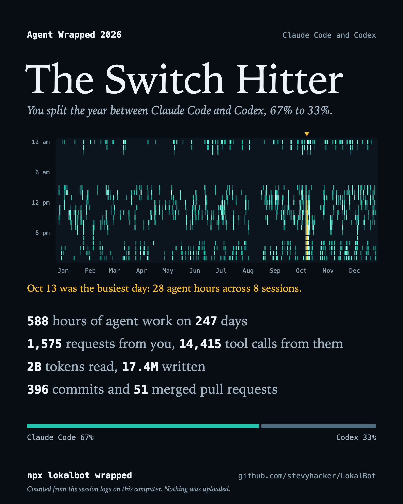

# Agent Wrapped

Your year with Claude Code and Codex, counted from the session logs on your own computer.

```bash
npx lokalbot wrapped
```



<sub>A made-up year, from `npx lokalbot wrapped --demo`.</sub>

It prints a card in your terminal. Add `--share` for the picture: a page opens in your browser where you can save or copy it as an image.

## What it reads

Claude Code and Codex each keep a log of every session on your computer. This command reads those files, counts, and prints.

- It makes no network requests. The package has no dependencies, and the source is about 2,200 lines you can read in [`src/`](src).
- It counts what you and the agents wrote, and when. It never keeps or prints the text itself.
- It reads `~/.claude/projects` and `~/.codex/sessions`, or wherever `CLAUDE_CONFIG_DIR` and `CODEX_HOME` point. It never opens credentials or either agent's internal state.
- The image leaves your project names out unless you pass `--projects`. The terminal card shows them, since that is your own screen.

## What the figures mean

| Figure | How it is counted |
| --- | --- |
| Agent hours | Time an agent was working. A run of work ends after ten minutes with no activity, and a pause longer than five minutes inside a run counts as five. Two agents working at once count twice. |
| Requests | Messages you typed, including slash commands. Text the agent's own software adds to your turn is left out. |
| Tool calls | Every tool an agent used, including the ones its subagents used. |
| Tokens read and written | Input tokens, including cached ones, and output tokens. |
| Commits, pull requests, test runs | Read from the shell commands the agents ran, such as `git commit -m` and `gh pr merge`. A command counts when it was run, whether or not it succeeded. |
| Most at once | The most sessions with work under way at the same moment. A subagent counts as part of the session that started it. |
| The title | The one trait that stands out most in your year, such as how much of it ran at night. |

`--json` prints every figure, for your own charts.

## If your year starts late

Claude Code deletes session logs after 30 days unless you tell it otherwise, so the picture may begin only a month ago. It does keep a count of sessions and tool calls for each day, and Agent Wrapped shows those earlier days as marks under the picture and tells you how many there were. They have no hours, so they stay out of the other figures.

To keep next year's logs, add this to `~/.claude/settings.json`:

```json
{ "cleanupPeriodDays": 3650 }
```

Codex keeps its logs.

## Options

```text
--year <year>       The year to count. Default: this year (last year in January).
--share             Also make the image: writes a page and opens it in your browser.
--out <file>        Where --share writes the page. Default: your temporary folder.
--no-open           With --share, write the page without opening it.
--projects          Name your three busiest projects on the image.
--json              Print the figures as JSON instead of the card.
--claude-dir <dir>  Read Claude Code projects from here instead of ~/.claude/projects.
--codex-dir <dir>   Read Codex from here instead of ~/.codex.
--demo              Show a made-up year, without reading any logs.
--no-color          Plain text.
```

Needs Node.js 20 or later. Tested on macOS, Linux and Windows.

## Where it comes from

[LokalBot](https://github.com/stevyhacker/LokalBot) is a free, open-source desktop app that keeps a private record of your work on your own computer: notes from your calls with no bot, search across what you saw and heard, and a timeline that shows each day's agent work next to your meetings. Agent Wrapped reads the logs the same way LokalBot's timeline does.

If you liked your card, a star on [the repository](https://github.com/stevyhacker/LokalBot) helps other people find it.

## Development

```bash
cd Distribution/npm
npm test                              # the tests read only fixtures they write themselves
node bin/lokalbot.mjs wrapped --demo  # a made-up year
```

GPL-3.0-only, like the rest of LokalBot.
