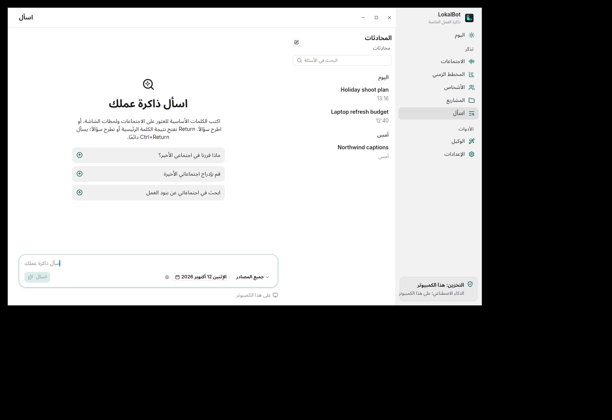
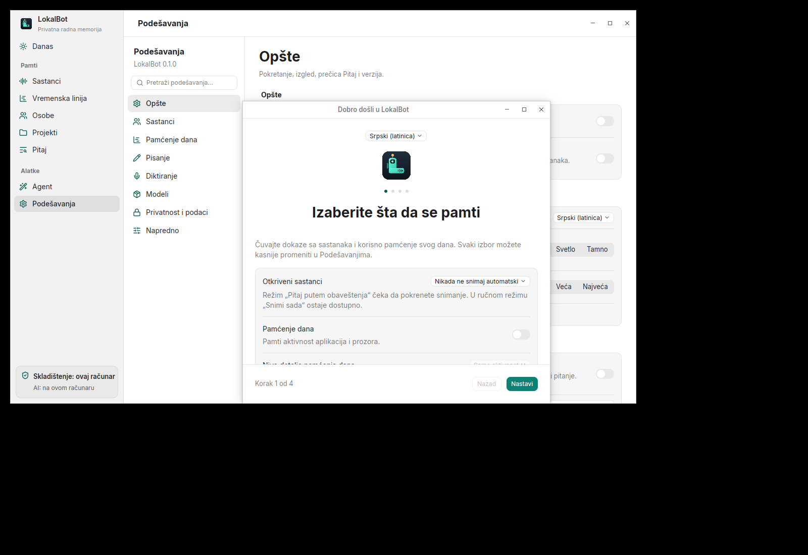

# Windows and Linux localization validation

UI checks ran on 2026-10-19 against base commit
`ccafdceb2926320f71c5f48e311ef10bfffc62eb` plus the localization changes.
Before PR submission, the branch was rebased onto
`6126eb9b40d45b604a58e8346eea80b6f85dbcb3` and the shared catalogs were
regenerated for its additional macOS strings. The full Rust suite, app build,
formatting and seven catalog checks passed again after that refresh.

## Completed

- The shared Windows/Linux app embeds the same 24 language catalogs as macOS,
  with 852 additional desktop-specific entries in every language. Shared keys
  cannot be overridden by the desktop catalogs.
- Settings and onboarding expose App language and Follow System. The saved
  `appLanguage` preference, locale aliases and language names match macOS.
- Interface labels, help, placeholders, settings search, starter questions,
  tray copy, component menus and dates use the selected language. Switching
  languages refreshes open windows while preserving draft input.
- Right-to-left interface rows mirror; plain paragraphs wrap before shaping
  each line. Answers select alignment from their content and code stays LTR.
- Calendar month/day names, selected-date labels and the first weekday are
  localized. Long picker menus scroll in the smaller onboarding window.
- CI checks catalog parity, placeholders, line breaks, direction controls,
  literal keyboard names, source-key coverage and generated-file freshness.

Catalog maintenance and rendering boundaries are documented in
[Interface languages](../README.md#interface-languages).

## Verification

The build and UI checks ran on the Ubuntu runner with a temporary fictional
library. No recordings, private library data or credentials were transferred.
The tested source was compared with the local task files using checksums;
all 127 files in the final source-transfer manifest matched. This report and
the screenshots are documentation and do not change the application.

| Check | Result |
| --- | --- |
| `cargo build -p lokalbot-app --locked` | Passed on Linux |
| `cargo test --workspace --locked` | 728 passed, 0 failed, 15 ignored |
| `cargo fmt --all -- --check` | Passed |
| `python3 -m unittest discover -s scripts/tests` | 7 passed |
| `git diff --check` | Passed |
| Existing-library language upgrade regression | Passed; failed with the settings fix undone |

The full Rust suite includes the substantive renderer, calendar and locale
changes. The final picker-scroll flag was subsequently built, formatting and
catalog checks were repeated, and its behavior was checked in the running app.

Observed Linux UI behavior:

- English/German live switching, localized settings search, language persistence
  after restart, and preservation of a draft containing literal braces.
- Arabic and Urdu paragraph wrapping; Hindi, Simplified Chinese and Serbian
  Latin rendering; mixed English conversation titles in Arabic interface chrome.
- Translated starter questions, Serbian input context menus and calendar names.
- Arabic calendar selection and applied date filter, including the localized
  label for 12 October 2026.
- Switching onboarding between Serbian Latin and Arabic updates both windows
  and the onboarding title while retaining disabled capture choices.
- Scrolling to Serbian Latin at the end of the onboarding language menu and
  selecting it successfully.

### Screenshots

Arabic interface with a localized date filter:

Serbian Latin selected from the end of the onboarding language menu:

## Remaining verification

- The Windows runner was unreachable. A Windows build and native UI check are
  still required; the successful Linux checks do not establish Windows runtime
  behavior.
- New desktop translations are machine-assisted. Native-speaker review remains
  outstanding, particularly for long help text and regional wording.
- Inputs and rich-text editors retain the pinned framework's native renderer.
  The plain-paragraph fix does not establish complete RTL editing support.
- These changes have not been installed or released. The temporary
  Linux UI test process was stopped after verification.
