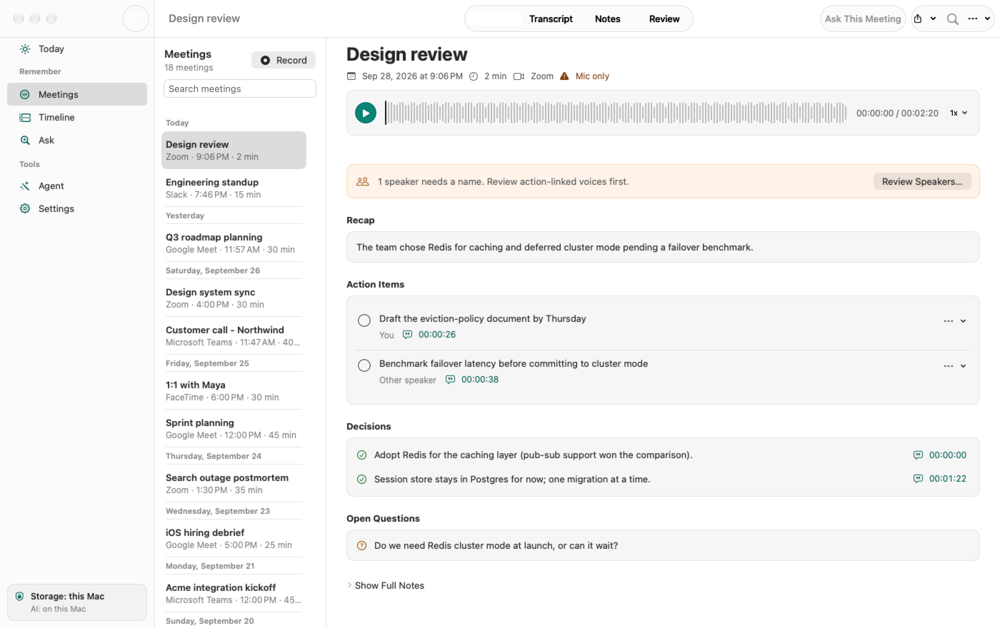
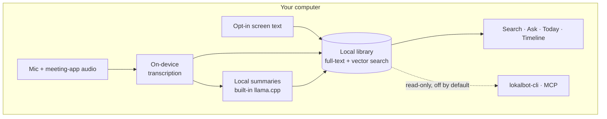

<div align="center">


# LokalBot

**Your personal context engine.**

Private meeting notes, workday recall, dictation, and autocomplete—with AI that runs on your computer.<br />
Your AI agents can search it too, from Claude Code, Codex, or any MCP client.<br />
Free and open source. No account. Nothing joins your calls.

[](https://github.com/stevyhacker/lokalbot/releases/latest)
[](https://github.com/stevyhacker/lokalbot/releases/latest)
[](https://github.com/stevyhacker/lokalbot/releases/latest)

<sub>Apple Silicon (M1 or later) with macOS 15+ · Windows 10/11 x64 (alpha) · Linux x86_64 (alpha) · on Mac, also <code>brew install --cask stevyhacker/tap/lokalbot</code></sub>

[](https://github.com/stevyhacker/lokalbot/releases/latest)
[](LICENSE)
[](#for-developers--agents)

<sub>⭐ If LokalBot is useful to you, star the repo. It's built by one developer, and stars are how other people find it.</sub>

**English** · [简体中文](README.zh-CN.md)

[Features](#features) · [Windows & Linux](#windows-and-linux) · [Compare](#how-it-compares) · [Privacy](#privacy) · [Get started](#get-started) · [Models](#local-ai-your-choice) · [Agents & CLI](#for-developers--agents) · [Website](https://www.lokalbot.com/)


<sub>The real app, recorded with fictional demo data.</sub>

</div>

<a id="see-it-in-action"></a>

https://github.com/user-attachments/assets/d9cf34ff-6367-4964-830a-5c7ee1343555

<div align="center"><sub>45 seconds: why LokalBot keeps what you heard and saw, which local models do the work, then the real app in use. Fictional demo data.</sub></div>

## Features

### Remember what was agreed

Record microphone and meeting-app audio without a bot joining. Get local transcripts, recaps, decisions, and action items, with citations back to the discussion.

<div align="center"><a href="Assets/screenshots/meetings-summary.png"></a></div>

### Find something you saw

One search across your meeting transcripts and, if you turn it on, what you saw on screen. Search by keyword or by meaning, then open the matching passage or screen moment instead of hunting through apps. The same window (**⌃⇧ Space**, or **Ctrl+Shift+Space** on Windows and Linux, once you turn on the shortcut in **Settings → General**) also runs app commands such as **Record now** or **Start dictation** from whatever app you're in.

<div align="center"><a href="Assets/screenshots/quick-recall.png"></a></div>

### Finish the sentence

As you type in other apps, gray text suggests how your sentence ends. Press **Tab** to take the next word, **\`** to take the rest on Mac, or keep typing.

<div align="center"></div>

<div align="center"><sub>Live suggestions in TextEdit, in real time. The ship date and condition come from the meeting with John. Fictional demo meeting.</sub></div>

- **Knows what you're answering.** It reads the message or page above the field, so a reply fits the thread.
- **Remembers your meetings, if you let it.** Turn on meeting and work memory, and it can bring in what was decided, like the ship date above.
- **Writes in your language.** On Mac, the same small model keeps up in German, French, Italian, Spanish, and more.
- **Stays on your computer.** A small model runs inside the app: Gemma 4 E2B on Mac, LFM2.5 1.2B on Windows and Linux. What you type and the context it reads never leave your computer.

Turn it on in **Settings → Writing**, where you can try it on a sample conversation first and later see how much it wrote for you.

### Pick up where you left off

Today brings your day digest and open meeting actions together. Timeline groups captured activity into work sessions, with the underlying context available to inspect. Correct actions, mark them done, and trace each one to its source.

<table>
  <tr>
    <td width="50%"><a href="Assets/screenshots/today.png"></a></td>
    <td width="50%"><a href="Assets/screenshots/timeline.png"></a></td>
  </tr>
  <tr>
    <td align="center"><sub><b>Today</b>: your digest and open actions</sub></td>
    <td align="center"><sub><b>Timeline</b>: work sessions and their context</sub></td>
  </tr>
</table>

### Talk instead of typing

Turn on Dictation in **Settings → Dictation**, then hold **⌥ Space** (**Alt+Space** on Windows and Linux, or a shortcut you choose there), speak, and release to insert text at your cursor in any app. Transcription runs on your computer. On Wayland, bind `lokalbot dictate` to a shortcut in your desktop's settings.

### Rewrite what you selected

Turn on selection actions in **Settings → General**, select text in any app, and press **⌃⇧ W**. Fix the grammar, make it shorter, translate it, summarize it, or type your own instruction, then replace the selection or copy the result. **Draft a reply with my memory** also searches your meetings, so the reply can use what was actually agreed, and lists the meetings it used. It runs on your Think model, which stays on your Mac unless you chose and approved a server. Selection actions are on Mac only for now.

### And more

| Ask, then check the source | Follow through | Bring your own agent |
| --- | --- | --- |
| Ask about your meeting library and follow the answer's citations back to the transcript or audio. Generated notes are a starting point, not a substitute for the discussion. | Prepare local follow-up drafts. On Mac, also keep a note for every meeting in your Obsidian or Logseq folder, and get daily briefs and weekly work logs. You review and send them yourself. | Give Claude Code or any MCP client read-only access to your meeting library through the bundled `lokalbot-cli`. It stays off until you enable it. |

<sub>Screenshots are unedited captures of the Mac app with fictional demo data. They show the interface, not a live inference benchmark. The Autocomplete clip is a cropped, real-time recording of live suggestions. Click an image for full resolution; see the <a href="Assets/screenshots/README.md">capture notes</a> for provenance.</sub>

<a id="windows-and-linux"></a>

### Also on Windows and Linux (alpha)

A native Windows and Linux app, written in Rust, has the same pages and reads the same library, so a library moves between computers. Meetings, transcription, Ask, search, day memory, screen context, dictation, autocomplete, calendar, Agent Mode, and the CLI and MCP server all work. It's an alpha: the Windows build isn't code-signed yet, some features depend on your Linux desktop (Wayland support is partial), and a few Mac features haven't been ported. See [what works where](LinuxWindows/README.md#what-works-where) and [screenshots](LinuxWindows/docs/screenshots).

## How it compares

| Coming from… | What's different with LokalBot |
| --- | --- |
| [Granola](https://www.lokalbot.com/lokalbot-vs-granola) | The same bot-free capture, but transcription and summaries run on your computer by default. No account and no subscription. |
| [Apple Notes](https://www.lokalbot.com/lokalbot-vs-apple-notes) | Notes records your microphone, so with headphones on it misses the other side of a Zoom or Teams call. LokalBot records both sides and keeps every meeting searchable, with notes that cite the discussion. |
| [Otter](https://www.lokalbot.com/lokalbot-vs-otter) · [Fireflies](https://www.lokalbot.com/lokalbot-vs-fireflies) | Nothing joins your call, audio stays on your computer, and there are no minute caps. |
| [Hyprnote (anarlog)](https://www.lokalbot.com/lokalbot-vs-hyprnote) | Local AI ships built in, with no separate model runner or API keys to set up. Dictation, a day timeline, and autocomplete come in the same app. |
| [Meetily](https://www.lokalbot.com/lokalbot-vs-meetily) | Both are open source and run locally. Speaker separation, meeting detection, and MCP access are free here rather than Pro features, and dictation, a day timeline, and autocomplete come in the same app. |
| [Screenpipe](https://www.lokalbot.com/lokalbot-vs-screenpipe) | Starts with app and window activity. Screen text and screenshots are opt-in and deleted after 14 days by default. GPLv3 rather than source-available. |
| [Rewind](https://www.lokalbot.com/lokalbot-vs-rewind) | Rewind's Mac app is discontinued. LokalBot's timeline is open source and actively developed. |
| [MacWhisper](https://www.lokalbot.com/lokalbot-vs-macwhisper) · [Superwhisper](https://www.lokalbot.com/lokalbot-vs-superwhisper) | Dictation comes alongside meeting notes, recall, and autocomplete, for free. For transcribing files you already have, MacWhisper is the better tool. |
| [Wispr Flow](https://www.lokalbot.com/lokalbot-vs-wispr-flow) | Dictation and bot-free meeting notes run on your computer, with no account, word cap, or connection required. Wispr Flow transcribes both in its cloud. |

<sub>Competitor details were last verified on September 24, 2026, and October 1, 2026 for Apple Notes, Meetily, and Wispr Flow; each link has the full comparison and sources. Trademarks belong to their owners.</sub>

<a id="privacy--verify-it"></a>

## Privacy

**Your work is personal. Keeping it local should be the starting point.**

Recording and built-in AI processing happen on your computer. LokalBot has no account system, analytics service, or telemetry backend. Your library lives in local files and SQLite under your user account.



- **You choose what to retain.** Activity-only tracking is the default. Visible screen text and encrypted screenshots are opt-in. Pause capture or exclude apps and domains at any time. Detection has limits; exclude anything you never want retained.
- **You control retention.** Captured screen text and screenshots expire after 14 days by default. Adjust the window or explicitly save a moment to keep it until you unsave or delete it.
- **Network access has boundaries.** Models, updates, and optional agent runtimes need downloads. Automatic update checks can be disabled. A remote model server receives context only after you approve its origin; optional Agent Mode and external CLI/MCP clients have separate permissions and data handling.

To check the local processing path, download the models, select the built-in backend, disable automatic update checks, and observe network traffic while recording, transcribing, and summarizing. Approved agent commands and external clients are separate paths.

[Read the full privacy policy](PRIVACY.md) · [Report a security issue privately](SECURITY.md)

<a id="download"></a>

## Get started

LokalBot runs on Apple Silicon Macs with macOS 15 or later. Windows and Linux are in alpha. You'll also need space for your selected models: **Settings → Models** shows download sizes and readiness, and storage and memory needs depend on the models you choose.

| | macOS | Windows (alpha) | Linux (alpha) |
| --- | --- | --- | --- |
| Runs on | Apple Silicon (M1 or later), macOS 15+ | Windows 10 or 11, x64 | x86_64 with glibc 2.39 or later (Ubuntu 24.04, Debian 13, Fedora 40 or newer), PulseAudio or PipeWire, and a Vulkan or OpenGL driver |
| Install | [`LokalBot-<version>-macos-arm64.dmg`](https://github.com/stevyhacker/lokalbot/releases/latest): drag LokalBot to Applications. Or `brew install --cask stevyhacker/tap/lokalbot`. | [`LokalBot-<version>-windows-x86_64-setup.exe`](https://github.com/stevyhacker/lokalbot/releases/latest): run it to install LokalBot for your user, with a Start menu shortcut and no administrator rights. It isn't code-signed yet, so SmartScreen asks first: **More info → Run anyway**. The same release has a portable zip. | [`LokalBot-<version>-linux-x86_64.tar.gz`](https://github.com/stevyhacker/lokalbot/releases/latest): extract it and run `./install.sh`, which adds LokalBot to your applications menu. Or install the `.deb` (Debian, Ubuntu), `.rpm` (Fedora, openSUSE) or Arch package from the same release. The `.deb`, and the `.rpm` on Fedora, add the LokalBot repository, so `sudo apt upgrade` or `sudo dnf upgrade` brings later versions; with the Arch package, LokalBot tells you about updates instead of installing them. |
| Your library | `~/Library/Application Support/me.dotenv.LokalBot` | `%LOCALAPPDATA%\LokalBot` | `~/.local/share/LokalBot` |

A library recorded on one platform opens on the others. Not every Mac feature is on Windows and Linux yet; see [what works where](LinuxWindows/README.md#what-works-where).

1. **Install the app** for your platform and open it.
2. **Choose what to capture.** Review recording settings: automatic detection, ask-first, or manual recording. Day tracking starts with activity only; saving screen text or screenshots is a separate opt-in. Grant only the permissions for the features you enable.
3. **Let the models download.** Built-in transcription, search, summaries, and writing can then work offline. No model server to set up and no API key to bring.

**Try this first:** make a short test recording, let it transcribe, then search for a phrase you said and open the matching passage. Add screen memory or writing tools when you're ready.

Let meeting participants know before recording and get their consent.

[Release notes](https://github.com/stevyhacker/lokalbot/releases) · [Setup help](SUPPORT.md) · [Homebrew options](Distribution/homebrew/README.md) · [Windows and Linux guide](LinuxWindows/README.md)

## FAQ

<details>
<summary><strong>Does a bot join my meetings?</strong></summary>

No. LokalBot records your microphone and the meeting app's audio on your computer. On Windows and Linux it records everything the computer plays, not one app. Audio sources are separate from individual speaker identification. When system-audio capture is unavailable, the app warns that recording is microphone-only. Always record with participants' consent.

</details>

<details>
<summary><strong>Does it record everything on my screen?</strong></summary>

No. New installs use activity-only tracking, which you can turn off. Saving visible text or screenshots requires a separate choice and the relevant macOS permissions (on Linux, your desktop's accessibility and screenshot support). Excluded apps and domains and secure fields are skipped; private browser windows are captured unless you exclude the browser or site. Detected credentials are redacted and associated pixels are dropped, but detection is not perfect. See [PRIVACY.md](PRIVACY.md).

</details>

<details>
<summary><strong>Can I take my notes elsewhere?</strong></summary>

Yes. On Mac, turn on **Meeting note export** to keep a Markdown note for every meeting in a folder you choose, such as an Obsidian vault or a Logseq graph: the summary, action items, the people and projects involved, and the transcript. You can also export a single meeting, write a daily memory note, or let local routines save drafts. These are ordinary, unencrypted files; any service you sync them with has its own privacy settings. See [Meeting transcripts in Obsidian](https://www.lokalbot.com/meeting-transcripts-obsidian-markdown). Note export isn't on Windows and Linux yet.

</details>

<details>
<summary><strong>Does it run on Windows or Linux?</strong></summary>

Yes, as an alpha. The Windows and Linux app is a native Rust app with the same pages, the same models for summaries and search, and the same library format, so a library moves between computers. Selection actions, meeting note export, Personal Context, spoken summaries, and coding-agent sessions in day memory are Mac only for now, and on Wayland some features depend on your desktop. See [what works where](LinuxWindows/README.md#what-works-where).

</details>

## Local AI, your choice

Start with the built-in models, then change them in **Settings → Models**. LokalBot supports its bundled llama.cpp runtime, Ollama, OpenAI-compatible servers, and Apple Intelligence on supported Macs running macOS 26 or later. Think can also run on your own ChatGPT plan (Sign in with ChatGPT) or Claude plan (through your signed-in Claude Code), without an API key. Remote servers and plans require approval before receiving context.

Different jobs use different models. These are the Mac defaults on a fresh install, about 9.6 GB of model files if you use every role. They are not a RAM requirement:

| Role | Default model | Format | Approx. model files |
| --- | --- | --- | ---: |
| Transcription | Qwen3-ASR 1.7B | MLX 8-bit | 2.47 GB |
| Summaries and chat | Qwen3.5 4B | `Q4_K_M` | 2.74 GB |
| Autocomplete | Gemma 4 E2B Base | `Q6_K` | 3.85 GB |
| Semantic search | EmbeddingGemma 2 | `Q8_0` | 0.31 GB |
| Speaker diarization | Nemotron 3 (preview) via FluidAudio | Core ML | ~0.20 GB |

Qwen3-ASR covers 52 languages and dialects. Transcription alternatives include Parakeet, Granite Speech, Whisper large-v3 turbo, SenseVoice for Chinese, Japanese, and Korean, and GigaAM for Russian; Pyannote Community-1 remains available for diarization. The Lightweight preset swaps in smaller models, including LFM2.5 1.2B Instruct (0.73 GB) for autocomplete. Model choices can vary by release; Settings shows the active selections and available presets. Speed and memory use depend on your computer, model, context length, and other workloads.

On Windows and Linux, transcription uses Qwen3-ASR 0.6B through sherpa-onnx (Parakeet v3, SenseVoice, and Whisper turbo are optional), speakers are separated with pyannote segmentation and TitaNet, and autocomplete uses LFM2.5 1.2B by default. Summaries (Qwen3.5 4B) and search (EmbeddingGemma 2) use the same models as on Mac. The default download is about 4 GB, and llama.cpp runs on a Vulkan GPU or the CPU.

[Project benchmarks](Benchmarks/README.md) · [Model catalog](LokalBot/Engines/ModelCatalog.swift) · [Search implementation](LokalBot/Services/EmbeddingIndex.swift) · [Model and runtime details](DEVELOPMENT.md#built-in-llm-runtime--llamacpp--model-catalog)

## For developers & agents

The app bundles **`lokalbot-cli`**, a read-only interface to your meeting library and a stdio **Model Context Protocol (MCP)** server. Access is off by default. Enable meeting-library access in **Settings → Privacy & Data**, then install the CLI from **Settings → Advanced → Agent CLI**.

<div align="center"></div>

```bash
lokalbot-cli search "database decision"
lokalbot-cli get latest --include metadata,summary
lokalbot-cli mcp
```

Without a PATH installation, use `/Applications/LokalBot.app/Contents/Helpers/lokalbot-cli` on Mac. On Windows and Linux, **Settings → Advanced → Agent CLI** installs it too; see [Coding agents](LinuxWindows/README.md#coding-agents) for where it goes and how to add it to your PATH. There the CLI has the read-only commands and every MCP tool; `ask`, `reply`, and the setup and configuration commands are Mac only.

Connect Claude Code with one command, or install the [Claude Code plugin](Distribution/claude-plugin/README.md):

```bash
# macOS
claude mcp add lokalbot -- /Applications/LokalBot.app/Contents/Helpers/lokalbot-cli mcp
# Windows and Linux, with lokalbot-cli on your PATH
claude mcp add lokalbot -- lokalbot-cli mcp
```

Screen-memory MCP tools require separate permission scoped to today, the last seven days, or all retained history. They return text and metadata, not decrypted screenshots. External clients may send results to their own model providers.

The app also has an optional **Agent Mode** for working with reviewed context. File and shell actions follow its approval settings; it is separate from the read-only CLI/MCP interface.

[CLI examples](.agents/skills/lokalbot-cli/SKILL.md) · [Claude Code plugin](Distribution/claude-plugin/README.md) · [MCP architecture](DEVELOPMENT.md#agent-cli--mcp)

## Build from source

For the Mac app, use an Apple Silicon Mac with full Xcode installed; the [build workflow](.github/workflows/build.yml) pins the CI toolchain. With Homebrew available:

```bash
brew install xcodegen cmake

git clone https://github.com/stevyhacker/lokalbot.git
cd lokalbot

# XcodeGen needs these paths before the first build fetches the runtimes.
mkdir -p Vendor/llama-cpp Vendor/sherpa-onnx
xcodegen generate
open LokalBot.xcodeproj
```

Select **LokalBot Dev**, set your signing team, and run. The Dev app has its own identity, macOS permission grants, library, model storage, and Keychain namespace, so it can live alongside the installed release without applying development retention settings to release data. The first build prepares pinned native runtimes; model downloads happen separately.

For the Windows and Linux app, see [Build from source](LinuxWindows/README.md#build-from-source) in its README (Rust).

[Build and test commands](DEVELOPMENT.md#build-workflows) · [Testing guide](DEVELOPMENT.md#testing) · [Screenshot guide](Docs/screenshot-kit.md)

<details>
<summary><strong>Find your way around the code</strong></summary>

```text
LokalBot/
├── Views/       # Native SwiftUI screens, settings, and onboarding
├── Services/    # Recording, search, storage, and workday memory
├── Engines/     # Transcription, model catalog, and local inference
├── Cotyping/    # System-wide autocomplete
├── Dictation/   # Voice typing
└── Agent/       # Optional Agent Mode and approval flow
CLI/             # Command-line interface and MCP entry points
LinuxWindows/    # Windows and Linux app (Rust + GPUI)
LokalBotTests/   # Unit tests
Scripts/         # Build, verification, capture, and release tooling
project.yml      # XcodeGen source of truth
```

</details>

<a id="contributing--security"></a>

## Contributing

Bug reports, documentation improvements, and code contributions are welcome. [Report an issue](https://github.com/stevyhacker/lokalbot/issues/new/choose) with steps to reproduce, expected and actual behavior, the app version, your OS and its version (on Linux, also the distribution, desktop, and X11 or Wayland), your chip or CPU and GPU, RAM, and selected models. Keep private recordings and transcripts out of reports.

For larger changes, [open an issue](https://github.com/stevyhacker/lokalbot/issues) to discuss the approach first. Follow the [working agreements](AGENTS.md) and [development guide](DEVELOPMENT.md), keep pull requests focused, and record your checks in the [PR template](.github/PULL_REQUEST_TEMPLATE.md). Include screenshots for UI changes; run UI tests on hosted CI or a remote runner.

## License & acknowledgements

LokalBot is free software under [GPLv3](LICENSE). Code in the Autocomplete engine that was ported from [Cotabby](https://github.com/FuJacob/cotabby) stays under [AGPLv3](LICENSES/AGPL-3.0.txt). Other third-party components and models retain their own licenses; see [third-party notices](THIRD_PARTY_NOTICES.md).

Built with [llama.cpp](https://github.com/ggml-org/llama.cpp), [MLX Swift](https://github.com/ml-explore/mlx-swift), [speech-swift](https://github.com/soniqo/speech-swift), [sherpa-onnx](https://github.com/k2-fsa/sherpa-onnx), [WhisperKit](https://github.com/argmaxinc/WhisperKit), [FluidAudio](https://github.com/FluidInference/FluidAudio), [Sparkle](https://github.com/sparkle-project/Sparkle), [XcodeGen](https://github.com/yonaskolb/XcodeGen), [GPUI](https://github.com/zed-industries/zed/tree/main/crates/gpui), [GPUI Kit](https://github.com/longbridge/gpui-kit), and [ONNX Runtime](https://github.com/microsoft/onnxruntime), with models including [Qwen3-ASR](https://huggingface.co/Qwen), [IBM Granite Speech](https://huggingface.co/ibm-granite), [Parakeet](https://huggingface.co/nvidia), and [LFM2.5](https://huggingface.co/LiquidAI). The Autocomplete engine started from [Cotabby](https://cotabby.app)'s open-source code.
