<div align="center">


# LokalBot

**Kişisel bağlam motorunuz.**

Granola, Wispr Flow ve Rewind için ücretsiz, açık kaynaklı, yerel öncelikli bir alternatif.<br />
Claude Code, Codex ve herhangi bir MCP istemcisi de arama yapabilir.

Bot olmadan her görüşmeden notlar. Gördüğünüz ve duyduğunuz her şey için tek arama.<br />
Herhangi bir uygulamada otomatik tamamlama ve dikte. Varsayılan olarak yerel.

<a id="see-it-in-action"></a>

<picture><source media="(prefers-color-scheme: dark)" srcset="Assets/hero/lokalbot-demo-dark.gif" /></picture>

<sub>Kurgusal veriler üzerinde gerçek uygulama. Beklemeler kesilmiş ve bazı yazma kısımları hızlandırılmıştır.</sub>

**macOS, Windows veya Linux'a kurun** (veya kurulumsuz [Agent Wrapped 2026](https://www.lokalbot.com/wrapped) deneyimini deneyin):

</div>

```bash
# macOS (Apple Silicon, macOS 15+)
brew install --cask stevyhacker/tap/lokalbot

# Windows (10/11 x64, alfa)
scoop bucket add lokalbot https://github.com/stevyhacker/scoop-bucket && scoop install lokalbot/lokalbot

# Debian / Ubuntu (x86_64, alfa)
curl -fsSL https://pkg.lokalbot.com/lokalbot.gpg | sudo tee /usr/share/keyrings/lokalbot-archive-keyring.gpg > /dev/null && printf 'Types: deb\nURIs: https://pkg.lokalbot.com/apt\nSuites: stable\nComponents: main\nArchitectures: amd64\nSigned-By: /usr/share/keyrings/lokalbot-archive-keyring.gpg\n' | sudo tee /etc/apt/sources.list.d/lokalbot.sources > /dev/null && sudo apt update && sudo apt install lokalbot

# Fedora (x86_64, alfa)
curl -fsSL https://pkg.lokalbot.com/lokalbot.asc | sudo tee /etc/pki/rpm-gpg/RPM-GPG-KEY-lokalbot > /dev/null && printf '[lokalbot]\nname=LokalBot (alpha)\nbaseurl=https://pkg.lokalbot.com/rpm\nenabled=1\ngpgcheck=1\nrepo_gpgcheck=1\ngpgkey=file:///etc/pki/rpm-gpg/RPM-GPG-KEY-lokalbot\n' | sudo tee /etc/yum.repos.d/lokalbot.repo > /dev/null && sudo dnf install lokalbot

# Agent Wrapped 2026 (kurulumsuz, yalnızca yerel kodlama ajanı günlükleri)
npx lokalbot
```

<div align="center">

[](https://github.com/stevyhacker/lokalbot/releases/latest)
[](https://github.com/stevyhacker/lokalbot/releases/latest)
[](https://github.com/stevyhacker/lokalbot/releases/latest)
[](https://apps.apple.com/app/id6836773709)
[](https://play.google.com/store/apps/details?id=me.dotenv.lokalbot.companion)

<sub>macOS: <code>.dmg</code> veya Homebrew · Windows 10/11 x64: <code>setup.exe</code>, Scoop veya taşınabilir zip (alfa) · Linux x86_64: <code>apt</code>/<code>dnf</code>, <code>.deb</code>, <code>.rpm</code>, Arch veya <code>.tar.gz</code> (alfa) · iOS/iPadOS 18+ ve Android 10+ eşlikçileri. <a href="#download">Kurulum ayrıntıları</a></sub>

**Ücretsiz ve açık kaynak (GPLv3) · Hesap yok · Analitik veya telemetri yok · Noter onaylı Mac uygulaması · Modeller indirildikten sonra yerleşik yapay zeka çevrimdışı çalışır**

[](https://github.com/stevyhacker/lokalbot/releases/latest)
[](https://github.com/stevyhacker/lokalbot/releases)
[](LICENSE)
[](#geliştiriciler-ve-ajanlar-için)
[](https://glama.ai/mcp/servers/stevyhacker/LokalBot)
[](https://www.raycast.com/stevan_bogosavljevic/lokalbot)
[](https://github.com/stevyhacker/lokalbot/discussions)

<sub>⭐ LokalBot işinize yarıyorsa depoya yıldız verin. Tek bir geliştirici tarafından yapılmıştır ve yıldızlar başkalarının onu bulma yoludur.</sub>

[English](README.md) · [简体中文](README.zh-CN.md) · **Türkçe**

[Ajanlar ve CLI](#geliştiriciler-ve-ajanlar-için) · [Özellikler](#özellikler) · [Windows ve Linux](#windows-and-linux) · [iOS ve Android](#on-your-phone) · [Karşılaştırma](#nasıl-karşılaştırılır) · [Performans](#performans) · [Kıyaslamalar](https://www.lokalbot.com/benchmarks) · [Donanım hesaplayıcı](https://www.lokalbot.com/hardware) · [Maliyet hesaplayıcı](https://www.lokalbot.com/calculator) · [Agent Wrapped](https://www.lokalbot.com/wrapped) · [Gizlilik](#gizlilik) · [Başlarken](#başlarken) · [Modeller](#yerel-yapay-zeka-sizin-seçiminiz) · [Tartışmalar](https://github.com/stevyhacker/lokalbot/discussions) · [Web Sitesi](https://www.lokalbot.com/)

</div>

## Geliştiriciler ve ajanlar için

Claude Code, Codex veya herhangi bir MCP istemcisine toplantılarınızdan bağlam verin: neye karar verildiğini, bir eylem öğesinin sahibinin kim olduğunu veya bir konunun nerede geçtiğini sorun. Ajanlar paketle birlikte gelen **`lokalbot-cli`** veya onun stdio **Model Context Protocol (MCP)** sunucusu aracılığıyla okuma yapar. Kitaplığınızı okuyabilirler ancak değiştiremezler.

<div align="center"><picture><source media="(prefers-color-scheme: dark)" srcset="Assets/readme/agents-dark.gif" />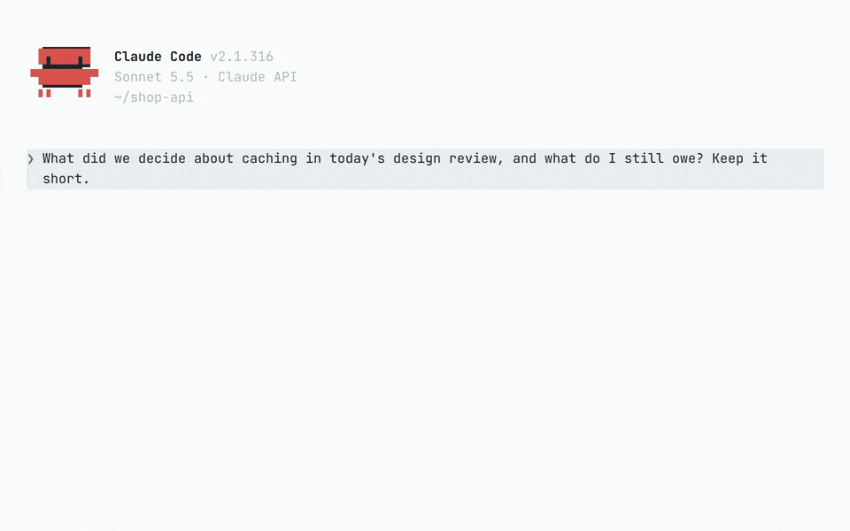</picture></div>

**Claude Code eklentisi.** Claude Code içinden:

```
/plugin marketplace add stevyhacker/lokalbot
/plugin install lokalbot@lokalbot
```

Alıntılı bir özet için `/lokalbot:brief`, söylediklerinizi, gördüklerinizi veya üzerinde anlaştıklarınızı bulmak için `/lokalbot:recall` ve LokalBot'u kurup sizinle birlikte yapılandıran `/lokalbot:setup` komutlarını ekler. Bkz. [eklenti kılavuzu](Distribution/claude-plugin/README.md).

**Veya tek komutla bağlanın:**

```bash
# macOS
claude mcp add lokalbot -- /Applications/LokalBot.app/Contents/Helpers/lokalbot-cli mcp
# Windows ve Linux, lokalbot-cli PATH üzerinde olduğunda
claude mcp add lokalbot -- lokalbot-cli mcp
```

**Codex:** `codex plugin marketplace add stevyhacker/lokalbot --sparse .agents/plugins --sparse Distribution/openai-plugin`, ardından `codex plugin add lokalbot@lokalbot`. Bkz. [ChatGPT ve Codex eklentisi](Distribution/openai-plugin/README.md).

Erişim varsayılan olarak kapalıdır: LokalBot içinde açar ve ajanların neleri okuyabileceğini seçersiniz. Harici istemciler sonuçları kendi model sağlayıcılarına gönderebilir.

**Bir toplantı üzerinde harekete geçmeye hazır mısınız?** Herhangi bir eylem öğesini Claude Code veya Codex içinde açın; istem, görevi ve nereden geldiğini içerecek şekilde sizin inceleyip göndermeniz için hazır yazılmış olur.

Veya CLI'yı herhangi bir kabuktan ya da ajandan kullanın:

```bash
lokalbot-cli search "database decision"
lokalbot-cli get latest --include metadata,summary
lokalbot-cli search-files "lease renewal" --kind pdf   # Files erişimi açıkken
lokalbot-cli search-notes "release steps"              # kodlama ajanlarınızın kaydettiği notlar (Agent notes erişimi açıkken)
lokalbot-cli mcp
```

<details>
<summary><strong>Erişimi açma, CLI kurulumu ve her aracın döndürdükleri</strong></summary>

Mac'te **Settings → External Agents** altında **Allow external agents to read your LokalBot data** seçeneğini açın ve ajanların neleri okuyabileceğini işaretleyin: Meetings, Screen memory, What I shared about myself, Files veya Agent notes. Windows ve Linux'ta her birinin **Settings → Privacy & Data** altındaki External agents bölümünde kendi anahtarı vardır: meeting library, files, agent notes, screen memory ve What I shared about myself. Ardından CLI'yı Mac'te **Settings → External Agents → Agent CLI** üzerinden veya Windows ve Linux'ta **Settings → Advanced → Agent CLI** üzerinden kurun.

PATH kurulumu olmadan Mac'te `/Applications/LokalBot.app/Contents/Helpers/lokalbot-cli` kullanın. Windows ve Linux'ta **Settings → Advanced → Agent CLI** da kurulumu yapar; nereye kurulduğunu ve PATH'e nasıl ekleneceğini görmek için [Coding agents](LinuxWindows/README.md#coding-agents) bölümüne bakın. Komutlar ve MCP araçları her platformda aynıdır.

Ekran belleği MCP araçları bugün, son yedi gün veya saklanan tüm geçmiş kapsamında ayrı izin gerektirir. Şifresi çözülmüş ekran görüntülerini değil, metin ve meta verileri döndürürler. `search_files`, Files altında seçtiğiniz klasörleri sözcüklere göre arar ve dosya yollarını, alıntıları ve eşleşen pasajları döndürür; Files erişimi gerektirir ve dosyalarınızı asla değiştirmez. `search_agent_notes`, Claude Code ve Codex'in kendi sonraki oturumları için kaydettiği notları arar; bunu kullanmak için **Read coding agent notes** (**Settings → Screen & Activity** Mac'te, **Settings → Day Memory** Windows ve Linux'ta) seçeneğini açın ve harici ajanlar için Agent notes izni verin, böylece bir ajan diğerinin yazdığını bulabilir.

</details>

Uygulamada ayrıca gözden geçirilmiş bağlamla çalışmak için isteğe bağlı bir **Agent Mode** bulunur. Dosya ve kabuk eylemleri kendi onay ayarlarını izler; salt okunur CLI/MCP arayüzünden ayrıdır.

[CLI örnekleri](.agents/skills/lokalbot-cli/SKILL.md) · [Claude Code eklentisi](Distribution/claude-plugin/README.md) · [Raycast uzantısı](https://www.raycast.com/stevan_bogosavljevic/lokalbot) · [Agent Wrapped (`npx lokalbot`)](https://www.lokalbot.com/wrapped) · [MCP mimarisi](Docs/development/agent-cli.md)

## Özellikler

### Toplantılar ve bellek

<a id="remember-what-was-agreed"></a>**Neler üzerinde anlaşıldığını hatırlayın.** Mikrofonu ve toplantı uygulaması sesini odaya bir bot katılmadan kaydedin. Tartışmaya geri dönen alıntılarla yerel dökümler, özetler, kararlar ve eylem öğeleri alın. Ses ve video dosyalarını da toplantı olarak içe aktarabilirsiniz.

<div align="center"><picture><source media="(prefers-color-scheme: dark)" srcset="Assets/readme/meetings-dark.png" />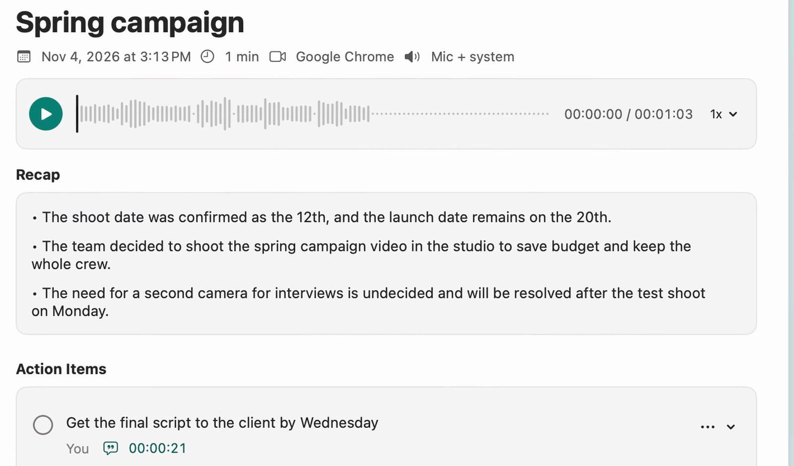</picture></div>

<a id="ask-then-check-the-source"></a>**Sorun, ardından kaynağı kontrol edin.** Kendi işinize bir soru sorun. Yanıtlar kaynaklarını alıntılar ve biri doğrulanamadığında bunu belirtir. Bir alıntıyı döküme veya sese kadar takip edin. Oluşturulan notlar bir başlangıç noktasıdır, tartışmanın yerini almaz.

<div align="center"><picture><source media="(prefers-color-scheme: dark)" srcset="Assets/readme/ask-dark.gif" />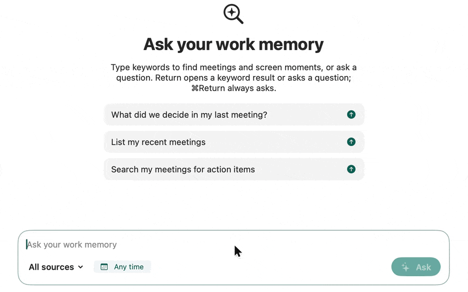</picture></div>

<table>
  <tr>
    <td width="50%" valign="top"><strong>Maya ile açıkta ne var?</strong><br />
      Sizi nelerin beklediğini ve birlikte neye karar verdiğinizi görün. Bir konuşmacıya bir kez ad verin, LokalBot sonraki toplantılarda sesini tanısın.</td>
    <td width="50%" valign="top"><strong>Bu proje ne durumda?</strong><br />
      Bir projeyi takip edin; LokalBot adını geçiren toplantıları, eylemleri ve kararları toplasın. Arkasındaki toplantılara bağlantılarla nerede durduğuna dair kısa bir not için açın. Neyi takip edeceğinizden emin değil misiniz? Toplantılarınızda sürekli geçen adları önerir.</td>
  </tr>
  <tr>
    <td><picture><source media="(prefers-color-scheme: dark)" srcset="Assets/readme/people-dark.gif" />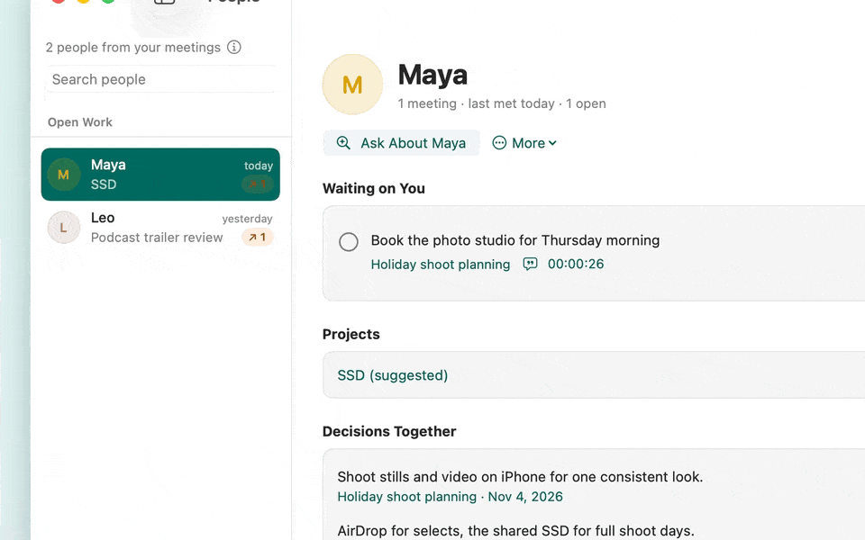</picture></td>
    <td><picture><source media="(prefers-color-scheme: dark)" srcset="Assets/readme/projects-dark.gif" />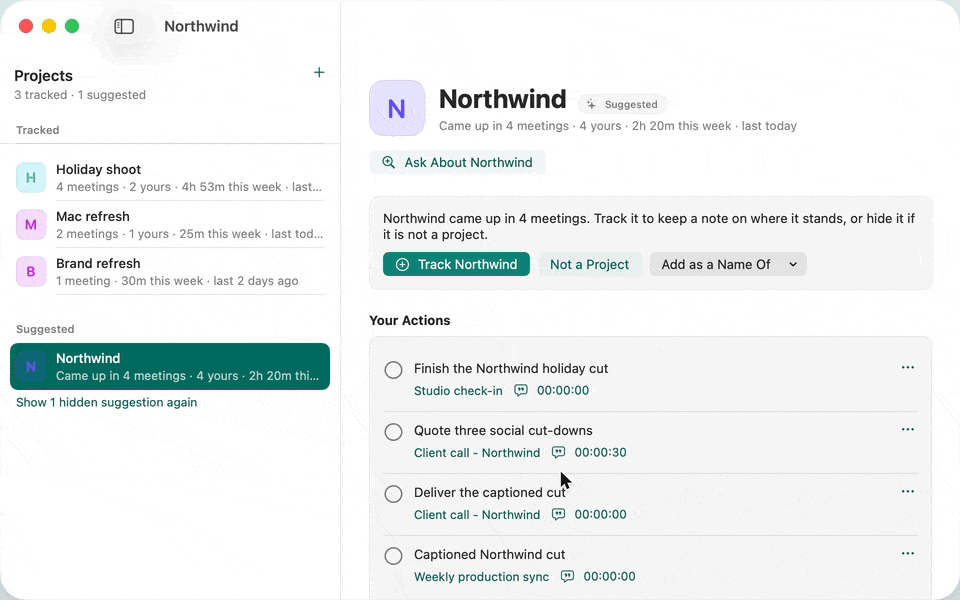</picture></td>
  </tr>
</table>

<a id="it-remembers-how-you-work"></a>**Nasıl çalıştığınızı hatırlar.** Personal Context; gerçeklerinizin, tercihlerinizin, hedeflerinizin ve ilkelerinizin şifrelenmiş bir listesidir. Ask'a "Remember I want the agenda the day before" deyin, Settings'te öğe ekleyin veya gecelik incelemenin toplantılardaki kendi sözlerinizden gerçekleri ve tercihleri yakalamasına izin verin. Ask tuttuklarını kullanır, böylece yanıtlar işinize uyar.

<details>
<summary>Personal Context nasıl öğrenir ve nasıl kapatılır</summary>

- **Yalnızca kendi sözleriniz.** Diğer konuşmacıların değil, sizin cümlelerinizden öğrenir. Bunları okuyan model, siz bir sunucu onaylamadığınız sürece bilgisayarınızda kalır.
- **Nereden geldiğini görürsünüz.** Öğrenilen her öğe arkasındaki satırı gösterir. Tercihler ve yazdıklarınızdan gelen her şey, saklamanız veya reddetmeniz için onayınızı bekler. Toplantılardan gelen gerçekler ve hedefler doğrudan kaydedilir.
- **Kapatmak sizin elinizde.** Öğrenme varsayılan olarak açıktır ve gecede en fazla üç öğe ekler. Settings'teki tek bir anahtar bunu durdurur.
- **Ajanlara karşı gizlidir.** Ajanlar yalnızca ayrı bir izin kapsamında paylaşmayı seçtiğiniz öğeleri okur.

</details>

### Her yerde yazın ve konuşun

<a id="finish-the-sentence"></a>**Cümleyi tamamlayın.** Diğer uygulamalarda yazarken gri metin cümlenizin nasıl biteceğini önerir. Sonraki sözcüğü almak için **Tab**, geri kalanını almak için **\`** tuşuna basın veya yazmaya devam edin.

<div align="center"></div>

<div align="center"><sub>TextEdit'te gerçek zamanlı canlı öneriler. Yayın tarihi ve koşulu John ile yapılan toplantıdan gelir. Kurgusal demo toplantısı.</sub></div>

- **Neyi yanıtladığınızı bilir.** Alanın üstündeki mesajı veya sayfayı okur, böylece yanıt konuya uyar.
- **İzin verirseniz toplantılarınızı hatırlar.** Toplantı ve iş belleğini açın; yukarıdaki yayın tarihi gibi kararlaştırılanları getirebilir.
- **Dilinizde yazar.** Aynı küçük model Almanca, Fransızca, İtalyanca, İspanyolca ve daha fazlasında ayak uydurur.
- **Bilgisayarınızda kalır.** Uygulama içinde küçük bir model çalışır: Mac, Windows ve Linux'ta Gemma 4 E2B. Yazdıklarınız ve okuduğu bağlam, siz bir otomatik tamamlama sunucusu seçip onaylamadığınız sürece bilgisayarınızda kalır.

<details>
<summary>Etkinleştirin</summary>

**Settings → Autocomplete** içinden açın; burada önce örnek bir konuşma üzerinde deneyebilir ve daha sonra sizin için ne kadar yazdığını görebilirsiniz.

</details>

<a id="talk-instead-of-typing"></a>**Yazmak yerine konuşun.** Herhangi bir uygulamada imlecinize metin eklemek için bir kısayolu basılı tutun, konuşun ve bırakın. Döküm bilgisayarınızda çalışır ve son dikteleriniz tekrar kopyalayabilmeniz için saklanır. Compose modunda ihtiyacınız olanı söyleyin; LokalBot izin verirseniz toplantılarınızdan yararlanarak imlecinize yazar.

<div align="center"><picture><source media="(prefers-color-scheme: dark)" srcset="Assets/readme/dictation-dark.gif" />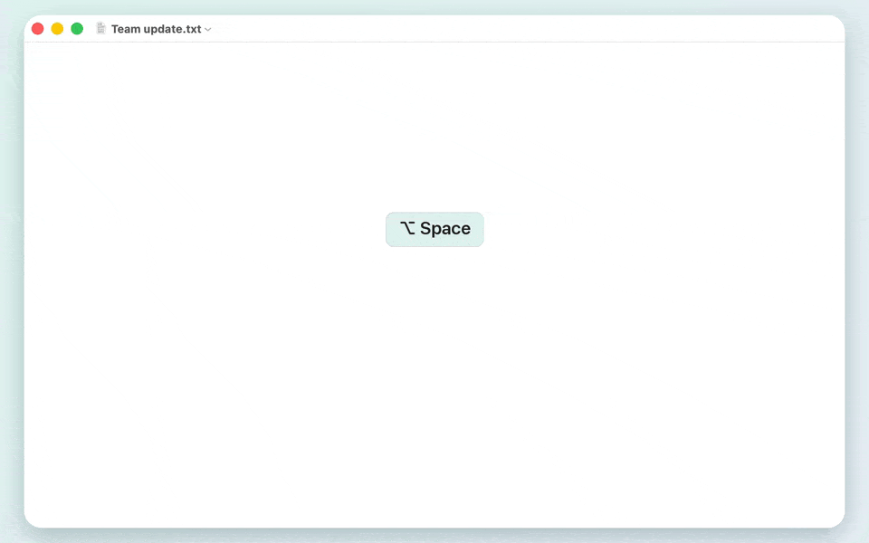</picture></div>

<details>
<summary>Kısayollar ve ayarlar</summary>

**Settings → Dictation** içinden Dictation'ı açın, ardından **⌥ Space** (Windows ve Linux'ta **Alt+Space** veya orada seçtiğiniz bir kısayol) tuşunu basılı tutun, konuşun ve bırakın. Wayland üzerinde masaüstü ayarlarınızda bir kısayola `lokalbot dictate` bağlayın.

</details>

<a id="rewrite-what-you-selected"></a>**Seçtiğinizi yeniden yazın.** Dilbilgisini düzeltmek, kısaltmak, çevirmek, özetlemek veya kendi yönergenizi yazmak için herhangi bir uygulamada metin seçin, ardından seçimi değiştirin veya sonucu kopyalayın. **Draft a reply with my memory** toplantılarınızı da arar, böylece yanıt gerçekte üzerinde anlaşılanları kullanabilir ve kullandığı toplantıları listeler. Siz bir sunucu seçip onaylamadığınız sürece bilgisayarınızda kalan Think modeliniz üzerinde çalışır.

<details>
<summary>Kısayollar ve ayarlar</summary>

**Settings → Ask** (Windows ve Linux'ta **Settings → General**) içinden seçim eylemlerini açın, herhangi bir uygulamada metin seçin ve **⌃⇧ W** tuşlarına basın. Windows ve Linux'ta kısayol **Ctrl+Alt+Space** şeklindedir, çünkü ⌃⇧ W orada sekmeleri ve pencereleri kapatır; Wayland üzerinde masaüstü ayarlarınızda bir kısayola `lokalbot selection-actions` bağlayın.

</details>

<a id="draft-the-follow-up"></a>**Takip taslağı hazırlayın.** Yerel takip taslakları hazırlayın ve günlük özetler ile haftalık iş günlükleri alın. Bunları kendiniz gözden geçirip gönderirsiniz.

### Geri çağırma ve zaman çizelgesi

<a id="find-something-you-saw"></a>**Gördüğünüz bir şeyi bulun.** Toplantı dökümlerinizde ve açarsanız ekranda gördüklerinizde tek arama. Anahtar sözcükle veya anlama göre arayın, ardından uygulamalar arasında aramak yerine eşleşen pasajı veya ekran anını açın.

<div align="center"><picture><source media="(prefers-color-scheme: dark)" srcset="Assets/readme/search-dark.png" />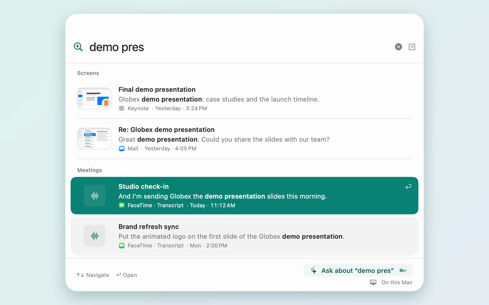</picture></div>

<details>
<summary>Kısayol ve uygulama komutları</summary>

Aynı pencere (**⌃⇧ Space**, veya Windows ve Linux'ta **Ctrl+Shift+Space**, kısayolu **Settings → Ask** veya Windows ve Linux'ta **Settings → General** içinde açtığınızda) hangi uygulamada olursanız olun **Record now** veya **Start dictation** gibi uygulama komutlarını da çalıştırır.

</details>

<a id="pick-up-where-you-left-off"></a>

<table>
  <tr>
    <td width="50%" valign="top"><strong>Hâlâ ne yapmam gerekiyor?</strong><br />
      Today günün özetini ve her biri geldiği toplantıya bağlı olan tüm açık eylemleri gösterir. Her sabah gecelik inceleme düne bir bakış ekler.</td>
    <td width="50%" valign="top"><strong>Gün nereye gitti?</strong><br />
      Gününüzü oturum oturum takip edin. İzleme uygulama ve pencere etkinliğiyle başlar; ekran metni ve ekran görüntüleri isteğe bağlıdır. Claude Code veya Codex kullanıyorsanız işi projeye göre adlandırabilir ve ilgili pull request'leri ile commit'leri gösterebilir.</td>
  </tr>
  <tr>
    <td><picture><source media="(prefers-color-scheme: dark)" srcset="Assets/readme/today-dark.gif" />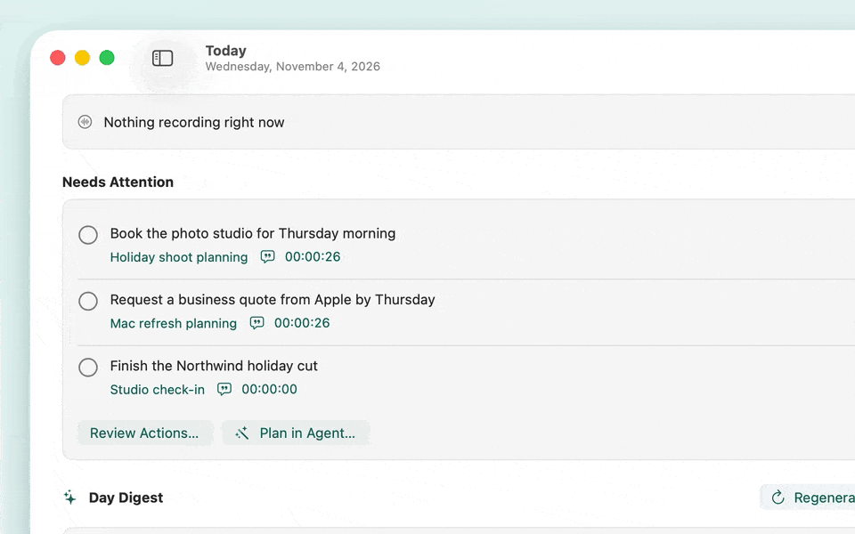</picture></td>
    <td><picture><source media="(prefers-color-scheme: dark)" srcset="Assets/readme/timeline-dark.gif" />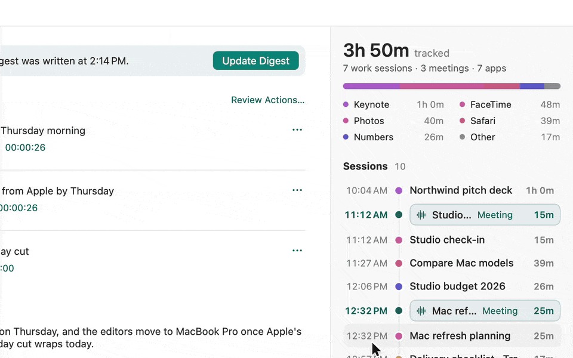</picture></td>
  </tr>
  <tr>
    <td colspan="2" align="center">
      <strong>Bunu nereye kaydettim?</strong><br />
      Seçtiğiniz klasörleri içindekilere göre arayın: belgeler, PDF sayfaları, resimler ve kayıtlardaki ile videolardaki anlar.<br /><br />
      <picture><source media="(prefers-color-scheme: dark)" srcset="Assets/readme/files-dark.gif" />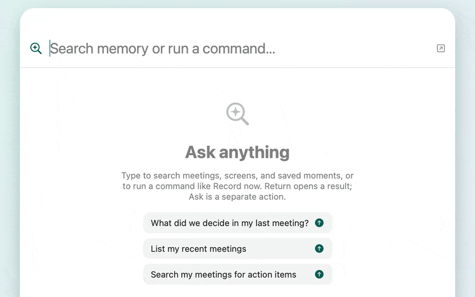</picture>
    </td>
  </tr>
</table>

### Notlarınız, ajanlarınız ve cihazlarınız

**Notlarınızı Obsidian veya Logseq'te tutun.** Bir Obsidian kasası veya Logseq grafiği gibi seçtiğiniz bir klasörde her toplantı için bir Markdown notu tutmak üzere **Meeting note export** seçeneğini açın ya da toplantıları aramak, açık eylem öğelerini Günlük Notlara eklemek ve Obsidian içinde yerel olarak LokalBot'a sormak için açık kaynaklı [Obsidian için LokalBot eklentisini](https://github.com/stevyhacker/obsidian-lokalbot) kullanın. Granola, Otter, Fireflies, Fathom veya Zoom'dan mı geliyorsunuz? Yüklemesiz [Meeting Export to Obsidian dönüştürücüsünü](https://www.lokalbot.com/migrate) deneyin veya doğrudan LokalBot içinde içe aktarın. Bkz. [Notlarımı başka yere taşıyabilir miyim?](#sss) ve [Obsidian'da toplantı dökümleri](https://www.lokalbot.com/meeting-transcripts-obsidian-markdown).

**İşinizi kodlama ajanlarına devredin.** Claude Code, Codex ve herhangi bir MCP istemcisi izin verdiklerinizi okuyabilir; bkz. [Geliştiriciler ve ajanlar için](#geliştiriciler-ve-ajanlar-için).

<a id="on-your-phone"></a>

#### Telefonunuzda ve tabletinizde (iOS ve Android)

> [!TIP]
> **LokalBot iPhone ve iPad için [App Store](https://apps.apple.com/app/id6836773709)'da ve Android için [Google Play](https://play.google.com/store/apps/details?id=me.dotenv.lokalbot.companion)'de.** Toplantılarınızı, eylemlerinizi ve Gün Özetlerinizi çevrimdışı okuyup arayın, bilgisayarınıza sorular sorun ve telefonunuzdan veya tabletinizden toplantılar kaydedin. Arada hiçbir LokalBot sunucusu olmadan, uçtan uca şifreli olarak doğrudan bilgisayarınızdan eşitlenir.

iPhone, iPad ve Android uygulamaları paylaşmayı seçtiğiniz toplantıların, eylemlerin, Timeline'ın, Gün Özetlerinin, kişilerin ve projelerin uçtan uca şifrelenmiş bir kopyasını tutar; böylece bunları çevrimdışı okuyabilir ve arayabilirsiniz. Ask sorunuzu bilgisayarınıza gönderir, bilgisayarınız da kendi yapay zeka ayarlarıyla yanıtlar; ondan uzaktayken soruyu daha sonrası için kuyruğa alır. Bunları Mac, Windows veya Linux bilgisayarda **Settings → Phones & tablets** altında bir QR kodu ile eşleştirin. Arada hiçbir LokalBot sunucusu olmadan yerel ağınız veya Tailscale üzerinden doğrudan bilgisayarınızdan eşitlenirler. Eşleştirilmiş bir telefon veya tablet de bir toplantıyı kaydedip aynı şekilde gönderebilir; bilgisayarınız onu işler ve ardından cihaz kendi kopyasını siler.

<div align="center"><picture><source media="(prefers-color-scheme: dark)" srcset="Assets/readme/ios-today-dark.png" />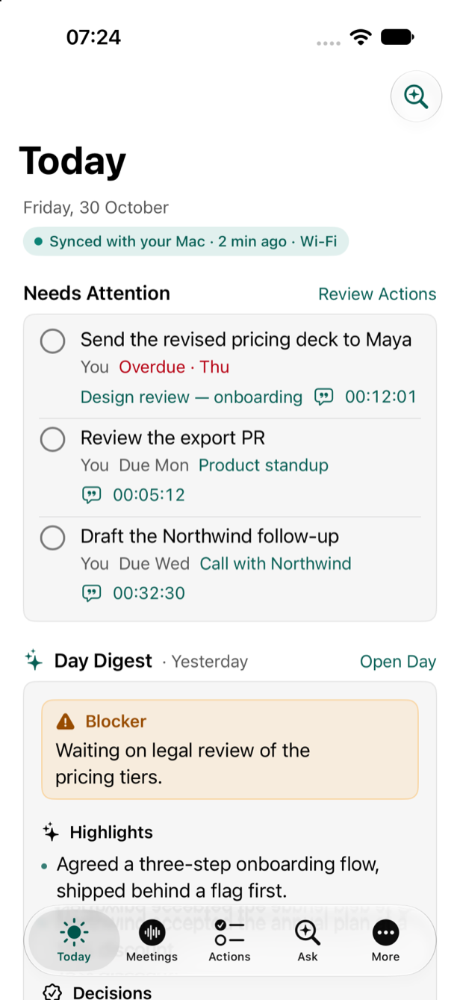</picture>&nbsp;&nbsp;&nbsp;&nbsp;<picture><source media="(prefers-color-scheme: dark)" srcset="Assets/readme/android-today-dark.png" />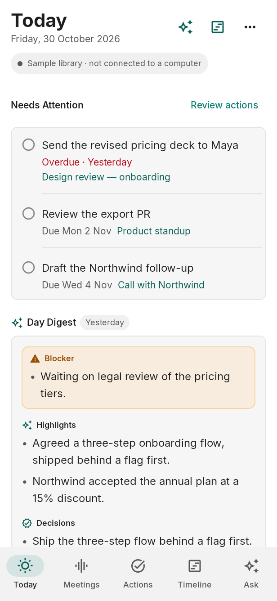</picture></div>

[App Store'dan indirin](https://apps.apple.com/app/id6836773709) (iOS ve iPadOS 18 veya üzeri), [Google Play'den edinin](https://play.google.com/store/apps/details?id=me.dotenv.lokalbot.companion) (Android 10 veya üzeri) veya [en son sürümden](https://github.com/stevyhacker/lokalbot/releases/latest) Android APK'sını kurun. Google Play ve sürüm APK'ları farklı anahtarlarla imzalanmıştır, bu yüzden birini seçin: daha sonra değiştirmek kaldırmak anlamına gelir, bu da telefonun kopyasını ve eşleştirmesini siler. Eşleştirmeden önce örnek kitaplığı deneyebilirsiniz.

<a id="windows-and-linux"></a>

#### Ayrıca Windows ve Linux'ta (alfa)

Rust ile yazılmış yerel bir Windows ve Linux uygulaması aynı sayfalara sahiptir ve aynı kitaplığı okur, böylece bir kitaplık bilgisayarlar arasında taşınabilir. Ask geçmişi, Personal Context, ekran görüntüleri ve hatırlanan sesler gibi şifrelenmiş öğeler yalnızca onları kaydeden bilgisayarda açılır. Toplantılar, döküm, Ask, arama, gün belleği, ekran bağlamı, dikte, otomatik tamamlama, seçim eylemleri, sesli özetler, Files, gecelik inceleme, Personal Context, takvim, Agent Mode ve CLI ile MCP sunucusu çalışır. Bu bir alfadır: Windows derlemesi henüz kod imzalı değildir, bazı özellikler Linux masaüstünüze bağlıdır (Wayland desteği kısmidir) ve toplantı özetlerindeki Gmail henüz taşınmamıştır. Bkz. [nerede ne çalışıyor](LinuxWindows/README.md#what-works-where) ve [ekran görüntüleri](LinuxWindows/docs/screenshots).

<sub>Klipler kurgusal veriler üzerinde gerçek Mac uygulamasını gösterir; beklemeler kesilmiş ve bazı yazma kısımları hızlandırılmıştır. Search, Today, Timeline ve People tohumlanmış bir kitaplık kullanır; notlar, Ask yanıtları, dikte, otomatik tamamlama ve Files sonuçları cihaz içi modellerden gelir. <a href="Video/lokalbot-landing-demos/README.md">Nasıl yapıldılar</a>.</sub>

## Nasıl karşılaştırılır

| Nereden geliyorsunuz… | LokalBot ile farkı ne |
| --- | --- |
| [Granola](https://www.lokalbot.com/lokalbot-vs-granola) | Aynı botsuz yakalama, ancak döküm ve özetler varsayılan olarak bilgisayarınızda çalışır. Hesap yok ve abonelik yok. |
| [Apple Notes](https://www.lokalbot.com/lokalbot-vs-apple-notes) | Notes yalnızca mikrofonunuzu kaydeder, bu yüzden kulaklık takılıyken bir Zoom veya Teams görüşmesinin diğer tarafını kaçırır. LokalBot her iki tarafı da kaydeder ve tartışmayı alıntılayan notlarla her toplantıyı aranabilir tutar. |
| [Otter](https://www.lokalbot.com/lokalbot-vs-otter) · [Fireflies](https://www.lokalbot.com/lokalbot-vs-fireflies) · [Fathom](https://www.lokalbot.com/lokalbot-vs-fathom) · [Read.ai](https://www.lokalbot.com/lokalbot-vs-read-ai) | Görüşmenize hiçbir şey katılmaz, ses bilgisayarınızda kalır ve dakika veya özet sınırı yoktur. |
| [Notion AI](https://www.lokalbot.com/lokalbot-vs-notion-ai) | Her çalışma alanı koltuğunu Business'a ($20/kullanıcı/ay) yükseltmeden botsuz yakalama; yerel modeller, Linux desteği ve düz Markdown dışa aktarımıyla. |
| [Hyprnote (anarlog)](https://www.lokalbot.com/lokalbot-vs-hyprnote) | Yerel yapay zeka yerleşik olarak gelir; kurulumu gereken ayrı bir model çalıştırıcı veya API anahtarı yoktur. Dikte, gün zaman çizelgesi ve otomatik tamamlama aynı uygulamada gelir. |
| [Meetily](https://www.lokalbot.com/lokalbot-vs-meetily) | İkisi de açık kaynaklıdır ve yerel çalışır. Konuşmacı ayrımı, toplantı algılama ve MCP erişimi Pro özellikleri olmak yerine burada ücretsizdir; dikte, gün zaman çizelgesi ve otomatik tamamlama aynı uygulamada gelir. |
| [Screenpipe](https://www.lokalbot.com/lokalbot-vs-screenpipe) | Uygulama ve pencere etkinliğiyle başlar. Ekran metni ve ekran görüntüleri isteğe bağlıdır ve varsayılan olarak 14 gün sonra silinir. Source-available yerine GPLv3. |
| [Rewind / Limitless](https://www.lokalbot.com/lokalbot-vs-rewind) | Rewind / Limitless Mac uygulaması Meta'nın satın almasından sonra sonlandırıldı. LokalBot'un zaman çizelgesi açık kaynaklıdır ve aktif olarak geliştirilmektedir. |
| [MacWhisper](https://www.lokalbot.com/lokalbot-vs-superwhisper) · [Superwhisper](https://www.lokalbot.com/lokalbot-vs-superwhisper) | Dikte; toplantı notları, geri çağırma ve otomatik tamamlama ile birlikte ücretsiz gelir. Zaten elinizde olan dosyaların dökümünü almak için MacWhisper daha iyi bir araçtır. |
| [Wispr Flow](https://www.lokalbot.com/lokalbot-vs-wispr-flow) | Dikte ve botsuz toplantı notları bilgisayarınızda çalışır; hesap, sözcük sınırı veya bağlantı gerekmez. Wispr Flow ikisinin de dökümünü bulutunda yapar. |

<sub>Rakip ayrıntıları en son 26 Ekim 2026 tarihinde (ve Fathom, Notion AI, Read.ai ile Rewind / Limitless için 20 Kasım 2026 tarihinde) doğrulanmıştır; her bağlantıda tam karşılaştırma ve kaynaklar bulunur. Ticari markalar sahiplerine aittir.</sub>

## Performans

Varsayılan modeller kullanılarak Apple M4 Max Mac'lerde (raporun kaydettiği yerlerde 48 GB bellek) ölçülmüştür. Hızınız ve bellek kullanımınız bilgisayarınıza, seçtiğiniz modellere, bağlam uzunluğuna ve diğer iş yüklerine bağlıdır.

| Görev | Ölçülen |
| --- | --- |
| 26 dakikalık bir toplantı için notlar ve eylem öğeleri | Model yüklüyken 33,4 sn, soğuk başlangıçtan 59,8 sn |
| 91 dakikalık bir toplantı için notlar ve eylem öğeleri | yaklaşık 72 sn |
| Konuşmacı ayrımı | gerçek zamanın 500× katı |
| Anlamsal arama | sorgu başına yaklaşık 9 ms; arama modelinin sunucusu boşta yaklaşık 0,5 GiB kullanır |
| Otomatik tamamlama | tuş vuruşu başına medyan 56 ms (p95: 102 ms) |
| Ekran metni (Apple Vision) | sentetik ekran görüntüsü başına yaklaşık 120 ms, gerçek olanlar için ortalama 243 ms |

Her rolü kullanırsanız varsayılan modeller Mac'te yaklaşık 8,8 GB, Windows ve Linux'ta ise yaklaşık 4 GB disk alanı kaplar. Bu RAM gereksinimi değil, indirme boyutudur. Makineniz için kesin disk, yerleşik RAM ve GPU VRAM uyumunu [Local AI Hardware & RAM Calculator](https://www.lokalbot.com/hardware) üzerinden kontrol edin veya [SaaS AI Cost Calculator](https://www.lokalbot.com/calculator) ile yıllık bulut SaaS tasarrufunu tahmin edin. Lightweight ön ayarı, otomatik tamamlama için LFM2.5 1.2B Instruct (0,73 GB) dahil daha küçük modellere geçer. Tam etkileşimli tablolar ve yeniden üretilebilir JSON [Local Desktop AI Leaderboard](https://www.lokalbot.com/benchmarks) ([JSON](https://www.lokalbot.com/benchmarks.json)) üzerinde bulunur, [Hugging Face Benchmark Space](https://huggingface.co/spaces/stevyhacker/lokalbot-benchmarks) üzerinde yansıtılır ve ham test düzenekleri [kıyaslama raporları](Benchmarks/README.md) içindedir.

## Yerel yapay zeka, sizin seçiminiz

Yerleşik modellerle başlayın, ardından **Settings > Models** içinde değiştirin. LokalBot paketle gelen llama.cpp çalışma zamanını, Ollama'yı, OpenAI uyumlu sunucuları ve macOS 26 veya üzeri çalışan desteklenen Mac'lerde Apple Intelligence'ı destekler. Think ayrıca API anahtarı olmadan kendi ChatGPT planınızda (ChatGPT ile oturum aç), Claude planınızda (oturum açılmış Claude Code üzerinden), Antigravity planınızda (oturum açılmış `agy` CLI üzerinden) veya Gemini planınızda (oturum açılmış `gemini` CLI üzerinden) çalışabilir ve Agent Mode ChatGPT planında çalışabilir. Uzak sunucular ve planlar bağlam almadan önce onay gerektirir.

Farklı işler farklı modeller kullanır. Mac varsayılanları dört açık ağırlıklı Apache-2.0 ince ayarımızı (Hugging Face üzerinde `stevyhacker/*-LokalBot-GGUF`) içerir; her rolü kullanırsanız yaklaşık 8,8 GB model dosyası tutar (stok yukarı akış kontrol noktaları Settings'te seçilebilir kalır). Dosya boyutları disk kullanımıdır, RAM gereksinimi değildir:

| Rol | Varsayılan model | Biçim | Yaklaşık model dosyaları |
| --- | --- | --- | ---: |
| Döküm | [Qwen3-ASR 1.7B (LokalBot v3)](https://huggingface.co/stevyhacker/Qwen3-ASR-1.7B-LokalBot-GGUF) | GGUF Q8_0 | 2,52 GB |
| Özetler ve sohbet | [Qwen3.5 4B (LokalBot v4)](https://huggingface.co/stevyhacker/Qwen3.5-4B-LokalBot-GGUF) | `Q4_K_M` | 2,74 GB |
| Otomatik tamamlama | [Gemma 4 E2B (LokalBot v4)](https://huggingface.co/stevyhacker/Gemma-4-E2B-LokalBot-GGUF) | `i1-Q5_K_M` | 3,02 GB |
| Anlamsal arama | EmbeddingGemma 2 | `Q8_0` | 0,31 GB |
| Konuşmacı ayrımı | FluidAudio üzerinden Nemotron 3 (önizleme) | Core ML | ~0,20 GB |

Kompakt Mac döküm katmanı [Qwen3-ASR 0.6B (LokalBot v1)](https://huggingface.co/stevyhacker/Qwen3-ASR-0.6B-LokalBot-GGUF) (`1.02 GB` GGUF Q8_0, Apache-2.0) kullanır. Tablo, bir özellik ilk kez ihtiyaç duyduğunda indirilen yardımcı modelleri dışarıda bırakır: Qwen3-ASR ile konuşmacı ayrımı yaklaşık 1 GB'lık bir sözcük zamanlama modeli ekler ve Files'ı açmak 555 MB'lık bir görsel ve ses projektörü ekler.

Qwen3-ASR 52 dil ve lehçeyi kapsar. Döküm alternatifleri arasında Parakeet, Granite Speech, Whisper large-v3 turbo, Çince, Japonca ve Korece için SenseVoice ve Rusça için GigaAM bulunur; konuşmacı ayrımı için Pyannote Community-1 kullanılabilir kalır. Lightweight ön ayarı, otomatik tamamlama için LFM2.5 1.2B Instruct (0,73 GB) dahil daha küçük modellere geçer. Model seçenekleri sürüme göre değişebilir; Settings etkin seçimleri ve kullanılabilir ön ayarları gösterir. Hız ve bellek kullanımı bilgisayarınıza, modele, bağlam uzunluğuna ve diğer iş yüklerine bağlıdır.

Windows ve Linux'ta döküm sherpa-onnx üzerinden Qwen3-ASR 0.6B kullanır (Parakeet v3 ve v2, SenseVoice, GigaAM Rusça ve Whisper turbo isteğe bağlıdır), konuşmacılar pyannote segmentasyonu ve TitaNet ile ayrılır ve otomatik tamamlama Mac'teki gibi varsayılan olarak [Gemma 4 E2B (LokalBot v4)](https://huggingface.co/stevyhacker/Gemma-4-E2B-LokalBot-GGUF) kullanır. Özetler ([Qwen3.5 4B (LokalBot v4)](https://huggingface.co/stevyhacker/Qwen3.5-4B-LokalBot-GGUF)) ve arama (EmbeddingGemma 2) Mac ile aynı modelleri kullanır. Varsayılan indirme yaklaşık 4 GB'tır ve llama.cpp Vulkan GPU, deneysel CUDA veya CPU üzerinde çalışır.

[Etkileşimli lider tablosu](https://www.lokalbot.com/benchmarks) · [Donanım ve RAM hesaplayıcı](https://www.lokalbot.com/hardware) · [SaaS maliyet hesaplayıcı](https://www.lokalbot.com/calculator) · [Agent Wrapped](https://www.lokalbot.com/wrapped) · [Hugging Face kıyaslama Space'i](https://huggingface.co/spaces/stevyhacker/lokalbot-benchmarks) · [Hugging Face model Koleksiyonu](https://huggingface.co/collections/stevyhacker/lokalbot-recommended-local-stack) · [Proje kıyaslamaları](Benchmarks/README.md) · [Model kataloğu](LokalBot/Engines/ModelCatalog.swift) · [Arama uygulaması](LokalBot/Services/Search/EmbeddingIndex.swift) · [Model ve çalışma zamanı ayrıntıları](Docs/development/llm-runtime.md)

<a id="privacy--verify-it"></a>

## Gizlilik

**İşiniz kişiseldir. Onu yerel tutmak başlangıç noktası olmalıdır.**

Kayıt ve yerleşik yapay zeka işleme bilgisayarınızda gerçekleşir. LokalBot'un hesap sistemi, analitik servisi veya telemetri arka ucu yoktur. Kitaplığınız kullanıcı hesabınız altında yerel dosyalarda ve SQLite içinde yaşar.

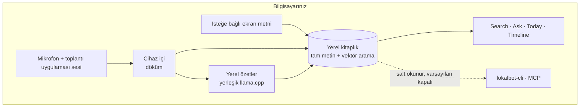

- **Nelerin saklanacağını siz seçersiniz.** Yalnızca etkinlik izleme varsayılandır. Görünür ekran metni ve şifrelenmiş ekran görüntüleri isteğe bağlıdır. İstediğiniz zaman yakalamayı duraklatın veya uygulamaları ve alan adlarını hariç tutun. Algılamanın sınırları vardır; asla saklanmasını istemediğiniz her şeyi hariç tutun.
- **Saklama süresini siz kontrol edersiniz.** Yakalanan ekran metinleri ve ekran görüntüleri varsayılan olarak 14 gün sonra sona erer. Süreyi ayarlayın veya siz kaydı kaldırana ya da silene kadar saklamak için bir anı açıkça kaydedin.
- **Ağ erişiminin sınırları vardır.** Modeller, güncellemeler ve isteğe bağlı ajan çalışma zamanları indirme gerektirir. Otomatik güncelleme denetimleri devre dışı bırakılabilir. Uzak bir model sunucusu bağlamı yalnızca kaynağını onayladıktan sonra alır; isteğe bağlı Agent Mode ve harici CLI/MCP istemcilerinin ayrı izinleri ve veri işleme kuralları vardır.
- **Telefonunuz yalnızca eşleştirirseniz bir kopya alır.** Settings → Phones & tablets varsayılan olarak kapalıdır. Açtığınızda Mac, eşleştirdiğiniz telefonlara ve tabletlere seçtiğiniz verilerin uçtan uca şifrelenmiş bir kopyasını arada hiçbir LokalBot sunucusu olmadan yerel ağınız veya Tailscale üzerinden gönderir. Ekran görüntüleri, ekran metni, katılımcı e-postaları ve ses profilleri asla paylaşılmaz. Eşleştirilmiş bir telefon da bir toplantıyı kaydedip aynı şekilde gönderebilir; Mac'iniz onu işler ve telefon ardından kendi kopyasını siler.

Yerel işleme yolunu kontrol etmek için modelleri indirin, yerleşik arka ucu seçin, otomatik güncelleme denetimlerini devre dışı bırakın ve kayıt, döküm ile özetleme sırasında ağ trafiğini gözlemleyin. Onaylanmış ajan komutları ve harici istemciler ayrı yollardır.

[Tam gizlilik politikasını okuyun](PRIVACY.md) · [Güvenlik sorununu özel olarak bildirin](SECURITY.md)

<a id="download"></a>

## Başlarken

LokalBot, macOS 15 veya üzeri çalışan Apple Silicon Mac'lerde çalışır. Windows ve Linux alfadır. Ayrıca seçtiğiniz modeller için alana ihtiyacınız olacak: **Settings → Models** indirme boyutlarını ve hazır olma durumunu gösterir; depolama ve bellek gereksinimleri seçtiğiniz modellere bağlıdır.

| | macOS | Windows (alfa) | Linux (alfa) |
| --- | --- | --- | --- |
| Çalıştığı sistemler | Apple Silicon (M1 veya üzeri), macOS 15+ | Windows 10 veya 11, x64 | glibc 2.39 veya üzeri x86_64 (Ubuntu 24.04, Debian 13, Fedora 40 veya daha yeni), PulseAudio veya PipeWire ve bir Vulkan veya OpenGL sürücüsü |
| Kurulum | [`LokalBot-<version>-macos-arm64.dmg`](https://github.com/stevyhacker/lokalbot/releases/latest): LokalBot'u Applications klasörüne sürükleyin. Veya `brew install --cask stevyhacker/tap/lokalbot`. | [`LokalBot-<version>-windows-x86_64-setup.exe`](https://github.com/stevyhacker/lokalbot/releases/latest): Başlat menüsü kısayolu, `PATH` üzerinde `lokalbot-cli` ile ve yönetici hakları olmadan kullanıcınız için LokalBot'u kurmak üzere çalıştırın (BT makine geneli dağıtım için `/ALLUSERS /VERYSILENT` geçirin). Veya [Scoop](https://github.com/stevyhacker/scoop-bucket) ile kurun: `scoop bucket add lokalbot https://github.com/stevyhacker/scoop-bucket && scoop install lokalbot/lokalbot`. Henüz kod imzalı değildir, bu nedenle SmartScreen önce sorar: **More info → Run anyway**. Aynı sürümde taşınabilir bir zip bulunur. | [`LokalBot-<version>-linux-x86_64.tar.gz`](https://github.com/stevyhacker/lokalbot/releases/latest): çıkarın ve LokalBot'u uygulamalar menünüze ekleyen `./install.sh` betiğini çalıştırın. Veya aynı sürümden `.deb` (Debian, Ubuntu), `.rpm` (Fedora, openSUSE) ya da Arch paketini kurun. `.deb` ve Fedora'daki `.rpm` LokalBot deposunu ekler, böylece `sudo apt upgrade` veya `sudo dnf upgrade` sonraki sürümleri getirir; Arch paketinde LokalBot güncellemeleri kurmak yerine size bildirir. |
| Kitaplığınız | `~/Library/Application Support/me.dotenv.LokalBot` | `%LOCALAPPDATA%\LokalBot` | `~/.local/share/LokalBot` |

Bir platformda kaydedilen kitaplık diğerlerinde açılır. Henüz her Mac özelliği Windows ve Linux'ta yoktur; bkz. [nerede ne çalışıyor](LinuxWindows/README.md#what-works-where).

**Telefonunuzda veya tabletinizde:** eşlikçi uygulamayı [App Store](https://apps.apple.com/app/id6836773709) (iOS ve iPadOS 18 veya üzeri) ya da [Google Play](https://play.google.com/store/apps/details?id=me.dotenv.lokalbot.companion) (Android 10 veya üzeri) üzerinden indirin ve **Settings → Phones & tablets** altında eşleştirin. Bkz. [Telefonunuzda ve tabletinizde](#on-your-phone).

1. Platformunuz için **uygulamayı kurun** ve açın.
2. **Nelerin yakalanacağını seçin.** Kayıt ayarlarını gözden geçirin: otomatik algılama, önce sor veya elle kayıt. Gün izleme yalnızca etkinlikle başlar; ekran metnini veya ekran görüntülerini kaydetmek ayrı bir isteğe bağlı seçimdir. Yalnızca etkinleştirdiğiniz özellikler için izin verin.
3. **Modellerin inmesini bekleyin.** Yerleşik döküm, arama, özetler ve yazma ardından çevrimdışı çalışabilir. Kurulacak model sunucusu ve getirilecek API anahtarı yoktur.

**Önce bunu deneyin:** kısa bir test kaydı yapın, dökümünü çıkarmasını bekleyin, ardından söylediğiniz bir ifadeyi arayın ve eşleşen pasajı açın. Hazır olduğunuzda ekran belleğini veya yazma araçlarını ekleyin.

Kaydetmeden önce toplantı katılımcılarına haber verin ve onaylarını alın.

[Sürüm notları](https://github.com/stevyhacker/lokalbot/releases) · [Kurulum yardımı](SUPPORT.md) · [Homebrew seçenekleri](Distribution/homebrew/README.md) · [Windows ve Linux kılavuzu](LinuxWindows/README.md)

## SSS

<details>
<summary><strong>Toplantılarıma bir bot katılıyor mu?</strong></summary>

Hayır. LokalBot bilgisayarınızda mikrofonunuzu ve toplantı uygulamasının sesini kaydeder. Windows ve Linux'ta mümkün olduğunda yalnızca toplantı uygulamasını, aksi halde bilgisayarın çaldığı her şeyi kaydeder. Ses kaynakları bireysel konuşmacı tanımadan ayrıdır. Sistem sesi yakalama kullanılamadığında uygulama kaydın yalnızca mikrofon olduğunu uyarır. Her zaman katılımcıların onayıyla kaydedin.

</details>

<details>
<summary><strong>Ekranımdaki her şeyi kaydediyor mu?</strong></summary>

Hayır. Yeni kurulumlar kapatabileceğiniz yalnızca etkinlik izlemeyi kullanır. Görünür metni veya ekran görüntülerini kaydetmek ayrı bir seçim ve ilgili macOS izinlerini (Linux'ta masaüstünüzün erişilebilirlik ve ekran görüntüsü desteğini) gerektirir. Hariç tutulan uygulamalar, alan adları ve güvenli alanlar atlanır; tarayıcıyı veya siteyi hariç tutmadığınız sürece gizli tarayıcı pencereleri yakalanır. Algılanan kimlik bilgileri sansürlenir ve ilişkili pikseller atılır, ancak algılama mükemmel değildir. Bkz. [PRIVACY.md](PRIVACY.md).

</details>

<details>
<summary><strong>Notlarımı başka yere taşıyabilir miyim?</strong></summary>

Evet. Bir Obsidian kasası veya Logseq grafiği gibi seçtiğiniz bir klasörde her toplantı için bir Markdown notu tutmak üzere **Meeting note export** seçeneğini açın: özet, eylem öğeleri, ilgili kişiler ve projeler ile döküm. Ayrıca tek bir toplantıyı dışa aktarabilir, günlük bir bellek notu yazabilir veya yerel rutinlerin taslak kaydetmesine izin verebilirsiniz. Bunlar sıradan, şifrelenmemiş dosyalardır; bunları eşitlediğiniz herhangi bir servisin kendi gizlilik ayarları vardır. Bkz. [Obsidian'da toplantı dökümleri](https://www.lokalbot.com/meeting-transcripts-obsidian-markdown).

</details>

<details>
<summary><strong>Windows veya Linux'ta çalışıyor mu?</strong></summary>

Evet, alfa olarak. Windows ve Linux uygulaması aynı sayfalara, özetler ve arama için aynı modellere ve aynı kitaplık biçimine sahip yerel bir Rust uygulamasıdır, bu yüzden bir kitaplık bilgisayarlar arasında taşınabilir. Ask geçmişi, Personal Context, ekran görüntüleri ve hatırlanan sesler gibi şifrelenmiş öğeler yalnızca onları kaydeden bilgisayarda açılır. Toplantı özetlerindeki Gmail şimdilik yalnızca Mac içindir ve Wayland üzerinde bazı özellikler masaüstünüze bağlıdır. Bkz. [nerede ne çalışıyor](LinuxWindows/README.md#what-works-where).

</details>

<details>
<summary><strong>Telefon uygulaması var mı?</strong></summary>

Evet — iPhone ve iPad (iOS ve iPadOS 18 veya üzeri) için [App Store](https://apps.apple.com/app/id6836773709) üzerinde ve Android (Android 10 veya üzeri) için [Google Play](https://play.google.com/store/apps/details?id=me.dotenv.lokalbot.companion) üzerinde. Bilgisayarınızdaki LokalBot'un eşlikçileridir: bilgisayarınızın paylaştığı toplantıları, eylemleri ve Gün Özetlerini okurlar, çevrimdışı ararlar, bilgisayarınızın dökümünü çıkarması için toplantı kaydederler ve sorularınızı bilgisayarınıza gönderirler. **Settings → Phones & tablets** seçeneğini açana kadar paylaşım kapalıdır ve kopya hiçbir zaman bir LokalBot sunucusundan geçmeden yerel ağınız veya Tailscale üzerinden uçtan uca şifreli olarak iletilir.

</details>

<a id="contributing--security"></a>

## Katkıda bulunma

Hata raporları, belge iyileştirmeleri ve kod katkıları memnuniyetle karşılanır. Yeniden üretme adımları, beklenen ve gerçek davranış, uygulama sürümü, işletim sisteminiz ve sürümü (Linux'ta ayrıca dağıtım, masaüstü ve X11 veya Wayland), çipiniz veya CPU ve GPU'nuz, RAM ve seçili modellerle birlikte [bir sorun bildirin](https://github.com/stevyhacker/lokalbot/issues/new/choose). Özel kayıtları ve dökümleri raporların dışında tutun.

Sorularınız, fikirleriniz veya paylaşmaya değer bir iş akışınız mı var? [Tartışmalar](https://github.com/stevyhacker/lokalbot/discussions) bölümünde bir konu başlatın.

Daha büyük değişiklikler için yaklaşımı önce tartışmak üzere [bir sorun açın](https://github.com/stevyhacker/lokalbot/issues). Bkz. [CONTRIBUTING.md](CONTRIBUTING.md), [Davranış Kurallarımız](CODE_OF_CONDUCT.md), [çalışma anlaşmaları](AGENTS.md) ve [geliştirme kılavuzu](DEVELOPMENT.md). Pull request'leri odaklı tutun ve kontrollerinizi [PR şablonuna](.github/PULL_REQUEST_TEMPLATE.md) kaydedin. İnsanların görebileceği bir değişiklik için kendi toplantılarınız veya mesajlarınız yerine örnek veriler kullanarak master ve dalınız üzerinde aynı adımların öncesi ve sonrası kayıtlarını ekleyin ([örnek](https://github.com/stevyhacker/lokalbot/pull/578#issuecomment-7078094930)). UI testlerini barındırılan CI veya uzak bir çalıştırıcı üzerinde çalıştırın. Donanım kıyaslama gönderimleri (M1, M2, M3, Windows ve Linux) de memnuniyetle karşılanır; bkz. [Benchmarks/README.md](Benchmarks/README.md#contribute-hardware-benchmarks).

<a id="build-from-source"></a>

**Kaynaktan derleme:** geliştirme kılavuzundaki [Kaynaktan derleme](DEVELOPMENT.md#build-from-source) ve [Kodda yolunuzu bulma](DEVELOPMENT.md#find-your-way-around-the-code) bölümlerine bakın.

## Lisans ve teşekkürler

LokalBot [GPLv3](LICENSE) altında özgür bir yazılımdır. Otomatik tamamlama motorunda [Cotabby](https://github.com/FuJacob/cotabby)'den taşınan kod [AGPLv3](LICENSES/AGPL-3.0.txt) altında kalır. Diğer üçüncü taraf bileşenler ve modeller kendi lisanslarını korur; bkz. [üçüncü taraf bildirimleri](THIRD_PARTY_NOTICES.md).

### Kod imzalama politikası

Ücretsiz kod imzalama [SignPath.io](https://signpath.io) tarafından sağlanır, sertifika [SignPath Foundation](https://signpath.org) tarafından verilir.

- **Kapsam:** GitHub Actions içinde bu depodan derlenen Windows sürüm yürütülebilir dosyaları (`lokalbot.exe`, `lokalbot-cli.exe`) ve Inno Setup kurucusu (`LokalBot-<version>-windows-x86_64-setup.exe`); yukarı akış üçüncü taraf çalışma zamanı DLL'leri yeniden imzalanmaz.
- **İşleyenler ve inceleyenler:** `stevyhacker/LokalBot` deposunun bakımcıları.
- **Onaylayanlar:** üretim imzalama isteklerini SignPath'te elle inceleyen ve onaylayan depo sahibi (`@stevyhacker`).
- **Gizlilik politikası:** Bu program, kullanıcı veya onu kuran ya da çalıştıran kişi tarafından açıkça istenmedikçe diğer ağ sistemlerine herhangi bir bilgi aktarmayacaktır. Bkz. [PRIVACY.md](PRIVACY.md) ve [lokalbot.com/privacy](https://www.lokalbot.com/privacy).

[llama.cpp](https://github.com/ggml-org/llama.cpp), [speech-swift](https://github.com/soniqo/speech-swift), [sherpa-onnx](https://github.com/k2-fsa/sherpa-onnx), [WhisperKit](https://github.com/argmaxinc/WhisperKit), [FluidAudio](https://github.com/FluidInference/FluidAudio), [Sparkle](https://github.com/sparkle-project/Sparkle), [XcodeGen](https://github.com/yonaskolb/XcodeGen), [GPUI](https://github.com/zed-industries/zed/tree/main/crates/gpui), [GPUI Kit](https://github.com/longbridge/gpui-kit) ve [ONNX Runtime](https://github.com/microsoft/onnxruntime) ile ve [Qwen3-ASR](https://huggingface.co/Qwen), [IBM Granite Speech](https://huggingface.co/ibm-granite), [Parakeet](https://huggingface.co/nvidia) ile [LFM2.5](https://huggingface.co/LiquidAI) dahil modellerle oluşturulmuştur. Otomatik tamamlama motoru [Cotabby](https://cotabby.app)'nin açık kaynaklı kodundan başlamıştır.
