<div align="center">


# LokalBot

**你的个人上下文引擎。**

每场会议都有纪要，不需要机器人进会。一次搜索，覆盖你看过和听过的一切。<br />
在任何应用里都能自动补全和语音输入。默认在本机运行。<br />
你的 AI 智能体也能搜索这些内容，支持 Claude Code、Codex 和任何 MCP 客户端。

<a href="Assets/screenshots/zh-Hans/meetings-summary.png">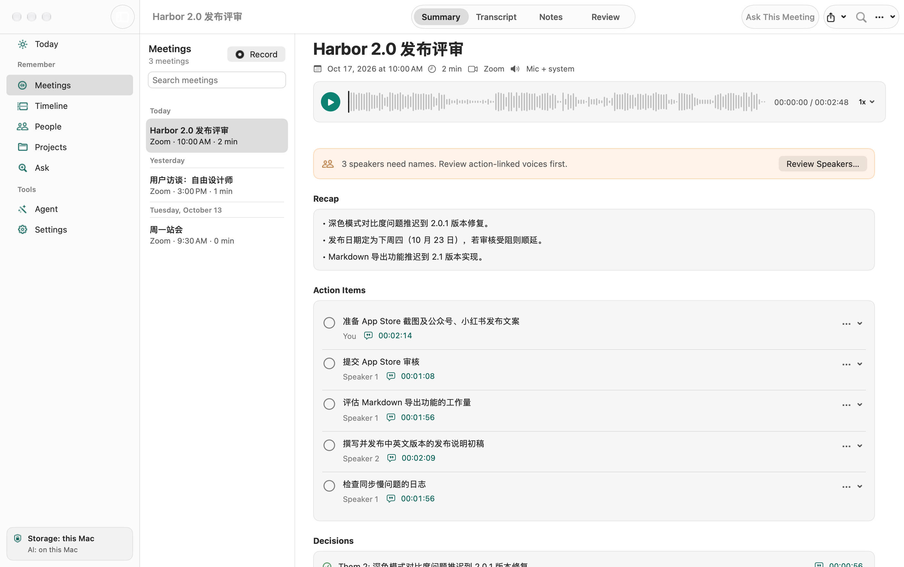</a>

<sub>真实应用截图。演示会议是虚构的普通话会议，语音由 TTS 合成；转写和纪要由本机上的 Qwen3-ASR 和 Qwen3.5 4B 实际生成，未做修改（<a href="Assets/screenshots/zh-Hans/README.md">制作说明</a>）。</sub>

**免费开源，无需注册账号。**

[](https://github.com/stevyhacker/lokalbot/releases/latest)
[](https://github.com/stevyhacker/lokalbot/releases/latest)
[](https://github.com/stevyhacker/lokalbot/releases/latest)

<sub>Apple Silicon（M1 或更新）+ macOS 15 及以上 · Windows 10/11 x64（alpha）· Linux x86_64（alpha）· Mac 上也可以用 <code>brew install --cask stevyhacker/tap/lokalbot</code></sub>

[](https://github.com/stevyhacker/lokalbot/releases/latest)
[](https://github.com/stevyhacker/lokalbot/releases)
[](LICENSE)
[](#developers)

[English](README.md) · **简体中文**

[功能](#features) · [中文支持](#chinese) · [开发者与智能体](#developers) · [Windows 与 Linux](#windows-and-linux) · [隐私](#privacy) · [快速开始](#get-started) · [模型](#models) · [官网](https://www.lokalbot.com/)

<picture><source media="(prefers-color-scheme: dark)" srcset="Assets/hero/lokalbot-demo-dark.gif" />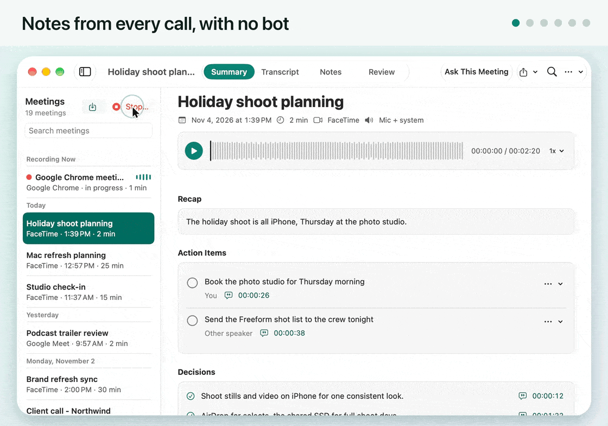</picture>

<sub>真实应用，虚构演示数据，界面为英文。等待时间已剪短，部分打字已加速。</sub>

</div>

<a id="features"></a>

## 功能

### 记住会上定下的事

不需要机器人进会，直接录制麦克风和会议软件的声音。转写、要点回顾、决策和待办都在本机生成，每一条都能跳回讨论的原话。也可以把音频和视频文件导入为会议。

<div align="center"><a href="Assets/screenshots/zh-Hans/meetings-transcript.png">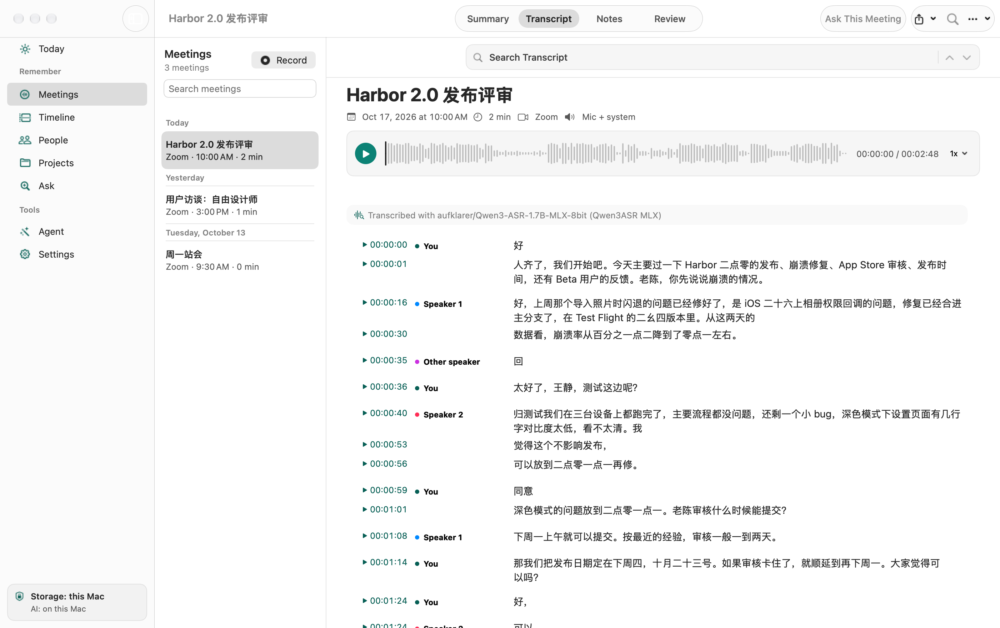</a></div>

<div align="center"><sub>同一场会议的转写，由 Qwen3-ASR 1.7B 在本机完成，中英混说也能识别。发言人还没有命名，所以显示为 Speaker 1、Speaker 2。</sub></div>

### 找到你看过的东西

一次搜索覆盖会议转写，以及（开启后）你在屏幕上看到过的文字。可以按关键词或按含义搜索，然后直接打开对应的段落或屏幕画面，不用在各个应用之间来回翻找。同一个窗口（**⌃⇧ Space**，Windows 和 Linux 上是 **Ctrl+Shift+Space**；需要先在 **Settings → Ask** 中开启快捷键，Windows 和 Linux 上是 **Settings → General**）还能在任何应用里直接执行应用命令，例如 **Record now** 或 **Start dictation**。

<div align="center"><picture><source media="(prefers-color-scheme: dark)" srcset="Assets/readme/search-dark.png" />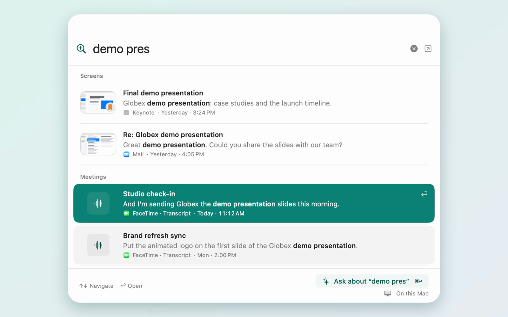</picture></div>

### 帮你把句子写完

在其他应用里打字时，灰色文字会提示这句话可以怎么结尾。按 **Tab** 接受下一个词，按 **\`** 接受剩下的全部，或者继续打字忽略它。

<div align="center"></div>

<div align="center"><sub>在 TextEdit 中实时录制的补全效果。发布日期和条件来自与 John 的会议。演示会议为虚构内容。</sub></div>

- **知道你在回复什么。** 它会读取输入框上方的消息或页面，让回复贴合上下文。
- **记得你的会议（需要你允许）。** 开启会议和工作记忆后，它能用上会上定下的事，比如上面的发布日期。
- **用你的语言写。** 在 Mac 上，同一个小模型可以用德语、法语、意大利语、西班牙语等语言补全。
- **留在你的电脑上。** 小模型在应用内运行：Mac 上是 Gemma 4 E2B，Windows 和 Linux 上是 LFM2.5 1.2B。你输入的内容和它读取的上下文都留在你的电脑上，除非你自己选择并批准了一个自动补全服务器。

在 **Settings → Autocomplete** 中开启。可以先在示例对话里试用，之后还能看到它帮你写了多少字。

### 接着上次的进度

<table>
  <tr>
    <td width="50%" valign="top"><strong>我还有什么要做？</strong><br />
      <b>Today</b> 显示当天的摘要和所有未完成的待办，每一条都链接到它来自的会议。每天早上，夜间回顾还会加上一段对昨天的回看。</td>
    <td width="50%" valign="top"><strong>这一天都去哪了？</strong><br />
      <b>Timeline</b> 按工作时段回溯你的一天。默认只记录应用和窗口活动；屏幕文字和截图需要单独开启。如果你用 Claude Code 或 Codex，它还能按项目命名这些工作，并显示相关的 Pull Request 和提交。</td>
  </tr>
  <tr>
    <td><picture><source media="(prefers-color-scheme: dark)" srcset="Assets/readme/today-dark.gif" />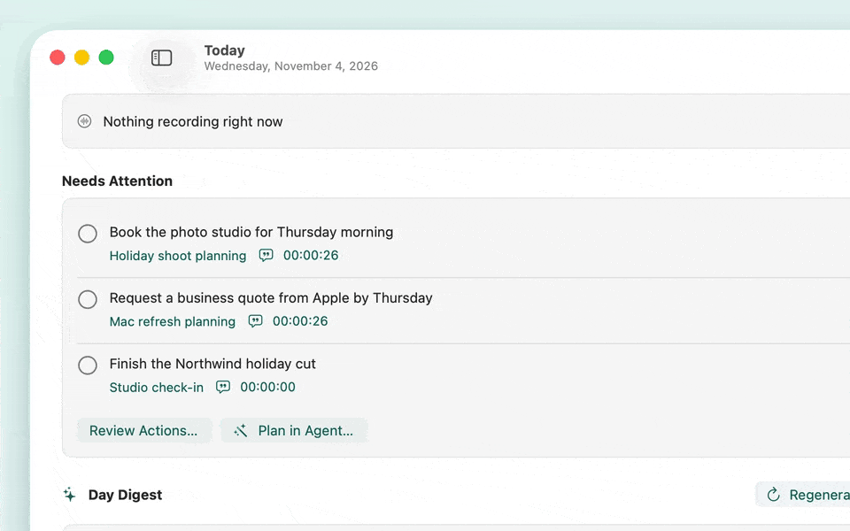</picture></td>
    <td><picture><source media="(prefers-color-scheme: dark)" srcset="Assets/readme/timeline-dark.gif" />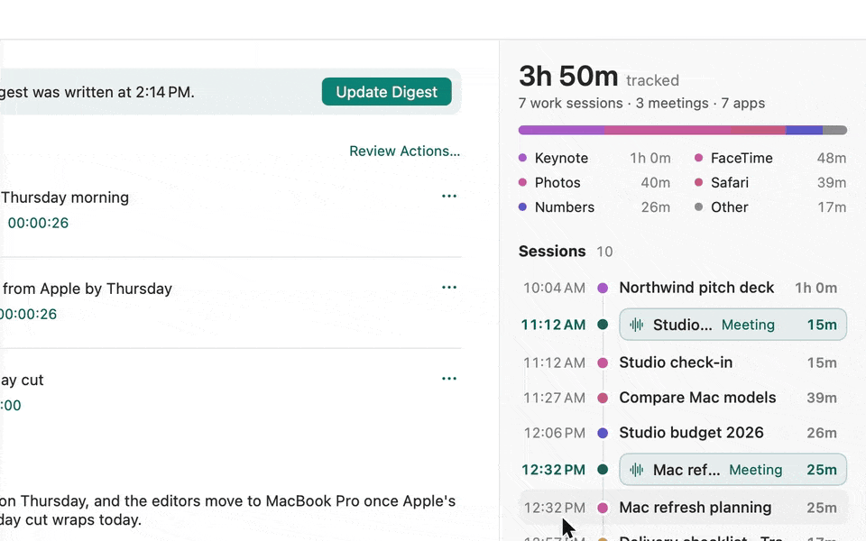</picture></td>
  </tr>
  <tr>
    <td width="50%" valign="top"><strong>和 Maya 还有什么没谈完？</strong><br />
      <b>People</b> 显示等你处理的事和你们一起做的决定。给发言人命名一次，LokalBot 之后的会议里就能认出这个声音。</td>
    <td width="50%" valign="top"><strong>我把它存哪了？</strong><br />
      <b>Files</b> 按内容搜索你选择的文件夹：文档、PDF 页面、图片，以及录音和视频中的片段。</td>
  </tr>
  <tr>
    <td><picture><source media="(prefers-color-scheme: dark)" srcset="Assets/readme/people-dark.gif" />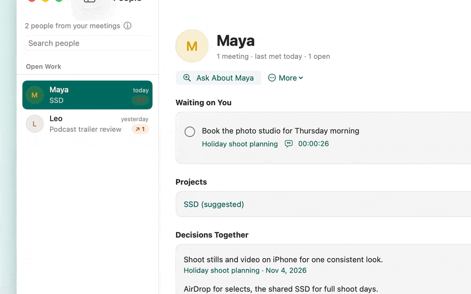</picture></td>
    <td><picture><source media="(prefers-color-scheme: dark)" srcset="Assets/readme/files-dark.gif" />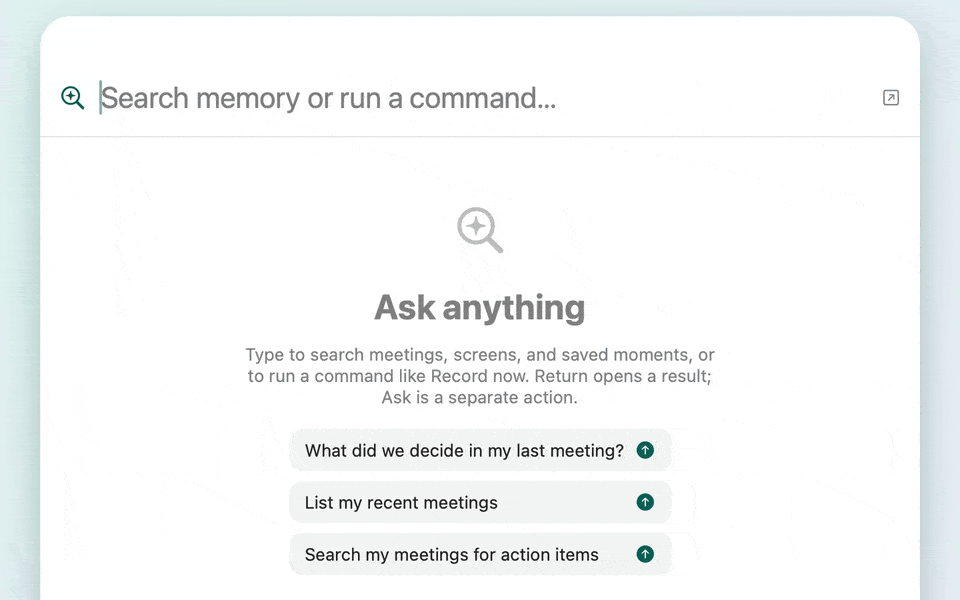</picture></td>
  </tr>
  <tr>
    <td colspan="2" align="center">
      <strong>这个项目进展到哪了？</strong><br />
      跟踪一个项目，LokalBot 会汇总提到它的会议、待办和决定。打开它可以看到一段简短的进展说明，并能链接回背后的会议。不确定该跟踪什么？它会建议你的会议里反复出现的名字。<br /><br />
      <picture><source media="(prefers-color-scheme: dark)" srcset="Assets/readme/projects-dark.gif" />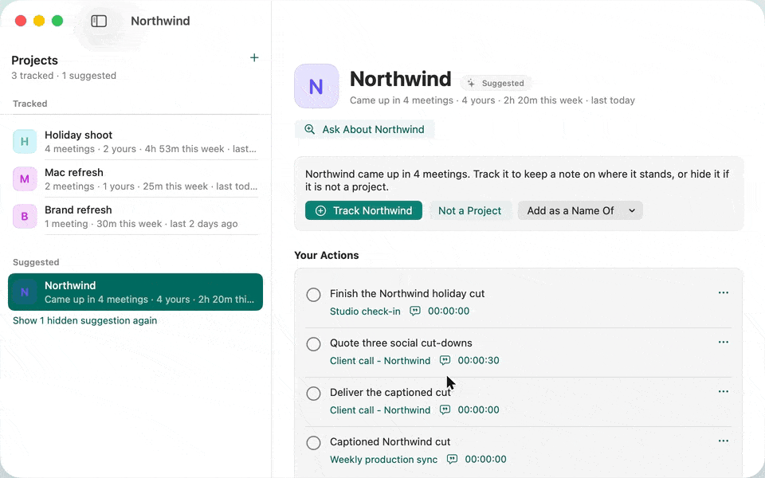</picture>
    </td>
  </tr>
</table>

### 提问，并核对出处

向你自己的工作提问。回答会引用来源，无法核实时也会说明。顺着引用可以回到原始转写或录音。生成的纪要只是起点，不能代替原本的讨论。

<div align="center"><picture><source media="(prefers-color-scheme: dark)" srcset="Assets/readme/ask-dark.gif" />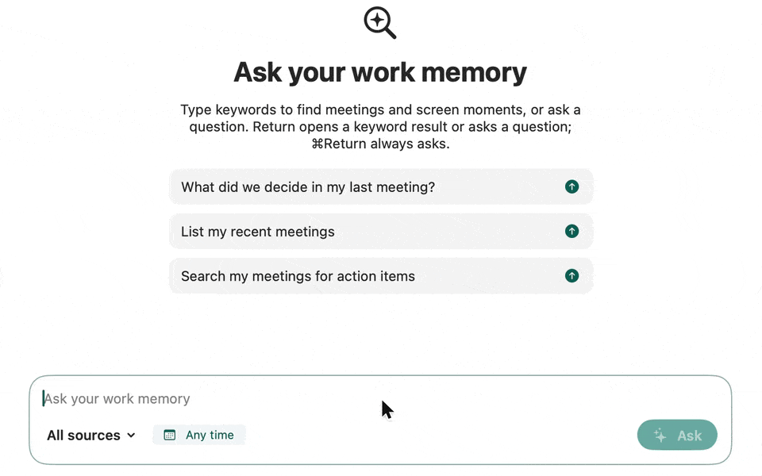</picture></div>

### 用说的代替打字

在 **Settings → Dictation** 中开启听写，然后按住 **⌥ Space**（Windows 和 Linux 上是 **Alt+Space**，也可以用你自己设置的快捷键）说话，松开后文字就会插入到任何应用的光标位置。转写在你的电脑上完成，使用的是你为会议选择的同一个转写模型，最近的听写内容也会保留，方便再次复制。在 Compose 模式下，说出你的需要，LokalBot 就会在光标处写好；如果你允许，还能用上会议里的内容。在 Wayland 上，请在桌面设置里把 `lokalbot dictate` 绑定到一个快捷键。

<div align="center"><picture><source media="(prefers-color-scheme: dark)" srcset="Assets/readme/dictation-dark.gif" />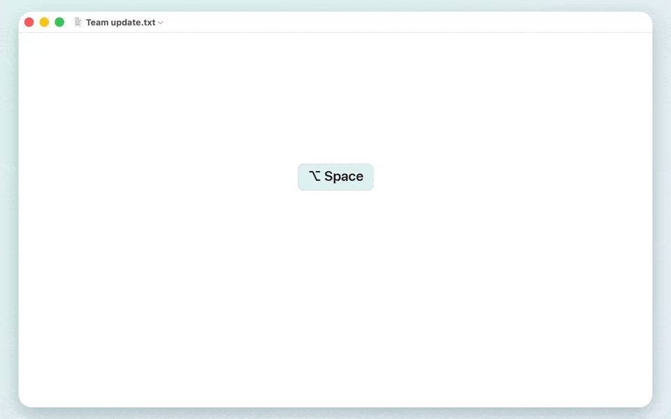</picture></div>

### 改写你选中的文字

在 **Settings → Ask**（Windows 和 Linux 上是 **Settings → General**）中开启选择文字操作，在任何应用里选中文字，然后按 **⌃⇧ W**。可以修正语法、缩短、翻译、总结，或者输入你自己的指令，然后替换选中的文字或复制结果。**Draft a reply with my memory** 还会搜索你的会议，让回复用上当时真正商定的内容，并列出它用到的会议。它使用你的 Think 模型，除非你选择并批准了某个服务器，否则内容留在你的电脑上。Windows 和 Linux 上的快捷键是 **Ctrl+Alt+Space**，因为 ⌃⇧ W 在那里会关闭标签页和窗口；在 Wayland 上，请在桌面环境的设置里把 `lokalbot selection-actions` 绑定到一个快捷键。

### 它记得你的工作方式

Personal Context（个人上下文）是一份加密的列表，保存你的事实、偏好、目标和原则。你可以对 Ask 说“记住我希望提前一天拿到议程”，在设置中添加，也可以让夜间回顾从你在会议里说的话中提取事实和偏好。Ask 会用上这些内容，让回答更贴合你的工作。

- **只学你自己的话。** 它只从你说的内容中学习，不会学其他发言人的话。读取这些内容的模型留在你的电脑上，除非你批准了某个服务器。
- **能看到出处。** 每一条学到的内容都会显示它来自哪句话。偏好以及来自你输入内容的条目，会等你决定保留还是忽略。会议里的事实和目标会直接保存。
- **可以随时关闭。** 学习默认开启，每晚最多三条。在设置里用一个开关就能停止。
- **对智能体保密。** 智能体只能读取你选择共享的条目，并且需要单独授权。

### 起草跟进内容

生成本地跟进草稿。还可以在你的 Obsidian 或 Logseq 文件夹里为每场会议保留一份笔记，并获得每日简报和每周工作日志。都由你检查后自己发送。

<sub>中文会议截图是 Mac 应用的真实截图，未经编辑。其余画面来自真实的 Mac 应用，使用英文虚构演示数据，等待时间已剪短，部分打字已加速。搜索、Today、Timeline 和 People 使用预置的资料库；纪要、Ask 回答、听写、自动补全和 Files 结果由本机模型生成。<a href="Video/lokalbot-landing-demos/README.md">制作说明（英文）</a>。</sub>

<a id="windows-and-linux"></a>

### Windows 和 Linux 版（alpha）

用 Rust 编写的原生 Windows 和 Linux 应用有相同的页面，读取相同格式的资料库，所以资料库可以在不同电脑之间迁移。加密保存的内容，例如提问历史、个人上下文、截图和记住的声纹，只能在保存它们的那台电脑上打开。会议录制、转写、提问、搜索、工作记录、屏幕上下文、听写、自动补全、选择文字操作、语音朗读摘要、文件搜索、夜间回顾、个人上下文（Personal Context）、日历、Agent Mode 以及 CLI 和 MCP 服务器都能使用。目前还是 alpha 版：Windows 版尚未代码签名，部分功能取决于你的 Linux 桌面环境（对 Wayland 的支持还不完整），会议简报中的 Gmail 尚未移植。详见[各平台功能对照（英文）](LinuxWindows/README.md#what-works-where)和[截图](LinuxWindows/docs/screenshots)。

<a id="chinese"></a>

## 中文支持

- **中文转写。** 默认的 Qwen3-ASR 1.7B 支持 30 种语言和 22 种中文方言，包括粤语、吴语、闽南语、四川话等；也可以换成专门针对中、粤、日、韩语的 SenseVoice。
- **中英混说。** 上面的演示里，App Store、TestFlight、bug、Markdown 这些夹在中文里的英文词都被正确识别。
- **中文纪要。** 纪要默认跟随转写的语言，中文会议会生成中文的要点、决策和待办，每一条都带有原话的时间戳。
- **中文听写。** 听写复用同一个转写模型，按住快捷键说中文即可输入。
- **国内会议软件。** Mac 版能识别腾讯会议、VooV Meeting、飞书、Lark、钉钉和企业微信的通话，并录下双方的声音。腾讯会议和 VooV 一接通就开始录制；飞书、Lark、钉钉和企业微信也会播放消息提示音和语音消息，所以通话声音要持续约 12 秒才开始录制（日历里有这场会议时会立即开始）。微信通话暂不自动识别。Windows 和 Linux 版在能单独录制时只录会议软件的声音，否则录制电脑播放的全部声音。
- **中文关键词搜索。** 在 Mac 版中，中文、日文和韩文关键词可以匹配一段话中的任意位置：搜“对比度”也能找到“深色模式下对比度不够”这样的句子。按含义搜索使用支持多语言的 EmbeddingGemma 2，用完整的短句或问题（比如“订阅价格要不要调”）同样可以找到中文内容。
- **在国内下载模型。** 中国大陆网络可能无法直接访问 Hugging Face。在 **设置 → 模型 → 模型下载来源** 中可以改用 HF-Mirror（hf-mirror.com）或魔搭 ModelScope（modelscope.cn）；电脑的地区设为中国大陆或语言设为简体中文时，首次设置也会显示这个选项。每个文件都会核对 LokalBot 固定的大小和 SHA-256，不一致就换下一个来源。也可以继续使用系统代理（或 TUN 模式）。

目前还有这些限制，我们会继续改进，也欢迎提 Issue 或 PR：

- **还没有在国内实测。** 国内会议软件的识别还没有在真实的腾讯会议、飞书、钉钉或企业微信通话中验证，HF-Mirror 也还没有在中国大陆网络中测试过。如果你遇到问题，欢迎告诉我们。
- **Windows 和 Linux 版** 中，中文关键词只能匹配一段话的开头。屏幕文字识别（OCR）在 Windows 上使用系统自带的识别器；在 Linux 上识别中文需要安装 Tesseract，没有它时只能识别拉丁字母。
- **发言人切换。** 中文会议里，发言人切换的地方偶尔会有一两个字被归到别的发言人名下（见上面转写截图的 00:00:35）。
- **自动补全** 主要针对英文和欧洲语言调优，中文（包括使用中文输入法时）还没有经过系统测试。

<a id="developers"></a>

## 开发者与智能体

Claude Code、Codex 或任何 MCP 客户端，都可以通过内置的 **`lokalbot-cli`** 或它的 stdio **Model Context Protocol (MCP)** 服务器搜索你的会议。可以问定了什么、某个待办归谁，或者某个话题在哪里出现过。智能体可以读取你的资料库，但不能修改。

<div align="center"><picture><source media="(prefers-color-scheme: dark)" srcset="Assets/readme/agents-dark.gif" />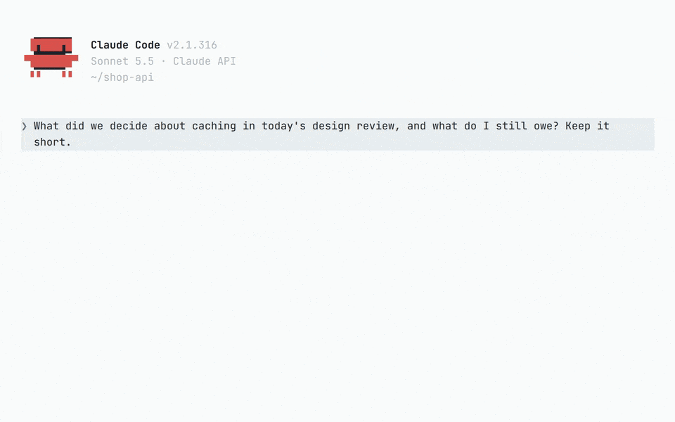</picture></div>

用一条命令连接 Claude Code，或者安装 [Claude Code 插件](Distribution/claude-plugin/README.md)：

```bash
# macOS
claude mcp add lokalbot -- /Applications/LokalBot.app/Contents/Helpers/lokalbot-cli mcp
# Windows 和 Linux，lokalbot-cli 已在 PATH 中
claude mcp add lokalbot -- lokalbot-cli mcp
```

访问默认关闭。在 Mac 上，到 **Settings → External Agents** 开启 **Allow external agents to read your LokalBot data**，并勾选智能体可以读取的内容：Meetings、Screen memory、What I shared about myself、Files 或 Agent notes。在 Windows 和 Linux 上，每一项在 **Settings → Privacy & Data** 的 External agents 下都有单独的开关：会议记录库、文件、屏幕记忆和 What I shared about myself。然后安装 CLI：Mac 上在 **Settings → External Agents → Agent CLI**，Windows 和 Linux 上在 **Settings → Advanced → Agent CLI**。

**想根据会议采取行动？** 在 Claude Code 或 Codex 中打开任意待办，提示词已经填好任务和它的出处，由你检查后发送。

也可以在任何终端或智能体中使用 CLI：

```bash
lokalbot-cli search "database decision"
lokalbot-cli get latest --include metadata,summary
lokalbot-cli search-files "lease renewal" --kind pdf   # 需开启 Files 访问
lokalbot-cli search-notes "release steps"              # 编程智能体保存的笔记（仅 Mac，需开启 Agent notes 访问）
lokalbot-cli mcp
```

在 Mac 上，没有安装到 PATH 时，可以直接使用 `/Applications/LokalBot.app/Contents/Helpers/lokalbot-cli`。在 Windows 和 Linux 上，**Settings → Advanced → Agent CLI** 同样会安装 CLI，安装位置和加入 PATH 的方法见[编程智能体（英文）](LinuxWindows/README.md#coding-agents)。各平台的命令和 MCP 工具完全相同，只有 `search-notes` 目前仅在 Mac 上提供。

屏幕记忆的 MCP 工具需要单独授权，范围可以是今天、最近七天或全部保留的历史。它们返回文字和元数据，不返回解密后的截图。`search_files` 按内容搜索你在 Files 中选择的文件夹，返回文件路径、摘录和匹配的段落；它需要开启 Files 访问，并且不会更改你的文件。在 Mac 上，在 **Settings → Screen & Activity** 开启 **Read coding agent notes** 并勾选 Agent notes 后，`search_agent_notes` 可以搜索 Claude Code 和 Codex 为自己之后的会话保存的笔记，这样一个智能体就能找到另一个智能体记下的内容。外部客户端可能会把结果发送给它们自己的模型提供商。

应用还提供可选的 **Agent Mode**，用来处理经过你审阅的上下文。文件和命令操作遵循它的审批设置，与只读的 CLI/MCP 接口相互独立。

[CLI 示例](.agents/skills/lokalbot-cli/SKILL.md) · [Claude Code 插件](Distribution/claude-plugin/README.md) · [MCP 架构](DEVELOPMENT.md#agent-cli--mcp)

## 和同类工具相比

| 如果你在用… | LokalBot 的不同之处 |
| --- | --- |
| Otter、Granola、飞书妙记、通义听悟等云端服务 | 录音、转写和纪要默认都在本机完成，不上传音频，没有分钟数限制，也不需要账号。 |
| Screenpipe、Rewind | 默认只记录应用和窗口活动；屏幕文字和截图需要单独开启，默认 14 天后删除。采用 GPLv3 开源协议。Rewind 的 Mac 应用已经停止服务。 |
| MacWhisper、Superwhisper、Wispr Flow | 除了听写，还有会议纪要、工作回顾和自动补全，全部免费，不需要账号，也不限字数。如果只是转写已有的音频文件，MacWhisper 更合适。 |

<sub>完整的对比和来源见英文版 <a href="README.md#how-it-compares">How it compares</a>。商标归各自所有者所有。</sub>

<a id="privacy"></a>

## 隐私

**你的工作是私人的，本地处理理应是默认选项。**

录音和内置的 AI 处理都在你的电脑上完成。LokalBot 没有账号系统、没有统计分析服务，也没有遥测后端。你的资料以本地文件和 SQLite 的形式保存在你的用户目录下。

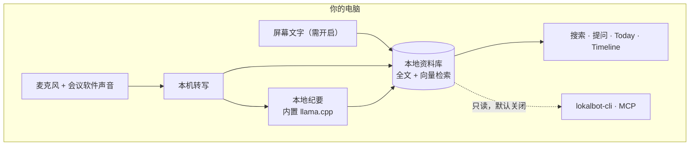

- **你决定保留什么。** 默认只记录活动。屏幕上的文字和加密截图需要单独开启。随时可以暂停采集，或者排除特定的应用和网站。检测并不完美，凡是你绝不想保留的内容，请直接排除。
- **你决定保留多久。** 屏幕文字和截图默认 14 天后过期。你可以调整时长，也可以手动保存某个时刻，它会一直保留到你取消保存或删除为止。
- **网络访问有明确的边界。** 下载模型、检查更新和可选的智能体运行环境需要联网；自动检查更新可以关闭。远程模型服务器只有在你批准它的地址之后才会收到内容；可选的 Agent Mode 和外部 CLI/MCP 客户端各有独立的权限和数据处理方式。
- **只有配对后，手机才会收到副本。** **Settings → Phones & tablets** 默认关闭。开启后，Mac 会通过本地网络或 Tailscale，把你选择的数据以端到端加密的方式发送给已配对的手机和平板，中间没有 LokalBot 服务器。截图、屏幕文字、参会者邮箱和声纹不会共享。已配对的手机也可以录制会议并以同样的方式发送；由 Mac 处理，之后手机会删除自己的副本。

想自己验证本地处理路径：下载模型，选择内置后端，关闭自动检查更新，然后在录音、转写和生成纪要时观察网络流量。经你批准的智能体命令和外部客户端是另外的路径。

[完整隐私政策（英文）](PRIVACY.md) · [私下报告安全问题](SECURITY.md)

<a id="get-started"></a>

## 快速开始

LokalBot 支持 macOS 15 或更新版本的 Apple Silicon Mac；Windows 和 Linux 版目前是 alpha 版。你还需要足够存放所选模型的空间：**Settings → Models** 会显示下载大小和就绪状态，所需的存储和内存取决于你选择的模型。

| | macOS | Windows（alpha） | Linux（alpha） |
| --- | --- | --- | --- |
| 系统要求 | Apple Silicon（M1 或更新），macOS 15 及以上 | Windows 10 或 11，x64 | x86_64，glibc 2.39 或更新（Ubuntu 24.04、Debian 13、Fedora 40 或更新），PulseAudio 或 PipeWire，以及 Vulkan 或 OpenGL 驱动 |
| 安装 | [`LokalBot-<version>-macos-arm64.dmg`](https://github.com/stevyhacker/lokalbot/releases/latest)：把 LokalBot 拖进“应用程序”文件夹；或者运行 `brew install --cask stevyhacker/tap/lokalbot`。 | [`LokalBot-<version>-windows-x86_64-setup.exe`](https://github.com/stevyhacker/lokalbot/releases/latest)：运行它即可为当前用户安装 LokalBot，会添加开始菜单快捷方式，不需要管理员权限。它还没有代码签名，SmartScreen 会先询问：选择**更多信息 → 仍要运行**。同一版本中也有免安装的 zip。 | [`LokalBot-<version>-linux-x86_64.tar.gz`](https://github.com/stevyhacker/lokalbot/releases/latest)：解压后运行 `./install.sh`，它会把 LokalBot 添加到应用程序菜单。也可以安装同一版本中的 `.deb`（Debian、Ubuntu）、`.rpm`（Fedora、openSUSE）或 Arch 软件包。`.deb` 和 Fedora 上的 `.rpm` 会添加 LokalBot 软件源，之后运行 `sudo apt upgrade` 或 `sudo dnf upgrade` 即可获得新版本；用 Arch 软件包安装时，有新版本会提示你，但不会自动安装。 |
| 资料库位置 | `~/Library/Application Support/me.dotenv.LokalBot` | `%LOCALAPPDATA%\LokalBot` | `~/.local/share/LokalBot` |

在一个平台上录制的资料库可以在其他平台上打开。并非所有 Mac 功能都已移植到 Windows 和 Linux，详见[各平台功能对照（英文）](LinuxWindows/README.md#what-works-where)。

1. **安装应用。** 安装对应平台的版本，然后打开它。
2. **选择要采集的内容。** 检查录制设置：自动检测、先询问，还是手动录制。工作记录默认只记活动；保存屏幕文字或截图是单独的选项。只为你要用的功能授予权限。
3. **等待模型下载。** 下载完成后，内置的转写、搜索、纪要和写作功能都可以离线使用，不需要配置模型服务器，也不需要 API Key。如果在中国大陆下载缓慢或失败，请先开启系统代理。

**建议先试试：** 录一段简短的测试录音，等它转写完成，然后搜索你提到过的内容，打开对应的段落。熟悉之后再开启屏幕记忆或写作工具。

录音前请告知会议参与者，并征得他们的同意。

[版本说明](https://github.com/stevyhacker/lokalbot/releases) · [安装帮助（英文）](SUPPORT.md) · [Homebrew 选项（英文）](Distribution/homebrew/README.md) · [Windows 与 Linux 指南（英文）](LinuxWindows/README.md)

## 常见问题

<details>
<summary><strong>会有机器人加入我的会议吗？</strong></summary>

不会。LokalBot 在你的电脑上录制你的麦克风和会议软件的声音；Windows 和 Linux 版在能单独录制时只录会议软件的声音，否则录制电脑播放的全部声音。音频来源和具体的发言人识别是两回事。无法捕获系统声音时，应用会提示这次只录了麦克风。录音请务必征得参与者的同意。

</details>

<details>
<summary><strong>它会录下我屏幕上的所有内容吗？</strong></summary>

不会。新安装默认只记录活动，而且可以关闭。保存屏幕文字或截图需要你单独选择，并授予相应的 macOS 权限（Linux 上需要桌面环境支持辅助功能和截图）。被排除的应用和网站、密码等安全输入框会被跳过；浏览器的无痕窗口仍会被采集，除非你排除了该浏览器或网站。检测到的凭据会被遮盖，相关像素会被丢弃，但检测并不完美。详见 [PRIVACY.md](PRIVACY.md)。

</details>

<details>
<summary><strong>我的笔记可以导出到别处吗？</strong></summary>

可以。开启 **Meeting note export**，就会在你选择的文件夹（比如 Obsidian 仓库或 Logseq 图谱）里为每场会议保留一份 Markdown 笔记，包括摘要、待办、相关的人和项目，以及转写。你也可以导出单场会议、写入每日记忆笔记，或者让本地例程保存草稿。这些都是普通的未加密文件；如果用其他服务同步它们，请留意对方的隐私设置。详见 [Meeting transcripts in Obsidian（英文）](https://www.lokalbot.com/meeting-transcripts-obsidian-markdown)。

</details>

<details>
<summary><strong>能在 Windows 或 Linux 上使用吗？</strong></summary>

可以，目前是 alpha 版。Windows 和 Linux 版是用 Rust 编写的原生应用，页面相同，纪要和搜索使用相同的模型，资料库格式也相同，所以资料库可以在不同电脑之间迁移。加密保存的内容，例如提问历史、个人上下文、截图和记住的声纹，只能在保存它们的那台电脑上打开。会议简报中的 Gmail 目前只有 Mac 版支持；在 Wayland 上，部分功能取决于你的桌面环境。详见[各平台功能对照（英文）](LinuxWindows/README.md#what-works-where)。

</details>

<a id="models"></a>

## 本地 AI，由你选择

先用内置模型，之后可以在 **Settings → Models** 中更换。LokalBot 支持内置的 llama.cpp 运行时、Ollama、OpenAI 兼容服务器，以及 macOS 26 及以上受支持 Mac 上的 Apple Intelligence。Think 角色也可以使用你自己的 ChatGPT 套餐（Sign in with ChatGPT）或 Claude 套餐（通过已登录的 Claude Code），不需要 API Key；Agent Mode 也可以使用 ChatGPT 套餐。远程服务器和套餐在收到任何内容之前都需要你批准。

不同的任务使用不同的模型。下面是 Mac 上全新安装时的默认模型，全部角色加起来约 9.6 GB 模型文件，这不是内存要求：

| 角色 | 默认模型 | 格式 | 模型文件约 |
| --- | --- | --- | ---: |
| 转写 | Qwen3-ASR 1.7B | MLX 8-bit | 2.47 GB |
| 纪要与对话 | Qwen3.5 4B | `Q4_K_M` | 2.74 GB |
| 自动补全 | Gemma 4 E2B Base | `Q6_K` | 3.85 GB |
| 语义搜索 | EmbeddingGemma 2 | `Q8_0` | 0.31 GB |
| 发言人分离 | Nemotron 3（预览），通过 FluidAudio | Core ML | ~0.20 GB |

表中不包括辅助模型，它们会在功能第一次需要时下载：使用 Qwen3-ASR 时，发言人分离会另外下载一个约 1 GB 的逐词对齐模型；开启文件搜索（Files）会另外下载一个 555 MB 的图像和音频投影器。

Qwen3-ASR 支持 52 种语言和方言。转写的其他选择包括 Parakeet、Granite Speech、Whisper large-v3 turbo、用于中日韩语的 SenseVoice，以及用于俄语的 GigaAM；发言人分离也可以继续使用 Pyannote Community-1。轻量预设会换用更小的模型，比如自动补全使用 LFM2.5 1.2B Instruct（0.73 GB）。不同版本的模型选择可能变化，以 Settings 中显示的为准。速度和内存占用取决于你的电脑、模型、上下文长度和其他负载。

在 Windows 和 Linux 上，转写默认通过 sherpa-onnx 使用 Qwen3-ASR 0.6B（可选 Parakeet v3 和 v2、SenseVoice、俄语的 GigaAM 和 Whisper turbo），发言人分离使用 pyannote 分割和 TitaNet，自动补全默认使用 LFM2.5 1.2B。纪要（Qwen3.5 4B）和搜索（EmbeddingGemma 2）使用和 Mac 相同的模型。默认下载约 4 GB，llama.cpp 运行在 Vulkan GPU 或 CPU 上。

[项目基准测试](Benchmarks/README.md) · [模型目录](LokalBot/Engines/ModelCatalog.swift) · [搜索实现](LokalBot/Services/EmbeddingIndex.swift) · [模型与运行时细节](DEVELOPMENT.md#built-in-llm-runtime--llamacpp--model-catalog)

## 从源码构建

构建 Mac 应用，你需要一台安装了完整 Xcode 的 Apple Silicon Mac；[构建流程](.github/workflows/build.yml) 固定了 CI 使用的工具链。在已安装 Homebrew 的情况下：

```bash
brew install xcodegen cmake
# 手机和平板同步库用 Rust 构建（https://rustup.rs）；仓库固定了工具链，rustup 会在首次使用时安装。
curl --proto '=https' --tlsv1.2 -sSf https://sh.rustup.rs | sh -s -- -y --default-toolchain none

git clone https://github.com/stevyhacker/lokalbot.git
cd lokalbot

# 首次构建获取运行时之前，XcodeGen 需要这些路径存在。
mkdir -p Vendor/llama-cpp Vendor/sherpa-onnx
# 把手机和平板同步库（Rust）构建为本地 Swift 包。
Scripts/build-sync-xcframework.sh
xcodegen generate
open LokalBot.xcodeproj
```

选择 **LokalBot Dev**，设置你的签名团队，然后运行。Dev 版本有独立的身份、macOS 权限、资料库、模型存储和钥匙串命名空间，可以和已安装的正式版并存，开发时的保留设置也不会影响正式版的数据。首次构建会准备固定版本的原生运行时；模型另外下载。

构建 Windows 和 Linux 应用，请参阅其 README 中的[从源码构建（英文）](LinuxWindows/README.md#build-from-source)（Rust）。

[构建与测试命令](DEVELOPMENT.md#build-workflows) · [测试指南](DEVELOPMENT.md#testing) · [截图指南](Docs/screenshot-kit.md)

## 参与贡献

欢迎提交 Bug 报告、改进文档和贡献代码，用中文提 Issue 也可以。[提交 Issue](https://github.com/stevyhacker/lokalbot/issues/new/choose) 时，请写明复现步骤、预期和实际行为、应用版本、操作系统及其版本（Linux 还请注明发行版、桌面环境以及 X11 或 Wayland）、芯片或 CPU 和 GPU、内存，以及所选的模型。请不要在报告里附上私人录音或转写。

较大的改动请先[开一个 Issue](https://github.com/stevyhacker/lokalbot/issues) 讨论思路。请遵循[协作约定](AGENTS.md)和[开发指南](DEVELOPMENT.md)，保持 PR 聚焦，并按照 [PR 模板](.github/PULL_REQUEST_TEMPLATE.md) 记录你做过的检查。UI 改动请附上截图；UI 测试请在托管 CI 或远程运行器上运行。

## 许可与致谢

LokalBot 是基于 [GPLv3](LICENSE) 协议的自由软件。自动补全引擎中移植自 [Cotabby](https://github.com/FuJacob/cotabby) 的代码仍采用 [AGPLv3](LICENSES/AGPL-3.0.txt) 协议。其他第三方组件和模型保留各自的许可证，详见[第三方声明](THIRD_PARTY_NOTICES.md)。

基于 [llama.cpp](https://github.com/ggml-org/llama.cpp)、[MLX Swift](https://github.com/ml-explore/mlx-swift)、[speech-swift](https://github.com/soniqo/speech-swift)、[sherpa-onnx](https://github.com/k2-fsa/sherpa-onnx)、[WhisperKit](https://github.com/argmaxinc/WhisperKit)、[FluidAudio](https://github.com/FluidInference/FluidAudio)、[Sparkle](https://github.com/sparkle-project/Sparkle)、[XcodeGen](https://github.com/yonaskolb/XcodeGen)、[GPUI](https://github.com/zed-industries/zed/tree/main/crates/gpui)、[GPUI Kit](https://github.com/longbridge/gpui-kit) 和 [ONNX Runtime](https://github.com/microsoft/onnxruntime) 构建，使用的模型包括 [Qwen3-ASR](https://huggingface.co/Qwen)、[IBM Granite Speech](https://huggingface.co/ibm-granite)、[Parakeet](https://huggingface.co/nvidia) 和 [LFM2.5](https://huggingface.co/LiquidAI)。自动补全引擎最初基于 [Cotabby](https://cotabby.app) 的开源代码。

<sub>本文译自英文版 README（2026 年 11 月 10 日），如有出入，以英文版为准。</sub>
