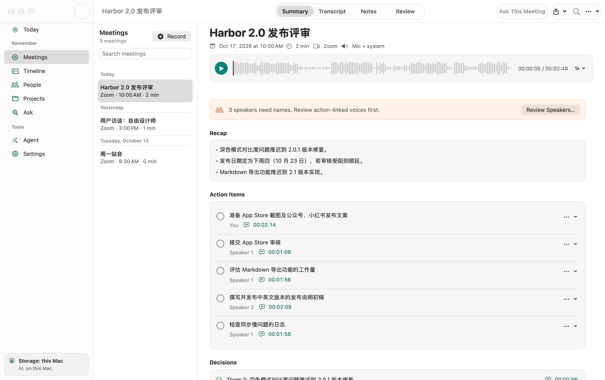
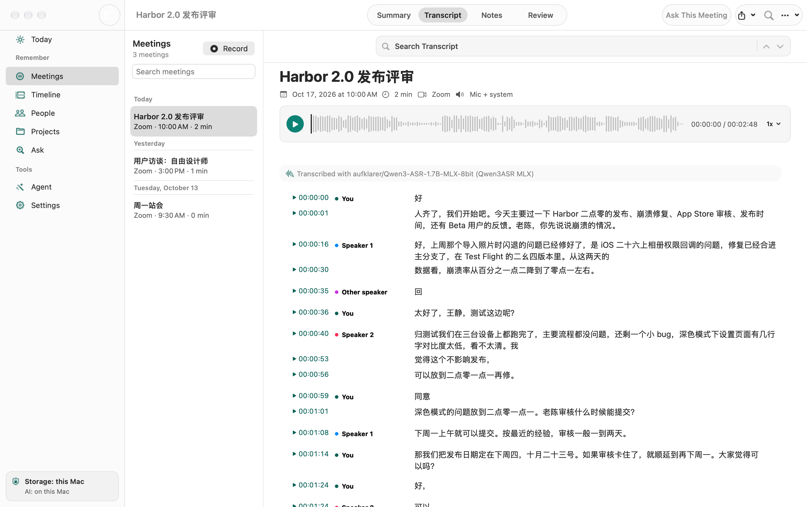
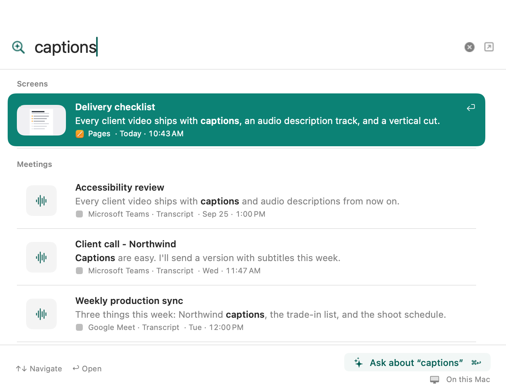
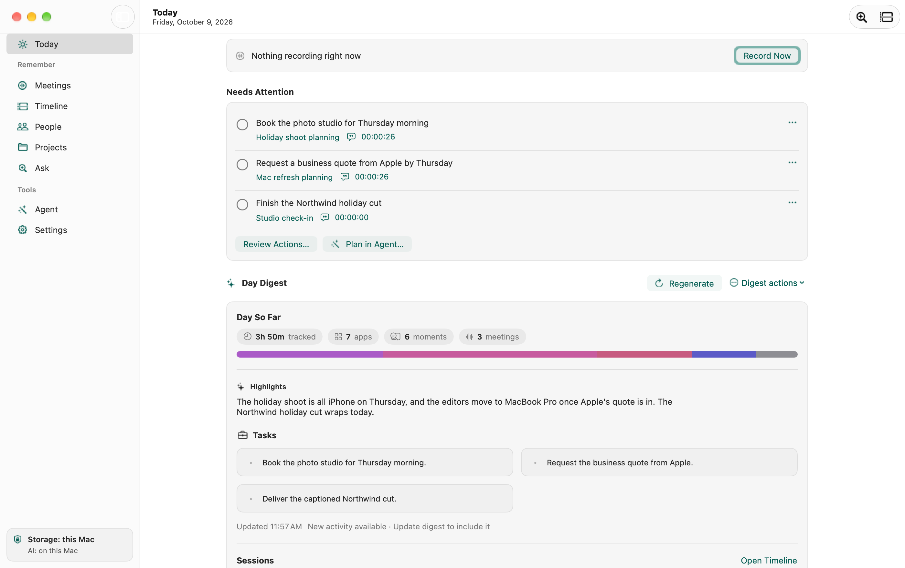
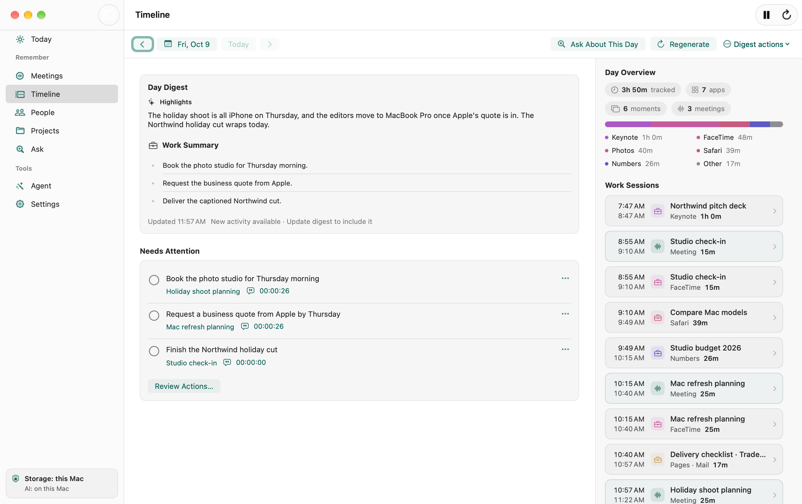
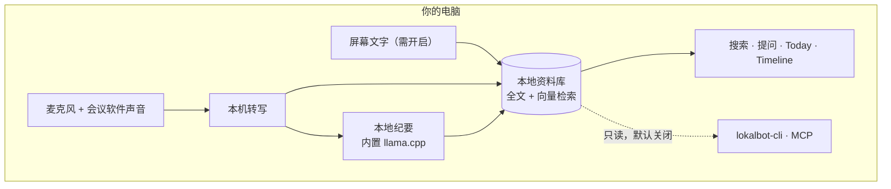

<div align="center">


# LokalBot

**你的个人上下文引擎。**

私密的会议纪要、工作回顾、语音输入和自动补全，AI 全部在你的电脑上运行。<br />
免费开源，无需注册账号，不会有机器人加入你的会议。

[](https://github.com/stevyhacker/lokalbot/releases/latest)
[](https://github.com/stevyhacker/lokalbot/releases/latest)
[](https://github.com/stevyhacker/lokalbot/releases/latest)

<sub>Apple Silicon（M1 或更新）+ macOS 15 及以上 · Windows 10/11 x64（alpha）· Linux x86_64（alpha）· Mac 上也可以用 <code>brew install --cask stevyhacker/tap/lokalbot</code></sub>

[](https://github.com/stevyhacker/lokalbot/releases/latest)
[](https://github.com/stevyhacker/lokalbot/releases)
[](LICENSE)
[](#developers)

[English](README.md) · **简体中文**

[功能](#features) · [Windows 与 Linux](#windows-and-linux) · [中文支持](#chinese) · [隐私](#privacy) · [快速开始](#get-started) · [模型](#models) · [开发者与智能体](#developers) · [官网](https://www.lokalbot.com/)

<a href="Assets/screenshots/zh-Hans/meetings-summary.png"></a>

<sub>真实应用截图。演示会议是虚构的普通话会议，语音由 TTS 合成；转写和纪要由本机上的 Qwen3-ASR 和 Qwen3.5 4B 实际生成，未做修改（<a href="Assets/screenshots/zh-Hans/README.md">制作说明</a>）。</sub>

</div>

https://github.com/user-attachments/assets/d9cf34ff-6367-4964-830a-5c7ee1343555

<div align="center"><sub>45 秒演示（英文旁白）：LokalBot 为什么要记住你听到和看到的内容、由哪些本地模型完成，以及真实应用的使用过程。演示数据为虚构内容。</sub></div>

<a id="features"></a>

## 功能

### 记住会上定下的事

不需要机器人进会，直接录制麦克风和会议软件的声音。转写、要点回顾、决策和待办都在本机生成，每一条都能跳回讨论的原话。

<div align="center"><a href="Assets/screenshots/zh-Hans/meetings-transcript.png"></a></div>

<div align="center"><sub>同一场会议的转写，由 Qwen3-ASR 1.7B 在本机完成，中英混说也能识别。发言人还没有命名，所以显示为 Speaker 1、Speaker 2。</sub></div>

### 找到你看过的东西

一次搜索覆盖会议转写，以及（开启后）你在屏幕上看到过的文字。可以按关键词或按含义搜索，然后直接打开对应的段落或屏幕画面，不用在各个应用之间来回翻找。

<div align="center"><a href="Assets/screenshots/quick-recall.png"></a></div>

### 帮你把句子写完

在其他应用里打字时，灰色文字会提示这句话可以怎么结尾。按 **Tab** 接受下一个词，在 Mac 上按 **\`** 接受剩下的全部，或者继续打字忽略它。

<div align="center"></div>

<div align="center"><sub>在 TextEdit 中实时录制的补全效果。发布日期和条件来自与 John 的会议。演示会议为虚构内容。</sub></div>

- **知道你在回复什么。** 它会读取输入框上方的消息或页面，让回复贴合上下文。
- **记得你的会议（需要你允许）。** 开启会议和工作记忆后，它能用上会上定下的事，比如上面的发布日期。
- **用你的语言写。** 在 Mac 上，同一个小模型可以用德语、法语、意大利语、西班牙语等语言补全。
- **留在你的电脑上。** 小模型在应用内运行：Mac 上是 Gemma 4 E2B，Windows 和 Linux 上是 LFM2.5 1.2B。你输入的内容和它读取的上下文都不会离开你的电脑。

在 **Settings → Writing** 中开启。可以先在示例对话里试用，之后还能看到它帮你写了多少字。

### 接着上次的进度

**Today** 汇总你的每日回顾和会议里还没完成的待办。**Timeline** 把采集到的活动按工作时段分组，背后的上下文都可以查看。待办可以修改、标记完成，并追溯到出处。

<table>
  <tr>
    <td width="50%"><a href="Assets/screenshots/today.png"></a></td>
    <td width="50%"><a href="Assets/screenshots/timeline.png"></a></td>
  </tr>
  <tr>
    <td align="center"><sub><b>Today</b>：每日回顾和未完成的待办</sub></td>
    <td align="center"><sub><b>Timeline</b>：工作时段及其上下文</sub></td>
  </tr>
</table>

### 用说的代替打字

在 **Settings → Dictation** 中开启听写，然后按住 **⌥ Space**（Windows 和 Linux 上是 **Alt+Space**，也可以用你自己设置的快捷键）说话，松开后文字就会插入到任何应用的光标位置。转写在你的电脑上完成，使用的是你为会议选择的同一个转写模型。在 Wayland 上，请在桌面设置里把 `lokalbot dictate` 绑定到一个快捷键。

### 更多

| 提问，并核对出处 | 跟进落实 | 接入你自己的智能体 |
| --- | --- | --- |
| 向会议记录库提问，顺着回答里的引用回到原始转写或录音。生成的纪要只是起点，不能代替原本的讨论。 | 生成本地跟进草稿。在 Mac 上，还可以导出纪要，并在你选择的文件夹里生成每日简报和每周工作日志。都由你检查后自己发送。 | 通过内置的 `lokalbot-cli`，让 Claude Code 或任何 MCP 客户端只读访问你的会议记录库。默认关闭，需要你手动开启。 |

<sub>截图都是 Mac 应用的真实截图，未经编辑。除中文会议截图外，其余截图和动图使用英文虚构演示数据。</sub>

<a id="windows-and-linux"></a>

### Windows 和 Linux 版（alpha）

用 Rust 编写的原生 Windows 和 Linux 应用有相同的页面，读取相同格式的资料库，所以资料库可以在不同电脑之间迁移。会议录制、转写、提问、搜索、工作记录、屏幕上下文、听写、自动补全、日历、Agent Mode 以及 CLI 和 MCP 服务器都能使用。目前还是 alpha 版：Windows 版尚未代码签名，部分功能取决于你的 Linux 桌面环境（对 Wayland 的支持还不完整），还有少数 Mac 功能没有移植。详见[各平台功能对照（英文）](LinuxWindows/README.md#what-works-where)和[截图](LinuxWindows/docs/screenshots)。

<a id="chinese"></a>

## 中文支持

- **中文转写。** 默认的 Qwen3-ASR 1.7B 支持 30 种语言和 22 种中文方言，包括粤语、吴语、闽南语、四川话等；也可以换成专门针对中、粤、日、韩语的 SenseVoice。
- **中英混说。** 上面的演示里，App Store、TestFlight、bug、Markdown 这些夹在中文里的英文词都被正确识别。
- **中文纪要。** 纪要默认跟随转写的语言，中文会议会生成中文的要点、决策和待办，每一条都带有原话的时间戳。
- **中文听写。** 听写复用同一个转写模型，按住快捷键说中文即可输入。
- **国内会议软件。** Mac 版能识别腾讯会议、VooV Meeting、飞书、Lark、钉钉和企业微信的通话，并录下双方的声音。腾讯会议和 VooV 一接通就开始录制；飞书、Lark、钉钉和企业微信也会播放消息提示音和语音消息，所以通话声音要持续约 12 秒才开始录制（日历里有这场会议时会立即开始）。微信通话暂不自动识别。Windows 和 Linux 版录制的是电脑播放的全部声音，不依赖具体的会议软件。
- **中文关键词搜索。** 在 Mac 版中，中文、日文和韩文关键词可以匹配一段话中的任意位置：搜“对比度”也能找到“深色模式下对比度不够”这样的句子。按含义搜索使用支持多语言的 EmbeddingGemma 2，用完整的短句或问题（比如“订阅价格要不要调”）同样可以找到中文内容。
- **在国内下载模型。** 中国大陆网络可能无法直接访问 Hugging Face。在 Mac 版的 **设置 → 模型 → 模型下载来源** 中可以改用 HF-Mirror（hf-mirror.com）或魔搭 ModelScope（modelscope.cn）；Mac 的地区设为中国大陆或语言设为简体中文时，首次设置也会显示这个选项。每个文件都会核对 LokalBot 固定的大小和 SHA-256，不一致就换下一个来源。也可以继续使用系统代理（或 TUN 模式）。

目前还有这些限制，我们会继续改进，也欢迎提 Issue 或 PR：

- **还没有在国内实测。** 国内会议软件的识别还没有在真实的腾讯会议、飞书、钉钉或企业微信通话中验证，HF-Mirror 也还没有在中国大陆网络中测试过。如果你遇到问题，欢迎告诉我们。
- **Windows 和 Linux 版** 暂时没有镜像下载，请用 `HTTPS_PROXY` 等环境变量设置代理来下载模型；中文关键词也只能匹配一段话的开头。屏幕文字识别（OCR）目前只识别拉丁字母，中文屏幕内容要靠应用提供的无障碍文本。
- **发言人切换。** 中文会议里，发言人切换的地方偶尔会有一两个字被归到别的发言人名下（见上面转写截图的 00:00:35）。
- **自动补全** 主要针对英文和欧洲语言调优，中文（包括使用中文输入法时）还没有经过系统测试。

## 和同类工具相比

| 如果你在用… | LokalBot 的不同之处 |
| --- | --- |
| Otter、Granola、飞书妙记、通义听悟等云端服务 | 录音、转写和纪要默认都在本机完成，不上传音频，没有分钟数限制，也不需要账号。 |
| Screenpipe、Rewind | 默认只记录应用和窗口活动；屏幕文字和截图需要单独开启，默认 14 天后删除。采用 GPLv3 开源协议。Rewind 的 Mac 应用已经停止服务。 |
| MacWhisper、Superwhisper、Wispr Flow | 除了听写，还有会议纪要、工作回顾和自动补全，全部免费，不需要账号，也不限字数。如果只是转写已有的音频文件，MacWhisper 更合适。 |

<sub>完整的对比和来源见英文版 <a href="README.md#how-it-compares">How it compares</a>。商标归各自所有者所有。</sub>

<a id="privacy"></a>

## 隐私

**你的工作是私人的，本地处理理应是默认选项。**

录音和内置的 AI 处理都在你的电脑上完成。LokalBot 没有账号系统、没有统计分析服务，也没有遥测后端。你的资料以本地文件和 SQLite 的形式保存在你的用户目录下。



- **你决定保留什么。** 默认只记录活动。屏幕上的文字和加密截图需要单独开启。随时可以暂停采集，或者排除特定的应用和网站。检测并不完美，凡是你绝不想保留的内容，请直接排除。
- **你决定保留多久。** 屏幕文字和截图默认 14 天后过期。你可以调整时长，也可以手动保存某个时刻，它会一直保留到你取消保存或删除为止。
- **网络访问有明确的边界。** 下载模型、检查更新和可选的智能体运行环境需要联网；自动检查更新可以关闭。远程模型服务器只有在你批准它的地址之后才会收到内容；可选的 Agent Mode 和外部 CLI/MCP 客户端各有独立的权限和数据处理方式。

想自己验证本地处理路径：下载模型，选择内置后端，关闭自动检查更新，然后在录音、转写和生成纪要时观察网络流量。经你批准的智能体命令和外部客户端是另外的路径。

[完整隐私政策（英文）](PRIVACY.md) · [私下报告安全问题](SECURITY.md)

<a id="get-started"></a>

## 快速开始

LokalBot 支持 macOS 15 或更新版本的 Apple Silicon Mac；Windows 和 Linux 版目前是 alpha 版。你还需要足够存放所选模型的空间：**Settings → Models** 会显示下载大小和就绪状态，所需的存储和内存取决于你选择的模型。

| | macOS | Windows（alpha） | Linux（alpha） |
| --- | --- | --- | --- |
| 系统要求 | Apple Silicon（M1 或更新），macOS 15 及以上 | Windows 10 或 11，x64 | x86_64，glibc 2.39 或更新（Ubuntu 24.04、Debian 13、Fedora 40 或更新），PulseAudio 或 PipeWire，以及 Vulkan 或 OpenGL 驱动 |
| 安装 | [`LokalBot-<version>-macos-arm64.dmg`](https://github.com/stevyhacker/lokalbot/releases/latest)：把 LokalBot 拖进“应用程序”文件夹；或者运行 `brew install --cask stevyhacker/tap/lokalbot`。 | [`LokalBot-<version>-windows-x86_64-setup.exe`](https://github.com/stevyhacker/lokalbot/releases/latest)：运行它即可为当前用户安装 LokalBot，会添加开始菜单快捷方式，不需要管理员权限。它还没有代码签名，SmartScreen 会先询问：选择**更多信息 → 仍要运行**。同一版本中也有免安装的 zip。 | [`LokalBot-<version>-linux-x86_64.tar.gz`](https://github.com/stevyhacker/lokalbot/releases/latest)：解压后运行 `./install.sh`，它会把 LokalBot 添加到应用程序菜单。也可以安装同一版本中的 `.deb`（Debian、Ubuntu）、`.rpm`（Fedora、openSUSE）或 Arch 软件包。`.deb` 和 Fedora 上的 `.rpm` 会添加 LokalBot 软件源，之后运行 `sudo apt upgrade` 或 `sudo dnf upgrade` 即可获得新版本；用 Arch 软件包安装时，有新版本会提示你，但不会自动安装。 |
| 资料库位置 | `~/Library/Application Support/me.dotenv.LokalBot` | `%LOCALAPPDATA%\LokalBot` | `~/.local/share/LokalBot` |

在一个平台上录制的资料库可以在其他平台上打开。并非所有 Mac 功能都已移植到 Windows 和 Linux，详见[各平台功能对照（英文）](LinuxWindows/README.md#what-works-where)。

1. **安装应用。** 安装对应平台的版本，然后打开它。
2. **选择要采集的内容。** 检查录制设置：自动检测、先询问，还是手动录制。工作记录默认只记活动；保存屏幕文字或截图是单独的选项。只为你要用的功能授予权限。
3. **等待模型下载。** 下载完成后，内置的转写、搜索、纪要和写作功能都可以离线使用，不需要配置模型服务器，也不需要 API Key。如果在中国大陆下载缓慢或失败，请先开启系统代理。

**建议先试试：** 录一段简短的测试录音，等它转写完成，然后搜索你提到过的内容，打开对应的段落。熟悉之后再开启屏幕记忆或写作工具。

录音前请告知会议参与者，并征得他们的同意。

[版本说明](https://github.com/stevyhacker/lokalbot/releases) · [安装帮助（英文）](SUPPORT.md) · [Homebrew 选项（英文）](Distribution/homebrew/README.md) · [Windows 与 Linux 指南（英文）](LinuxWindows/README.md)

## 常见问题

<details>
<summary><strong>会有机器人加入我的会议吗？</strong></summary>

不会。LokalBot 在你的电脑上录制你的麦克风和会议软件的声音；Windows 和 Linux 版录制的是电脑播放的全部声音，而不只是某一个应用。音频来源和具体的发言人识别是两回事。无法捕获系统声音时，应用会提示这次只录了麦克风。录音请务必征得参与者的同意。

</details>

<details>
<summary><strong>它会录下我屏幕上的所有内容吗？</strong></summary>

不会。新安装默认只记录活动，而且可以关闭。保存屏幕文字或截图需要你单独选择，并授予相应的 macOS 权限（Linux 上需要桌面环境支持辅助功能和截图）。被排除的应用和网站、密码等安全输入框会被跳过；浏览器的无痕窗口仍会被采集，除非你排除了该浏览器或网站。检测到的凭据会被遮盖，相关像素会被丢弃，但检测并不完美。详见 [PRIVACY.md](PRIVACY.md)。

</details>

<details>
<summary><strong>我的笔记可以导出到别处吗？</strong></summary>

可以。在 Mac 上，你可以导出会议内容，或者开启 Markdown、Obsidian、Logseq 记忆导出。本地例程也可以把草稿保存到你选择的文件夹。这些 Markdown 文件是普通的未加密文件；如果用其他服务同步它们，请留意对方的隐私设置。Windows 和 Linux 版暂时还不支持导出。

</details>

<details>
<summary><strong>能在 Windows 或 Linux 上使用吗？</strong></summary>

可以，目前是 alpha 版。Windows 和 Linux 版是用 Rust 编写的原生应用，页面相同，纪要和搜索使用相同的模型，资料库格式也相同，所以资料库可以在不同电脑之间迁移。选择文字操作、纪要导出、个人上下文（Personal Context）、语音朗读摘要，以及工作记录中的编程智能体会话，目前只有 Mac 版支持；在 Wayland 上，部分功能取决于你的桌面环境。详见[各平台功能对照（英文）](LinuxWindows/README.md#what-works-where)。

</details>

<a id="models"></a>

## 本地 AI，由你选择

先用内置模型，之后可以在 **Settings → Models** 中更换。LokalBot 支持内置的 llama.cpp 运行时、Ollama、OpenAI 兼容服务器，以及 macOS 26 及以上受支持 Mac 上的 Apple Intelligence。Think 角色也可以使用你自己的 ChatGPT 套餐（Sign in with ChatGPT）或 Claude 套餐（通过已登录的 Claude Code），不需要 API Key。远程服务器和套餐在收到任何内容之前都需要你批准。

不同的任务使用不同的模型。下面是 Mac 上全新安装时的默认模型，全部角色加起来约 9.6 GB 模型文件，这不是内存要求：

| 角色 | 默认模型 | 格式 | 模型文件约 |
| --- | --- | --- | ---: |
| 转写 | Qwen3-ASR 1.7B | MLX 8-bit | 2.47 GB |
| 纪要与对话 | Qwen3.5 4B | `Q4_K_M` | 2.74 GB |
| 自动补全 | Gemma 4 E2B Base | `Q6_K` | 3.85 GB |
| 语义搜索 | EmbeddingGemma 2 | `Q8_0` | 0.31 GB |
| 发言人分离 | Nemotron 3（预览），通过 FluidAudio | Core ML | ~0.20 GB |

Qwen3-ASR 支持 52 种语言和方言。转写的其他选择包括 Parakeet、Granite Speech、Whisper large-v3 turbo、用于中日韩语的 SenseVoice，以及用于俄语的 GigaAM；发言人分离也可以继续使用 Pyannote Community-1。轻量预设会换用更小的模型，比如自动补全使用 LFM2.5 1.2B Instruct（0.73 GB）。不同版本的模型选择可能变化，以 Settings 中显示的为准。速度和内存占用取决于你的电脑、模型、上下文长度和其他负载。

在 Windows 和 Linux 上，转写默认通过 sherpa-onnx 使用 Qwen3-ASR 0.6B（可选 Parakeet v3、SenseVoice 和 Whisper turbo），发言人分离使用 pyannote 分割和 TitaNet，自动补全默认使用 LFM2.5 1.2B。纪要（Qwen3.5 4B）和搜索（EmbeddingGemma 2）使用和 Mac 相同的模型。默认下载约 4 GB，llama.cpp 运行在 Vulkan GPU 或 CPU 上。

[项目基准测试](Benchmarks/README.md) · [模型目录](LokalBot/Engines/ModelCatalog.swift) · [搜索实现](LokalBot/Services/EmbeddingIndex.swift) · [模型与运行时细节](DEVELOPMENT.md#built-in-llm-runtime--llamacpp--model-catalog)

<a id="developers"></a>

## 开发者与智能体

应用内置了 **`lokalbot-cli`**：它是会议记录库的只读接口，同时也是一个 stdio **Model Context Protocol (MCP)** 服务器。访问默认关闭：先在 **Settings → Privacy & Data** 中开启会议记录库访问，再到 **Settings → Advanced → Agent CLI** 安装 CLI。

<div align="center"></div>

```bash
lokalbot-cli search "database decision"
lokalbot-cli get latest --include metadata,summary
lokalbot-cli mcp
```

在 Mac 上，没有安装到 PATH 时，可以直接使用 `/Applications/LokalBot.app/Contents/Helpers/lokalbot-cli`。在 Windows 和 Linux 上，**Settings → Advanced → Agent CLI** 同样会安装 CLI，安装位置和加入 PATH 的方法见[编程智能体（英文）](LinuxWindows/README.md#coding-agents)。那里的 CLI 提供只读命令和全部 MCP 工具；`ask`、`reply` 以及设置和配置命令只有 Mac 版提供。

屏幕记忆的 MCP 工具需要单独授权，范围可以是今天、最近七天或全部保留的历史。它们返回文字和元数据，不返回解密后的截图。外部客户端可能会把结果发送给它们自己的模型提供商。

应用还提供可选的 **Agent Mode**，用来处理经过你审阅的上下文。文件和命令操作遵循它的审批设置，与只读的 CLI/MCP 接口相互独立。

[CLI 示例](.agents/skills/lokalbot-cli/SKILL.md) · [Claude Code 插件](Distribution/claude-plugin/README.md) · [MCP 架构](DEVELOPMENT.md#agent-cli--mcp)

## 从源码构建

构建 Mac 应用，你需要一台安装了完整 Xcode 的 Apple Silicon Mac；[构建流程](.github/workflows/build.yml) 固定了 CI 使用的工具链。在已安装 Homebrew 的情况下：

```bash
brew install xcodegen cmake

git clone https://github.com/stevyhacker/lokalbot.git
cd lokalbot

# 首次构建获取运行时之前，XcodeGen 需要这些路径存在。
mkdir -p Vendor/llama-cpp Vendor/sherpa-onnx
xcodegen generate
open LokalBot.xcodeproj
```

选择 **LokalBot Dev**，设置你的签名团队，然后运行。Dev 版本有独立的身份、macOS 权限、资料库、模型存储和钥匙串命名空间，可以和已安装的正式版并存，开发时的保留设置也不会影响正式版的数据。首次构建会准备固定版本的原生运行时；模型另外下载。

构建 Windows 和 Linux 应用，请参阅其 README 中的[从源码构建（英文）](LinuxWindows/README.md#build-from-source)（Rust）。

[构建与测试命令](DEVELOPMENT.md#build-workflows) · [测试指南](DEVELOPMENT.md#testing) · [截图指南](Docs/screenshot-kit.md)

## 参与贡献

欢迎提交 Bug 报告、改进文档和贡献代码，用中文提 Issue 也可以。[提交 Issue](https://github.com/stevyhacker/lokalbot/issues/new/choose) 时，请写明复现步骤、预期和实际行为、应用版本、操作系统及其版本（Linux 还请注明发行版、桌面环境以及 X11 或 Wayland）、芯片或 CPU 和 GPU、内存，以及所选的模型。请不要在报告里附上私人录音或转写。

较大的改动请先[开一个 Issue](https://github.com/stevyhacker/lokalbot/issues) 讨论思路。请遵循[协作约定](AGENTS.md)和[开发指南](DEVELOPMENT.md)，保持 PR 聚焦，并按照 [PR 模板](.github/PULL_REQUEST_TEMPLATE.md) 记录你做过的检查。UI 改动请附上截图。

## 许可与致谢

LokalBot 是基于 [GPLv3](LICENSE) 协议的自由软件。第三方组件和模型保留各自的许可证，详见[第三方声明](THIRD_PARTY_NOTICES.md)。

基于 [llama.cpp](https://github.com/ggml-org/llama.cpp)、[MLX Swift](https://github.com/ml-explore/mlx-swift)、[speech-swift](https://github.com/soniqo/speech-swift)、[sherpa-onnx](https://github.com/k2-fsa/sherpa-onnx)、[WhisperKit](https://github.com/argmaxinc/WhisperKit)、[FluidAudio](https://github.com/FluidInference/FluidAudio)、[Sparkle](https://github.com/sparkle-project/Sparkle)、[XcodeGen](https://github.com/yonaskolb/XcodeGen)、[GPUI](https://github.com/zed-industries/zed/tree/main/crates/gpui)、[GPUI Kit](https://github.com/longbridge/gpui-kit) 和 [ONNX Runtime](https://github.com/microsoft/onnxruntime) 构建，使用的模型包括 [Qwen3-ASR](https://huggingface.co/Qwen)、[IBM Granite Speech](https://huggingface.co/ibm-granite)、[Parakeet](https://huggingface.co/nvidia) 和 [LFM2.5](https://huggingface.co/LiquidAI)。自动补全引擎与 [Cotabby](https://cotabby.app) 共享同一个核心循环。

<sub>本文译自英文版 README（2026 年 10 月 20 日），如有出入，以英文版为准。</sub>
